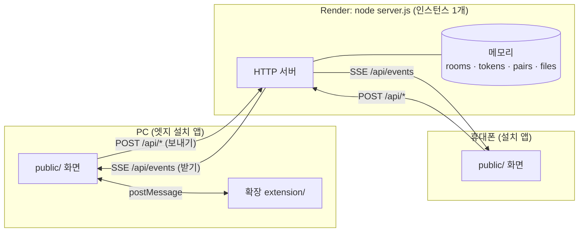
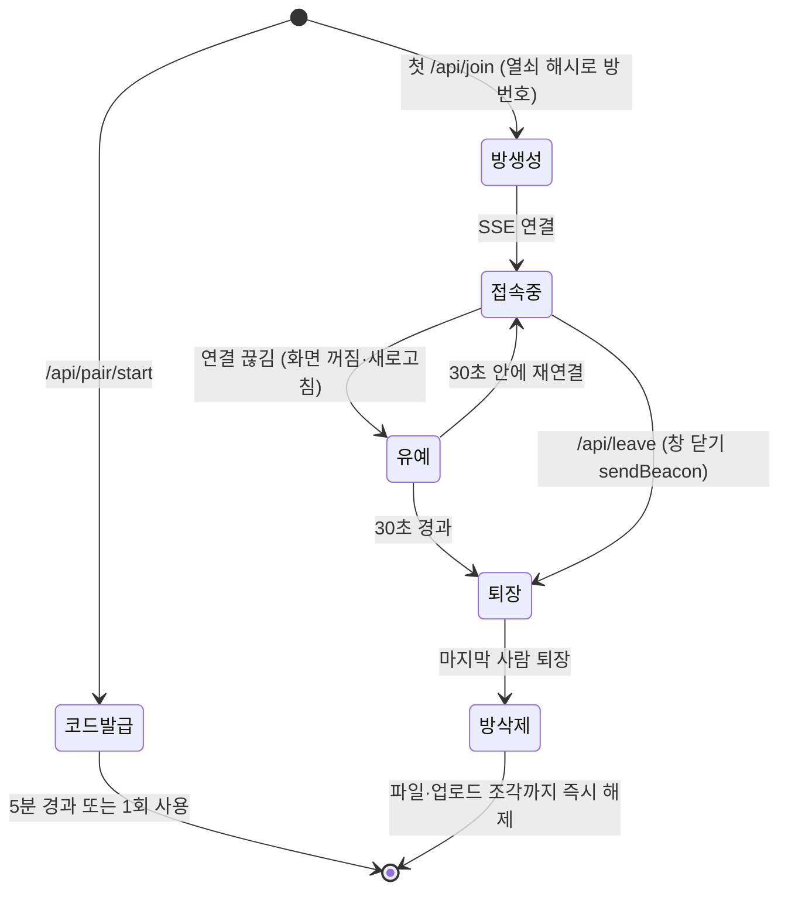
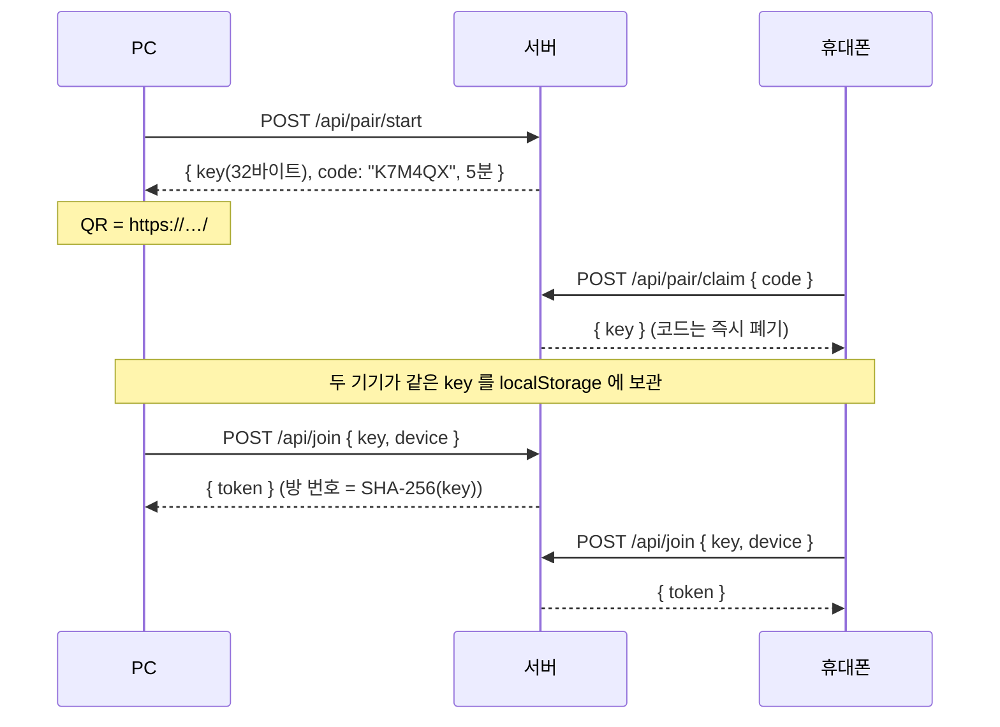
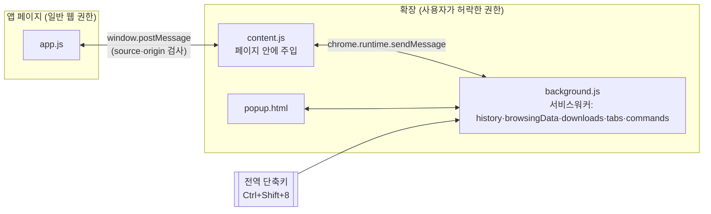
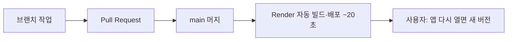

# text-tunnel 아키텍처 공부 노트

> 작성 2026-10-20 · 이 프로젝트를 만들며 실제로 부딪힌 설계 문제를 주제별로 정리한 학습 자료.
> 각 주제는 **무엇을 골랐나 → 왜 → 다른 선택지 → 코드 위치 → 더 공부할 키워드** 순서다.
> 코드 위치의 줄 번호는 2026-10-20 main 기준이며, 이후 바뀔 수 있다.
> **코드가 실제로 어떤 순서로 무슨 메시지를 주고받는지**(API 명세, 짝 맺기·메시지·업로드·확장 연결의 단계별 흐름)는 [FLOWS.md](FLOWS.md) 에 있다.
> 각 장 끝의 **📄 실제 코드** 를 누르면 그 기술이 적용된 코드가 펼쳐진다. 파일에서 그대로 잘라 넣은 2026-10-20 시점의 사본이다.

## 목차
1. [전체 그림: 상태를 가진 단일 서버](#1-전체-그림-상태를-가진-단일-서버)
2. [실시간 통신: SSE + POST](#2-실시간-통신-sse--post)
3. [메모리 상태와 생명주기](#3-메모리-상태와-생명주기)
4. [인증·보안 모델: 열쇠가 곧 권한](#4-인증보안-모델-열쇠가-곧-권한)
5. [접속 상태(presence)와 장애 감지](#5-접속-상태presence와-장애-감지)
6. [파일 전송: 조각 업로드, Range, 캐시](#6-파일-전송-조각-업로드-range-캐시)
7. [PWA: 웹을 앱처럼](#7-pwa-웹을-앱처럼)
8. [프레임워크 없는 클라이언트 구조](#8-프레임워크-없는-클라이언트-구조)
9. [브라우저 확장: 권한이 다른 세 세계](#9-브라우저-확장-권한이-다른-세-세계)
10. [배포·운영: PaaS와 12-Factor](#10-배포운영-paas와-12-factor)
11. [시험 전략](#11-시험-전략)
12. [한계와 다음 단계 (공부 거리)](#12-한계와-다음-단계-공부-거리)

---

## 1. 전체 그림: 상태를 가진 단일 서버



**무엇을 골랐나**: Node 프로세스 **하나**가 정적 파일(화면)과 API를 함께 내보내고, 모든 상태를 **자기 메모리**에 둔다. DB·Redis·외부 서비스 없음.

**왜**: 요구사항이 "DB 없이, 기록 없이"였다. 상태가 메모리에만 있으면 프로세스가 내려가는 순간 전부 사라진다. 보통은 단점이지만 여기서는 **그 휘발성이 곧 기능**이다.

**핵심 개념: stateful vs stateless 서버**
- **Stateless(무상태)** 서버는 요청마다 필요한 상태를 외부(DB, 캐시)에서 읽는다. 인스턴스를 몇 개 띄워도 상관없어서 수평 확장이 쉽다. 서버리스(Vercel, Lambda)가 이 모델이다.
- **Stateful(상태 보유)** 서버는 상태를 자기 메모리에 들고 있다. 빠르고 단순하지만 **인스턴스가 하나여야** 모두가 같은 상태를 본다.
- 이 프로젝트에서 **Vercel이 안 된 진짜 이유**가 이것이다. 휴대폰 요청은 인스턴스 A, PC 요청은 인스턴스 B로 가면 A의 메모리에 있는 방을 B는 모른다. 해결하려면 Redis Pub/Sub나 Pusher 같은 **외부 메시지 브로커**가 필요한데, 그게 곧 "외부 서비스"라 요구사항과 충돌했다.

**다른 선택지**: 서버리스 + 외부 브로커(Pusher/Ably/Redis) / P2P(WebRTC) / 상시 VM(오라클). 비교는 [WORKLOG §1](WORKLOG.md#1-요구사항과-결정).

**코드**: 라우터 전체가 `http.createServer` 콜백 하나 — [server.js:202](../server.js#L202) 이후. `/api/` 가 아니면 정적 파일 — `serveStatic` [server.js:127](../server.js#L127).

**키워드**: stateful vs stateless, horizontal scaling, sticky session, pub/sub, message broker

**이 기술이 적용된 실제 코드**

<details>
<summary>📄 실제 코드 — <code>server.js</code> 202–212 · 라우터: zip · 정적 파일 · API 가 한 프로세스에</summary>

[GitHub에서 보기](../server.js#L202-L212)

```js
const server = http.createServer((req, res) => {
  const url = new URL(req.url, 'http://x');
  const p = url.pathname;
  if (p === '/text-tunnel-cleaner.zip' && extZip) {
    res.writeHead(200, { 'Content-Type': 'application/zip', 'Content-Length': extZip.length, 'Content-Disposition': 'attachment; filename="text-tunnel-cleaner.zip"', 'Cache-Control': 'no-cache' });
    return res.end(extZip);
  }
  if (!p.startsWith('/api/')) return serveStatic(url, res);

  if (p === '/api/health') return send(res, 200, 'ok');
```

</details>

<details>
<summary>📄 실제 코드 — <code>server.js</code> 127–136 · serveStatic (경로 탈출 방지)</summary>

[GitHub에서 보기](../server.js#L127-L136)

```js
function serveStatic(url, res) {
  const rel = url.pathname === '/' ? 'index.html' : url.pathname.slice(1);
  const file = path.join(PUB, path.normalize(rel));
  if (!file.startsWith(PUB)) return send(res, 403, 'forbidden');
  fs.readFile(file, (err, data) => {
    if (err) return send(res, 404, 'not found');
    res.writeHead(200, { 'Content-Type': MIME[path.extname(file)] || 'application/octet-stream', 'Cache-Control': 'no-cache' });
    res.end(data);
  });
}
```

</details>

<details>
<summary>📄 실제 코드 — <code>server.js</code> 22–26 · 모든 상태가 이 Map 들에 (메모리)</summary>

[GitHub에서 보기](../server.js#L22-L26)

```js
const rooms = new Map();  // roomId -> { members: Map<token, Member>, files: Map, uploads: Map }
const tokens = new Map(); // token -> roomId
const pairs = new Map();  // 6자리 코드 -> { key, timer }
const misses = new Map(); // ip -> { n, until } 틀린 코드 시도 제한
let fileBytes = 0;
```

</details>


---

## 2. 실시간 통신: SSE + POST

| 방식 | 방향 | 특징 | 여기서 |
|---|---|---|---|
| Polling | 클라 → 서버 반복 질문 | 단순, 지연·낭비 큼 | ✗ |
| Long polling | 서버가 응답을 붙잡고 있다가 보냄 | 호환성 좋음, 구현 번거로움 | ✗ |
| **SSE** (Server-Sent Events) | **서버 → 클라 한 방향 스트림** | 그냥 HTTP 응답, 브라우저가 **자동 재연결**, 라이브러리 불필요 | ✅ 받기 |
| WebSocket | 양방향 | 강력, 서버에 `ws` 같은 라이브러리 필요 | ✗ |
| WebRTC | 기기 ↔ 기기 직접 | 서버 부담 없음, NAT 통과 실패 가능 | ✗ |

**무엇을 골랐나**: **받기는 SSE, 보내기는 평범한 POST**.

**왜**:
- Node 기본 모듈만으로 구현 가능 (의존성 0 원칙). SSE는 `Content-Type: text/event-stream` 응답을 끝내지 않고 계속 `data: ...\n\n` 을 써 주는 것뿐이다.
- 메신저는 "보내기"가 드물고 "받기 대기"가 길다. 받기만 스트림이면 충분하다.
- 일반 HTTP라 회사 프록시·방화벽을 잘 통과한다.

**함정과 대응**
- **프록시의 유휴 연결 끊기**: 아무것도 안 보내면 중간 장비가 연결을 끊는다 → 25초마다 주석 줄 `: ping` 을 보낸다 [server.js:283](../server.js#L283).
- **프록시 버퍼링**: 응답을 모아 두었다가 보내면 실시간이 깨진다 → `X-Accel-Buffering: no` [server.js:277](../server.js#L277).
- **재연결 간격**: `retry: 2000` 으로 브라우저 자동 재연결 주기를 지정.
- **EventSource는 헤더를 못 붙인다** → 인증 토큰을 쿼리스트링으로 보낸다 (`/api/events?token=`). 대신 토큰은 짧은 수명의 세션 토큰으로 분리했다(§4).

**코드**: 서버 [server.js:276-293](../server.js#L276) · 클라이언트 `connect()` (public/app.js, `new EventSource`) · 브로드캐스트 `broadcast()` [server.js:55](../server.js#L55).

**키워드**: Server-Sent Events, EventSource, WebSocket vs SSE, head-of-line blocking, proxy buffering, keepalive

**이 기술이 적용된 실제 코드**

<details>
<summary>📄 실제 코드 — <code>server.js</code> 276–292 · SSE 응답: 헤더·retry·25초 ping·끊김 처리</summary>

[GitHub에서 보기](../server.js#L276-L292)

```js
  if (p === '/api/events' && req.method === 'GET') {
    res.writeHead(200, { 'Content-Type': 'text/event-stream', 'Cache-Control': 'no-store', Connection: 'keep-alive', 'X-Accel-Buffering': 'no' });
    res.write('retry: 2000\n\n');
    clearTimeout(member.timer);
    member.res?.end(); // 같은 탭이 재접속하면 이전 연결을 정리
    member.res = res;
    presence(room);
    const ping = setInterval(() => res.write(': ping\n\n'), 25000);
    req.on('close', () => {
      clearInterval(ping);
      if (member.res !== res) return;
      member.res = null;
      presence(room);
      member.timer = setTimeout(() => removeMember(room, token), GRACE);
    });
    return;
  }
```

</details>

<details>
<summary>📄 실제 코드 — <code>server.js</code> 55–63 · broadcast · presence</summary>

[GitHub에서 보기](../server.js#L55-L63)

```js
function broadcast(room, ev) {
  const line = `data: ${JSON.stringify(ev)}\n\n`;
  for (const m of room.members.values()) m.res?.write(line);
}

function presence(room) {
  const users = [...room.members.values()].filter((m) => m.res).map((m) => ({ id: m.id, name: m.name }));
  broadcast(room, { type: 'presence', users });
}
```

</details>

<details>
<summary>📄 실제 코드 — <code>public/app.js</code> 161–176 · 화면: EventSource 와 재연결 판단</summary>

[GitHub에서 보기](../public/app.js#L161-L176)

```js
function connect() {
  es?.close();
  es = new EventSource(api('events'));
  es.onerror = async () => {
    setStatus('off');
    // 서버가 재시작됐거나 방이 정리됐으면 다시 들어간다
    const r = await fetch(api('ping')).catch(() => null);
    if (r?.status === 401) { es.close(); token = null; setTimeout(joinRoom, 500); }
  };
  es.onmessage = (ev) => {
    const m = JSON.parse(ev.data);
    if (m.type === 'presence') onPresence(m.users);
    else if (m.type === 'clear') { clearList(); toast(m.from === myId ? '대화를 지웠어요' : `${m.name}에서 대화를 지웠어요`); }
    else add(m);
  };
}
```

</details>


---

## 3. 메모리 상태와 생명주기



**자료구조** [server.js:22-26](../server.js#L22)
| Map | 키 → 값 | 수명 |
|---|---|---|
| `rooms` | 방 번호(열쇠 SHA-256) → { members, files, uploads } | 마지막 사람이 나갈 때까지 |
| `tokens` | 세션 토큰 → 방 번호 | 그 기기가 방에 있는 동안 |
| `pairs` | 6자리 코드 → 열쇠 | 5분 또는 1회 사용 |
| `misses` | IP → 틀린 코드 횟수 | 10분 |
| 방 안 `files` | 파일 ID → Buffer | 10분, 대화 지우기, 방 삭제 |

**설계 포인트**
- **모든 상태에 끝이 있다(TTL)**. `setTimeout` 으로 만료를 예약하고, 먼저 끝나면 `clearTimeout` 으로 취소한다. 타이머를 안 지우면 이미 지운 객체를 다시 건드리거나 메모리가 새는 버그가 생긴다.
- **메모리 상한과 거절(back-pressure)**: 서버가 들고 있는 파일 총량 `fileBytes` 를 세고, 넘치면 업로드를 `507` 로 거절한다 [server.js:328](../server.js#L328). 무료 서버(512MB)가 메모리 부족으로 죽지 않게 하는 장치다. 방 개수도 `MAX_ROOMS` 로 제한.
- **휘발성 = 개인정보 보호**: 저장하지 않는 데이터는 유출될 수도 없다(data minimization).

**키워드**: TTL, resource lifecycle, memory leak via timers, back-pressure, load shedding, data minimization

**이 기술이 적용된 실제 코드**

<details>
<summary>📄 실제 코드 — <code>server.js</code> 10–26 · 수명·한도 상수와 상태 Map</summary>

[GitHub에서 보기](../server.js#L10-L26)

```js
const PORT = Number(process.env.PORT) || 8787;
const MAX_MB = Number(process.env.MAX_MB) || 100;        // 파일 하나 상한
const MEM_MB = Number(process.env.MEM_MB) || 300;        // 서버가 들고 있는 파일 전체 상한
const MAX_ROOMS = Number(process.env.MAX_ROOMS) || 50;
const ROOM_SIZE = 2;
const FILE_TTL = 10 * 60 * 1000;
const PAIR_TTL = 5 * 60 * 1000;     // 짝 코드 유효 시간
const GRACE = 30 * 1000;            // 연결이 끊긴 기기를 기다려 주는 시간 (화면 꺼짐·새로고침)
const STALE = (Number(process.env.STALE_SEC) || 90) * 1000;          // 이만큼 살아 있다는 신호가 없으면, 방이 꽉 찼을 때 자리를 내준다
const CHUNK_MAX = 16 * 1024 * 1024; // 브라우저는 8MB씩 보낸다. 여유를 둔 상한
const PUB = path.join(__dirname, 'public');

const rooms = new Map();  // roomId -> { members: Map<token, Member>, files: Map, uploads: Map }
const tokens = new Map(); // token -> roomId
const pairs = new Map();  // 6자리 코드 -> { key, timer }
const misses = new Map(); // ip -> { n, until } 틀린 코드 시도 제한
let fileBytes = 0;
```

</details>

<details>
<summary>📄 실제 코드 — <code>server.js</code> 35–53 · destroyRoom · removeMember (타이머까지 해제)</summary>

[GitHub에서 보기](../server.js#L35-L53)

```js
function destroyRoom(id) {
  const room = rooms.get(id);
  if (!room) return;
  for (const [t, m] of room.members) { tokens.delete(t); clearTimeout(m.timer); m.res?.end(); }
  for (const f of room.files.values()) { clearTimeout(f.timer); fileBytes -= f.buf.length; }
  for (const u of room.uploads.values()) clearTimeout(u.timer);
  rooms.delete(id);
}

function removeMember(room, token) {
  const m = room.members.get(token);
  if (!m) return;
  clearTimeout(m.timer);
  m.res?.end();
  room.members.delete(token);
  tokens.delete(token);
  if (!room.members.size) destroyRoom(room.id);
  else presence(room);
}
```

</details>

<details>
<summary>📄 실제 코드 — <code>server.js</code> 319–340 · 업로드 시작: 메모리 상한 넘으면 507</summary>

[GitHub에서 보기](../server.js#L319-L340)

```js
  // 파일은 8MB 조각으로 순서대로 올라온다 (프록시의 요청 크기 제한을 피하려고)
  // ?uid=업로드ID&offset=시작바이트&total=전체크기&name=파일명
  if (p === '/api/upload' && req.method === 'POST') {
    const uid = url.searchParams.get('uid');
    const offset = Number(url.searchParams.get('offset'));
    const total = Number(url.searchParams.get('total'));
    if (!uid || !Number.isInteger(offset) || !Number.isInteger(total) || total <= 0) return send(res, 400, 'bad params');
    if (total > MAX_MB * 1024 * 1024) return send(res, 413, `파일은 ${MAX_MB}MB까지 보낼 수 있어요`);

    let up = room.uploads.get(uid);
    if (offset === 0 && !up) {
      if (fileBytes + total > MEM_MB * 1024 * 1024) return send(res, 507, '서버가 파일을 더 들고 있을 수 없어요. 잠시 뒤에 보내 주세요');
      up = {
        chunks: [], received: 0, total,
        name: (url.searchParams.get('name') || 'file').slice(0, 200),
        batch: /^[\w-]{1,40}$/.test(url.searchParams.get('batch') || '') ? url.searchParams.get('batch') : undefined, // 한 번에 고른 사진 묶음
        mime: req.headers['content-type'] || 'application/octet-stream',
        timer: setTimeout(() => room.uploads.delete(uid), FILE_TTL),
      };
      room.uploads.set(uid, up);
    }
    if (!up || up.total !== total || up.received !== offset) return send(res, 409, '업로드 순서가 어긋났어요. 다시 보내 주세요');
```

</details>


---

## 4. 인증·보안 모델: 열쇠가 곧 권한



**무엇을 골랐나**: 아이디·비밀번호 계정이 없다. **긴 비밀 열쇠를 가진 기기 = 권한 있는 기기**(capability 방식).

**설계 포인트**
- **장기 비밀과 세션 토큰 분리**: 열쇠(key)는 방을 찾는 장기 비밀이고, 실제 API 호출은 입장할 때마다 새로 받는 **세션 토큰**으로 한다. URL에 실리는 것은 토큰뿐이라, 노출돼도 그 접속에만 영향이 있다.
- **서버는 열쇠 원문을 보관하지 않는다**: 방 번호로 `SHA-256(key)` 만 쓴다 [server.js:244](../server.js#L244). 메모리를 들여다봐도 열쇠는 없다.
- **짧은 코드의 무차별 대입 계산**: 6자리 × 31글자 = 약 8.9억 가지, 유효 5분, 1회용, **IP당 10번 틀리면 10분 차단** [server.js:90](../server.js#L90). 짧아서 입력하기 쉬운 코드를 안전하게 쓰는 전형적인 방법(rate limiting + 짧은 수명 + 1회성)이다.
- **헷갈리는 글자 제외**: 0/O, 1/I/L 을 뺀 문자 집합 [server.js:81](../server.js#L81). 보안이 아니라 사용성 설계다.
- **인원 제한도 보안 장치**: 방은 최대 2대. 열쇠가 새도 내 두 기기가 접속해 있으면 세 번째는 못 들어온다.
- **XSS 방지**: 받은 메시지는 절대 `innerHTML` 로 넣지 않고 `textContent` 와 DOM API로만 그린다(링크도 `<a>` 를 직접 만들어 넣음). 상대가 보낸 문자열이 코드로 실행될 수 없다.
- (초기 버전) 비밀번호 비교에 `crypto.timingSafeEqual` 을 썼다. 문자열 비교 시간이 일치 길이에 따라 달라지는 **타이밍 공격**을 막는 습관.

**위협 모델에서 의도적으로 못 막는 것**: 회사 네트워크의 접속 기록, 회사 보안 프로그램, Render 플랫폼 로그, **서버가 메시지를 평문으로 중계한다는 점**(§12의 종단간 암호화 참고).

**키워드**: capability-based security, bearer token, session token, hashing vs encryption, brute force & rate limiting, entropy, XSS, timing attack, threat modeling

**이 기술이 적용된 실제 코드**

<details>
<summary>📄 실제 코드 — <code>server.js</code> 80–98 · 짝 코드 문자 집합·생성·IP 차단</summary>

[GitHub에서 보기](../server.js#L80-L98)

```js
// 헷갈리는 글자(0/O, 1/I/L)를 뺀 6자리
const CODE_CHARS = '23456789ABCDEFGHJKMNPQRSTUVWXYZ';
function newCode() {
  let c;
  do c = [...crypto.randomBytes(6)].map((b) => CODE_CHARS[b % CODE_CHARS.length]).join('');
  while (pairs.has(c));
  return c;
}

const clientIp = (req) => (req.headers['x-forwarded-for'] || '').split(',')[0].trim() || req.socket.remoteAddress;
function blocked(ip) {
  const m = misses.get(ip);
  return m && m.until > Date.now() && m.n >= 10;
}
function miss(ip) {
  const m = misses.get(ip);
  if (!m || m.until < Date.now()) misses.set(ip, { n: 1, until: Date.now() + 10 * 60 * 1000 });
  else m.n++;
}
```

</details>

<details>
<summary>📄 실제 코드 — <code>server.js</code> 213–235 · 1회용 코드로 열쇠 전달</summary>

[GitHub에서 보기](../server.js#L213-L235)

```js
  // 짝 맺기 시작: 열쇠를 가진 기기가 6자리 코드를 받는다. { key? } — 없으면 새 열쇠를 만든다
  if (p === '/api/pair/start' && req.method === 'POST') {
    return readJson(req, (j) => {
      const key = typeof j?.key === 'string' && /^[A-Za-z0-9_-]{43}$/.test(j.key) ? j.key : crypto.randomBytes(32).toString('base64url');
      const code = newCode();
      pairs.set(code, { key, timer: setTimeout(() => pairs.delete(code), PAIR_TTL) });
      send(res, 200, { code, key, expiresIn: PAIR_TTL / 1000 });
    });
  }

  // 짝 맺기 완료: 다른 기기가 코드를 내고 열쇠를 받는다. 코드는 한 번 쓰면 사라진다
  if (p === '/api/pair/claim' && req.method === 'POST') {
    const ip = clientIp(req);
    if (blocked(ip)) return send(res, 429, { error: '코드를 너무 많이 틀렸어요. 10분 뒤에 다시 해 주세요' });
    return readJson(req, (j) => {
      const code = String(j?.code || '').toUpperCase().replace(/[^A-Z0-9]/g, '');
      const pair = pairs.get(code);
      if (!pair) { miss(ip); return send(res, 404, { error: '코드가 맞지 않거나 시간이 지났어요. PC에서 새 코드를 받아 주세요' }); }
      clearTimeout(pair.timer);
      pairs.delete(code);
      send(res, 200, { key: pair.key });
    });
  }
```

</details>

<details>
<summary>📄 실제 코드 — <code>server.js</code> 237–268 · 열쇠의 SHA-256 을 방 번호로, 세션 토큰 발급, 2대 제한</summary>

[GitHub에서 보기](../server.js#L237-L268)

```js
  // 방 입장: { key, name, device } — 방 번호는 열쇠의 해시. 열쇠 자체는 어디에도 보관하지 않는다
  if (p === '/api/join' && req.method === 'POST') {
    return readJson(req, (j) => {
      const key = String(j?.key || '');
      const device = String(j?.device || '').slice(0, 64);
      const name = String(j?.name || '').trim().slice(0, 20) || '기기';
      if (!/^[A-Za-z0-9_-]{43}$/.test(key) || !device) return send(res, 400, { error: '연결 정보가 올바르지 않아요. 다시 연결해 주세요' });
      const id = crypto.createHash('sha256').update(key).digest('hex');

      let room = rooms.get(id);
      if (!room) {
        if (rooms.size >= MAX_ROOMS) return send(res, 429, { error: '서버가 붐벼요. 잠시 뒤에 다시 열어 주세요' });
        room = { id, members: new Map(), files: new Map(), uploads: new Map() };
        rooms.set(id, room);
      }
      // 같은 기기가 다시 들어오면(새로고침·앱 재실행) 이전 자리를 비운다
      for (const [t, m] of room.members) if (m.device === device) dropMember(room, t);
      // 꽉 찼으면 소식이 끊긴 자리(앱 강제 종료 등으로 남은 유령)를 가장 오래된 것부터 비운다
      if (room.members.size >= ROOM_SIZE) {
        const stale = [...room.members].filter(([, m]) => Date.now() - m.seen > STALE).sort(([, a], [, b]) => a.seen - b.seen);
        if (stale.length) { dropMember(room, stale[0][0]); presence(room); }
      }
      if (room.members.size >= ROOM_SIZE) return send(res, 409, { error: '이미 두 기기가 연결돼 있어요' });

      const token = crypto.randomBytes(24).toString('base64url');
      const member = { id: crypto.randomUUID(), device, name, res: null, timer: null, seen: Date.now() };
      member.timer = setTimeout(() => removeMember(room, token), GRACE); // 연결을 안 열면 정리
      room.members.set(token, member);
      tokens.set(token, id);
      send(res, 200, { token, id: member.id });
    });
  }
```

</details>

<details>
<summary>📄 실제 코드 — <code>public/app.js</code> 252–261 · XSS 방지: textContent 와 <a> 로만 그리기</summary>

[GitHub에서 보기](../public/app.js#L252-L261)

```js
function linkify(node, text) {
  let last = 0;
  for (const m of text.matchAll(/https?:\/\/[^\s<>"']+/g)) {
    node.append(text.slice(last, m.index));
    const a = el('a', null, m[0]); a.href = m[0]; a.target = '_blank'; a.rel = 'noopener';
    node.append(a);
    last = m.index + m[0].length;
  }
  node.append(text.slice(last));
}
```

</details>


---

## 5. 접속 상태(presence)와 장애 감지

분산 시스템의 근본 문제: **상대가 죽었는지, 느린 건지 구분할 수 없다.** 그래서 시간 제한으로 판단한다.

| 장치 | 값 | 목적 | 코드 |
|---|---|---|---|
| SSE 끊김 감지 | `req.on('close')` | 정상 종료·새로고침 감지 | [server.js:284](../server.js#L284) |
| 유예 시간(grace) | 30초 | 화면 꺼짐·새로고침 때 바로 쫓아내지 않기 | `GRACE` |
| 살아 있음 신호(heartbeat) | 20초마다 `/api/ping` | 프록시 뒤라 서버가 끊김을 못 볼 때 대비 | public/app.js `setInterval` |
| 유령 판정(stale) | 90초 무신호 | 방이 꽉 찼을 때만, 가장 오래된 유령부터 비움 | [server.js:247-252](../server.js#L247) |
| 기기 ID | localStorage | 같은 기기 재입장은 자리를 이어받음(멱등 입장) | `/api/join` |
| 즉시 퇴장 | `sendBeacon` on `pagehide` | 창 닫힘을 바로 알림 | public/app.js `leaveNow` |

**실제로 겪은 장애**: 앱을 강제 종료하면 Render 프록시가 서버 쪽 연결을 열어 둔 채로 있어서 서버는 휴대폰이 아직 있다고 믿었다(**유령**). 재접속한 휴대폰은 "이미 두 기기"로 막혔다. → heartbeat + stale 판정으로 해결 (PR #2).

**왜 유령을 "꽉 찼을 때만" 정리하나**: PC 브라우저는 백그라운드 탭의 타이머를 1분에 한 번으로 늦춘다. 평소에 90초 기준으로 잘라 내면 멀쩡한 PC가 쫓겨날 수 있다. 필요할 때만, 가장 오래된 것부터 정리하는 것이 안전하다.

**키워드**: failure detection, heartbeat, timeout, phi accrual failure detector, idempotency, presence system

**이 기술이 적용된 실제 코드**

<details>
<summary>📄 실제 코드 — <code>server.js</code> 65–77 · auth: 요청마다 seen 갱신</summary>

[GitHub에서 보기](../server.js#L65-L77)

```js
function auth(url) {
  const token = url.searchParams.get('token') || '';
  const room = rooms.get(tokens.get(token));
  const member = room?.members.get(token);
  if (member) member.seen = Date.now(); // 앱은 20초마다 /api/ping 으로 살아 있음을 알린다
  return member ? { room, member, token } : null;
}

function dropMember(room, token) {
  const m = room.members.get(token);
  clearTimeout(m.timer); m.res?.end();
  room.members.delete(token); tokens.delete(token);
}
```

</details>

<details>
<summary>📄 실제 코드 — <code>server.js</code> 252–259 · 유령 자리 정리 (꽉 찼을 때만, 가장 오래된 것부터)</summary>

[GitHub에서 보기](../server.js#L252-L259)

```js
      // 같은 기기가 다시 들어오면(새로고침·앱 재실행) 이전 자리를 비운다
      for (const [t, m] of room.members) if (m.device === device) dropMember(room, t);
      // 꽉 찼으면 소식이 끊긴 자리(앱 강제 종료 등으로 남은 유령)를 가장 오래된 것부터 비운다
      if (room.members.size >= ROOM_SIZE) {
        const stale = [...room.members].filter(([, m]) => Date.now() - m.seen > STALE).sort(([, a], [, b]) => a.seen - b.seen);
        if (stale.length) { dropMember(room, stale[0][0]); presence(room); }
      }
      if (room.members.size >= ROOM_SIZE) return send(res, 409, { error: '이미 두 기기가 연결돼 있어요' });
```

</details>

<details>
<summary>📄 실제 코드 — <code>public/app.js</code> 178–182 · 화면: sendBeacon 으로 즉시 퇴장</summary>

[GitHub에서 보기](../public/app.js#L178-L182)

```js
function leaveNow() {
  if (!token || DEMO) return;
  navigator.sendBeacon?.(api('leave')) || fetch(api('leave'), { method: 'POST', keepalive: true }).catch(() => {});
  es?.close(); token = null;
}
```

</details>

<details>
<summary>📄 실제 코드 — <code>public/app.js</code> 788–803 · 화면: 다시 보이기·창 닫기·20초 살아 있음 신호</summary>

[GitHub에서 보기](../public/app.js#L788-L803)

```js
document.addEventListener('visibilitychange', () => {
  if (document.hidden) return;
  unread = 0; document.title = 'Text Tunnel';
  if (!others && key) refreshWaitQr();
  if (!DEMO && key && (!token || es?.readyState === 2)) { token = null; joinRoom(); }
});
// 창·앱을 닫으면 바로 나가서, 둘 다 닫으면 방이 즉시 사라지게 한다
addEventListener('pagehide', leaveNow);
addEventListener('pageshow', (e) => { if (e.persisted && key && !DEMO) { token = null; joinRoom(); } });

// 20초마다 살아 있다고 알린다. 서버는 이 신호가 끊긴 자리를 유령으로 보고, 방이 꽉 찼을 때 비워 준다
setInterval(async () => {
  if (DEMO || !token || document.hidden) return;
  const r = await fetch(api('ping')).catch(() => null);
  if (r?.status === 401) { es?.close(); token = null; joinRoom(); }
}, 20000);
```

</details>


---

## 6. 파일 전송: 조각 업로드, Range, 캐시

**조각 업로드(chunked upload)** — public/app.js `uploadOne`, [server.js:321](../server.js#L321)
- 브라우저가 파일을 **8MB씩** 순서대로 POST: `?uid&offset&total`. 서버는 `offset` 이 지금까지 받은 양과 정확히 같아야 받는다(아니면 `409`). 마지막 조각이 오면 합쳐서 알린다.
- 이유: 터널·프록시는 **요청 하나의 크기 제한**(예: 100MB)이 있다. 조각으로 나누면 제한과 상관없고, 진행률 표시도 쉽다.
- 더 나아가면: 실패한 조각만 다시 보내는 **재개 가능 업로드**(tus 프로토콜, S3 multipart).

**HTTP Range (206 Partial Content)** — `serveFile` [server.js:139](../server.js#L139)
- 아이폰 사파리는 동영상을 `Range: bytes=0-1` 처럼 **부분 요청**으로만 재생한다. 요청 구간만 잘라 `206` 으로 응답해야 재생된다.

**캐시 제어**: 파일 응답은 `Cache-Control: no-store` → 브라우저 캐시 폴더에 사진이 남지 않는다. 화면 파일은 `no-cache`(매번 확인) → 배포하면 앱을 다시 열 때 바로 새 버전.

**클라이언트 이미지 압축** — public/app.js `shrink`
- 큰 사진은 `createImageBitmap` → `<canvas>` 에 긴 변 2048px로 다시 그려 JPEG 0.85 로 내보냄. 서버 부담·전송 시간을 **보내는 쪽에서** 줄이는 설계(edge processing).

**묶음(batch) ID**: 한 번에 고른 사진에 같은 ID를 붙여 서버가 그대로 전달 → 받는 쪽이 같은 ID 끼리 앨범 말풍선으로 묶는다. 서버는 의미를 몰라도 되고 **표현은 클라이언트가 결정**.

**키워드**: chunked/resumable upload, multipart upload, HTTP Range requests, Content-Disposition, Cache-Control (no-store vs no-cache), client-side compression

**이 기술이 적용된 실제 코드**

<details>
<summary>📄 실제 코드 — <code>public/app.js</code> 377–396 · 화면: 8MB 조각 업로드 (XHR 진행률)</summary>

[GitHub에서 보기](../public/app.js#L377-L396)

```js
function uploadOne(file, batch, onProgress) {
  const CHUNK = 8 * 1024 * 1024;
  const uid = randId();
  return new Promise((resolve, reject) => {
    const sendChunk = (offset) => {
      const part = file.slice(offset, offset + CHUNK);
      const xhr = new XMLHttpRequest();
      xhr.open('POST', api('upload', { uid, offset, total: file.size, name: file.name, ...(batch ? { batch } : {}) }));
      xhr.setRequestHeader('Content-Type', file.type || 'application/octet-stream');
      xhr.upload.onprogress = (e) => onProgress(offset + e.loaded);
      xhr.onload = () => {
        if (xhr.status !== 200) return reject(new Error(xhr.responseText || '실패'));
        if (xhr.responseText === 'done') resolve(); else sendChunk(offset + part.size);
      };
      xhr.onerror = () => reject(new Error('연결이 끊겼어요'));
      xhr.send(part);
    };
    sendChunk(0);
  });
}
```

</details>

<details>
<summary>📄 실제 코드 — <code>server.js</code> 319–359 · 서버: 조각 순서 검사·합치기</summary>

[GitHub에서 보기](../server.js#L319-L359)

```js
  // 파일은 8MB 조각으로 순서대로 올라온다 (프록시의 요청 크기 제한을 피하려고)
  // ?uid=업로드ID&offset=시작바이트&total=전체크기&name=파일명
  if (p === '/api/upload' && req.method === 'POST') {
    const uid = url.searchParams.get('uid');
    const offset = Number(url.searchParams.get('offset'));
    const total = Number(url.searchParams.get('total'));
    if (!uid || !Number.isInteger(offset) || !Number.isInteger(total) || total <= 0) return send(res, 400, 'bad params');
    if (total > MAX_MB * 1024 * 1024) return send(res, 413, `파일은 ${MAX_MB}MB까지 보낼 수 있어요`);

    let up = room.uploads.get(uid);
    if (offset === 0 && !up) {
      if (fileBytes + total > MEM_MB * 1024 * 1024) return send(res, 507, '서버가 파일을 더 들고 있을 수 없어요. 잠시 뒤에 보내 주세요');
      up = {
        chunks: [], received: 0, total,
        name: (url.searchParams.get('name') || 'file').slice(0, 200),
        batch: /^[\w-]{1,40}$/.test(url.searchParams.get('batch') || '') ? url.searchParams.get('batch') : undefined, // 한 번에 고른 사진 묶음
        mime: req.headers['content-type'] || 'application/octet-stream',
        timer: setTimeout(() => room.uploads.delete(uid), FILE_TTL),
      };
      room.uploads.set(uid, up);
    }
    if (!up || up.total !== total || up.received !== offset) return send(res, 409, '업로드 순서가 어긋났어요. 다시 보내 주세요');

    return readBody(req, Math.min(CHUNK_MAX, total - offset), (err, buf) => {
      if (err) { clearTimeout(up.timer); room.uploads.delete(uid); return send(res, 413, 'chunk too large'); }
      if (!rooms.has(room.id)) return send(res, 410, '연결이 끝났어요');
      up.chunks.push(buf);
      up.received += buf.length;
      if (up.received < up.total) return send(res, 200, 'more');

      clearTimeout(up.timer);
      room.uploads.delete(uid);
      const fid = crypto.randomUUID();
      const file = { buf: Buffer.concat(up.chunks), mime: up.mime, name: up.name };
      fileBytes += file.buf.length;
      file.timer = setTimeout(() => { room.files.delete(fid); fileBytes -= file.buf.length; }, FILE_TTL);
      room.files.set(fid, file);
      broadcast(room, { type: 'file', mid: crypto.randomUUID(), fid, fname: file.name, mime: file.mime, size: file.buf.length, batch: up.batch, from: member.id, name: member.name, at: Date.now() });
      send(res, 200, 'done');
    });
  }
```

</details>

<details>
<summary>📄 실제 코드 — <code>server.js</code> 138–156 · Range 206 · no-store</summary>

[GitHub에서 보기](../server.js#L138-L156)

```js
// 동영상은 iOS Safari가 Range 요청으로만 재생하므로 부분 응답을 지원한다.
function serveFile(f, req, res) {
  const total = f.buf.length;
  const head = {
    'Content-Type': f.mime,
    'Accept-Ranges': 'bytes',
    'Cache-Control': 'no-store', // 사진·동영상이 브라우저 캐시 폴더에 남지 않게
    'Content-Disposition': `inline; filename*=UTF-8''${encodeURIComponent(f.name)}`,
  };
  const m = /bytes=(\d*)-(\d*)/.exec(req.headers.range || '');
  if (!m) { res.writeHead(200, { ...head, 'Content-Length': total }); return res.end(f.buf); }
  const start = m[1] ? Number(m[1]) : total - Number(m[2]);
  const end = m[1] && m[2] ? Number(m[2]) : total - 1;
  if (start < 0 || start >= total || end >= total || start > end) {
    res.writeHead(416, { 'Content-Range': `bytes */${total}` }); return res.end();
  }
  res.writeHead(206, { ...head, 'Content-Range': `bytes ${start}-${end}/${total}`, 'Content-Length': end - start + 1 });
  res.end(f.buf.subarray(start, end + 1));
}
```

</details>

<details>
<summary>📄 실제 코드 — <code>public/app.js</code> 359–374 · 화면: canvas 로 사진 줄이기</summary>

[GitHub에서 보기](../public/app.js#L359-L374)

```js
// 카톡 '일반 화질'처럼 큰 사진은 긴 변 2048px JPEG로 줄인다. 줄일 수 없거나 더 커지면 원본 그대로
async function shrink(file) {
  if (!/^image\/(jpeg|png|webp)$/.test(file.type) || file.size < 1.5 * 1024 * 1024) return file;
  try {
    const bmp = await createImageBitmap(file, { imageOrientation: 'from-image' });
    const scale = Math.min(1, 2048 / Math.max(bmp.width, bmp.height));
    const c = document.createElement('canvas');
    c.width = Math.round(bmp.width * scale); c.height = Math.round(bmp.height * scale);
    c.getContext('2d').drawImage(bmp, 0, 0, c.width, c.height);
    bmp.close?.();
    const blob = await new Promise((ok) => c.toBlob(ok, 'image/jpeg', 0.85));
    if (!blob || blob.size >= file.size) return file;
    return new File([blob], file.name.replace(/\.[^.]+$/, '') + '.jpg', { type: 'image/jpeg' });
  } catch { return file; }
}
```

</details>


---

## 7. PWA: 웹을 앱처럼

| 구성 | 역할 | 이 프로젝트 |
|---|---|---|
| `manifest.json` | 이름·아이콘·전체화면 모드·공유 대상 선언 | `display: standalone`, `share_target` |
| Service Worker `sw.js` | 네트워크 요청 가로채기, 오프라인, 설치 조건 | **일부러 캐시 안 함**(항상 최신·기록 최소화), 공유 메뉴 POST만 처리 |
| HTTPS | 서비스워커·설치·클립보드의 필수 조건 | Render 가 자동 제공 |

**배운 것**
- **Share Target**: 안드로이드 공유 메뉴에서 앱으로 사진을 보내면 브라우저가 `POST /share` 를 만든다. 서비스워커가 받아 Cache Storage 에 잠깐 넣고 페이지로 넘긴다. 열쇠는 페이지만 알기 때문에 실제 업로드는 페이지가 한다.
- **설치 프롬프트**: 안드로이드 크롬은 `beforeinstallprompt` 이벤트를 붙잡아 두었다가 우리 버튼에서 띄운다. 아이폰은 이 API가 없어 안내 문구로 대신한다.
- **저장소 분리(storage partitioning)**: 아이폰은 사파리와 홈 화면 앱의 `localStorage` 가 따로다 → 설치한 앱에서 코드를 한 번 더 입력하는 흐름이 필요했다. 안드로이드 카메라·렌즈의 **인앱 브라우저**도 저장소가 따로라 같은 문제가 생겼다.
- **자동 업데이트**: 캐시를 안 쓰니 서버 배포 = 다음 실행부터 새 버전.

**키워드**: Progressive Web App, Web App Manifest, Service Worker lifecycle, Cache Storage, Web Share Target, storage partitioning, in-app browser

**이 기술이 적용된 실제 코드**

<details>
<summary>📄 실제 코드 — <code>public/manifest.json</code> 전체 · PWA 매니페스트 (share_target 포함)</summary>

[GitHub에서 보기](../public/manifest.json)

```json
{
  "name": "Text Tunnel",
  "short_name": "Tunnel",
  "start_url": "/",
  "display": "standalone",
  "background_color": "#ffffff",
  "theme_color": "#ffffff",
  "icons": [
    { "src": "icon-192.png", "sizes": "192x192", "type": "image/png", "purpose": "any" },
    { "src": "icon-512.png", "sizes": "512x512", "type": "image/png", "purpose": "any" },
    { "src": "icon-512.png", "sizes": "512x512", "type": "image/png", "purpose": "maskable" },
    { "src": "icon.svg", "sizes": "any", "type": "image/svg+xml" }
  ],
  "share_target": {
    "action": "/share",
    "method": "POST",
    "enctype": "multipart/form-data",
    "params": {
      "title": "title",
      "text": "text",
      "url": "url",
      "files": [{ "name": "files", "accept": ["image/*", "video/*", "audio/*", "application/*", "text/*"] }]
    }
  }
}
```

</details>

<details>
<summary>📄 실제 코드 — <code>public/sw.js</code> 전체 · 서비스워커 (캐시 안 함 · 공유 메뉴 수신)</summary>

[GitHub에서 보기](../public/sw.js)

```js
// 앱 설치(PWA)용 서비스워커. 페이지는 캐시하지 않는다 — 항상 서버에서 받아온다.
self.addEventListener('install', () => self.skipWaiting());
self.addEventListener('activate', (e) => e.waitUntil(self.clients.claim()));

// 안드로이드 "공유" 메뉴로 들어온 글·파일을 잠깐 캐시에 넣고 앱을 연다.
// 실제 전송은 비밀번호를 아는 페이지(app.js의 sendShared)가 한다.
self.addEventListener('fetch', (e) => {
  const url = new URL(e.request.url);
  if (e.request.method !== 'POST' || url.pathname !== '/share') return;
  e.respondWith((async () => {
    const form = await e.request.formData();
    const cache = await caches.open('tt-share');
    const text = [form.get('title'), form.get('text'), form.get('url')].filter(Boolean).join('\n');
    if (text) await cache.put('/shared/text', new Response(text));
    let i = 0;
    for (const f of form.getAll('files')) {
      if (!(f instanceof File)) continue;
      await cache.put(`/shared/file-${i++}`, new Response(f, {
        headers: { 'Content-Type': f.type || 'application/octet-stream', 'x-name': encodeURIComponent(f.name) },
      }));
    }
    return Response.redirect('/?shared=1', 303);
  })());
});
```

</details>

<details>
<summary>📄 실제 코드 — <code>public/app.js</code> 125–142 · 화면: 설치 안내·설치 버튼</summary>

[GitHub에서 보기](../public/app.js#L125-L142)

```js
function showInstall() {
  show('install');
  $('installIos').hidden = !IS_IOS;
  $('installAndroid').hidden = IS_IOS;
  $('installBtn').hidden = !installPrompt;
  $('installManual').hidden = !!installPrompt;
}

async function runInstall() {
  if (!installPrompt) return showInstall();
  installPrompt.prompt();
  const { outcome } = await installPrompt.userChoice.catch(() => ({}));
  installPrompt = null;
  if (outcome === 'accepted') toast('설치했어요. 홈 화면의 아이콘으로 열 수 있어요');
  enterChat();
}

/* ── 연결 ─────────────────────────────── */
```

</details>

<details>
<summary>📄 실제 코드 — <code>public/app.js</code> 783–786 · 화면: beforeinstallprompt 붙잡기</summary>

[GitHub에서 보기](../public/app.js#L783-L786)

```js
addEventListener('beforeinstallprompt', (e) => {
  e.preventDefault(); installPrompt = e;
  if (!$('install').hidden) showInstall();
});
```

</details>


---

## 8. 프레임워크 없는 클라이언트 구조

**무엇을 골랐나**: React 없이 HTML 하나 + JS 하나(`public/app.js`).

- **화면 전환**: 모든 화면이 HTML에 미리 있고 `show(id)` 가 하나만 보이게 한다. 단순한 **상태 기계(state machine)**: 깨우기 → 처음 → (코드·QR·설치) → 대화.
- **상태**: 모듈 최상위 변수 몇 개(`key`, `token`, `peers`, `tray` 등). 상태가 바뀌면 그 부분 DOM을 직접 고친다.
- **이벤트 중심**: 서버 이벤트(SSE) → `add()` / `onPresence()`, 사용자 이벤트 → 핸들러.
- **데모 모드**: `/#demo-chat` 처럼 주소로 장면을 지정하면 서버 없이 예시 데이터로 화면이 뜬다. UI 개발·시안·스크린샷 시험에 썼다(테스트 더블의 일종).
- **장점/한계**: 번들러·빌드 없음, 수 KB. 화면이 더 커지면 컴포넌트·상태 관리 라이브러리가 필요해지는 지점이 온다 — 지금 `app.js` 가 그 경계쯤이다.

**키워드**: vanilla JS, DOM manipulation, UI state machine, event-driven UI, test double, when to adopt a framework

**이 기술이 적용된 실제 코드**

<details>
<summary>📄 실제 코드 — <code>public/app.js</code> 1–34 · 화면 상태 변수와 저장소 래퍼</summary>

[GitHub에서 보기](../public/app.js#L1-L34)

```js
// 두 기기가 QR/코드로 한 번 짝을 맺으면 같은 열쇠를 각자 이 기기에 보관하고, 앱을 열 때마다 그 열쇠로 자동 연결한다.
// 대화는 어디에도 저장하지 않는다. 이 기기에 남는 것은 열쇠·기기 이름·기기 ID뿐이다.
const $ = (id) => document.getElementById(id);
const store = {
  get(k) { try { return localStorage.getItem(k); } catch { return null; } },
  set(k, v) { try { localStorage.setItem(k, v); } catch {} },
  del(k) { try { localStorage.removeItem(k); } catch {} },
};

// 서버 없이 화면만 보는 모드: /#demo(=chat), /#demo-wait 처럼 장면 지정, 또는 window.TT_DEMO
// 장면: 'welcome' | 'code' | 'qr' | 'install-android' | 'install-ios' | 'wait' | 'chat'
const DEMO = /^#demo(?:-([\w-]+))?$/.test(location.hash) ? (location.hash.slice(6) || 'chat') : window.TT_DEMO;

const UA = navigator.userAgent;
const IS_IOS = /iPhone|iPad|iPod/.test(UA) || (/Macintosh/.test(UA) && navigator.maxTouchPoints > 1);
const IS_MOBILE = IS_IOS || /Android|Mobile/i.test(UA);
const STANDALONE = matchMedia('(display-mode: standalone)').matches || navigator.standalone === true;

let key = store.get('tt.key');
let myName = store.get('tt.name') || guessName();
let device = store.get('tt.device');
if (!device) { device = crypto.randomUUID?.() || String(Math.random()).slice(2) + Date.now(); store.set('tt.device', device); }

let token = null;   // 이번 접속의 입장권
let myId = null;    // 이번 접속에서 내 메시지를 알아보는 ID
let others = 0;
let peers = null;   // 직전 접속 목록 (id -> name). null 이면 아직 첫 수신 전
let unread = 0;
let es;
let installPrompt = null;
let qrTimer;

const api = (path, extra = {}) => `/api/${path}?${new URLSearchParams({ token: token || '', ...extra })}`;
const post = (path, body) => fetch(`/api/${path}`, { method: 'POST', body: JSON.stringify(body) });
```

</details>

<details>
<summary>📄 실제 코드 — <code>public/app.js</code> 43–44 · 화면 전환 show()</summary>

[GitHub에서 보기](../public/app.js#L43-L44)

```js
const SCREENS = ['boot', 'welcome', 'codeForm', 'qrScreen', 'install', 'chat', 'extScreen'];
function show(id) { for (const s of SCREENS) $(s).hidden = s !== id; }
```

</details>

<details>
<summary>📄 실제 코드 — <code>public/app.js</code> 810–830 · 데모 모드 (서버 없이 화면 개발)</summary>

[GitHub에서 보기](../public/app.js#L810-L830)

```js
function startDemo(scene) {
  myId = 'me'; myName = 'PC';
  if (scene === 'welcome') return show('welcome');
  if (scene === 'ext') return openExt();
  if (scene === 'ext-on') { ext = { version: '1.0.0', auto: true }; return openExt(); }
  if (scene === 'code') { show('codeForm'); $('codeInput').value = 'K7M 4Q'; return; }
  if (scene === 'qr') return openQr();
  if (scene.startsWith('install')) {
    show('install');
    $('installIos').hidden = scene !== 'install-ios';
    $('installAndroid').hidden = scene === 'install-ios';
    $('installBtn').hidden = false; $('installManual').hidden = true;
    return;
  }
  show('chat');
  onPresence([{ id: 'me', name: 'PC' }]);
  if (scene === 'wait') return;
  onPresence([{ id: 'me', name: 'PC' }, { id: 'p', name: '휴대폰' }]);
  const t = Date.now() - 5 * 60000;
  // 예시 사진 (그라데이션 풍경)
  const pic = (a, b, w = 640, h = 420) => '<svg xmlns="http://www.w3.org/2000/svg" width="' + w + '" height="' + h + '"><defs><linearGradient id="g" x2="1" y2="1"><stop offset="0" stop-color="' + a + '"/><stop offset="1" stop-color="' + b + '"/></linearGradient></defs><rect width="100%" height="100%" fill="url(#g)"/><circle cx="72%" cy="30%" r="9%" fill="#fff" opacity=".85"/><path d="M0 ' + h * .78 + 'l' + w * .25 + '-' + h * .28 + ' ' + w * .22 + ' ' + h * .24 + ' ' + w * .19 + '-' + h * .17 + ' ' + w * .34 + ' ' + h * .36 + 'v' + h * .07 + 'H0z" fill="#2b2250" opacity=".5"/></svg>';
```

</details>


---

## 9. 브라우저 확장: 권한이 다른 세 세계



**왜 필요했나**: 웹페이지는 보안상 **브라우저 방문 기록을 읽거나 지울 수 없다**. 사용자가 직접 설치하며 권한을 준 확장만 가능하다 → **권한 상승이 필요한 일만 확장으로 분리**.

**설계 포인트**
- **세 실행 환경**: 페이지(일반 권한) / content script(페이지에 붙지만 확장 API 일부 사용) / background 서비스워커(전체 확장 API). 서로 **메시지로만** 대화한다.
- **메시지 검증**: `e.source === window`, `source: 'tt-app' | 'tt-ext'` 확인, `postMessage(…, location.origin)` 으로 대상 출처 고정 — 다른 출처의 위조 메시지를 무시한다.
- **최소 범위**: 지울 대상을 `isOurs` / `isOurSearch` 함수로 엄격히 한정(우리 주소, 우리 검색어, 8787 포트만). 다른 사이트 기록은 절대 건드리지 않는다.
- **전역 단축키와 OS 자원 경쟁**: 전역 단축키는 Windows에서 **한 프로그램만** 등록할 수 있다. 크롬과 엣지에 같은 확장을 깔면 먼저 켜진 쪽이 키를 가져가고, 나머지는 **조용히 실패**했다. → 앱 창이 앞에 있으면 페이지가 직접 키를 받는 **이중화(fallback)** 를 넣었다.
- **배포의 한계**: 스토어를 거치지 않은 확장은 개발자 모드로만 설치되고 자동 업데이트가 없다. 그래서 앱이 확장 버전을 확인해 업데이트 안내를 띄운다(버전 협상).

**키워드**: Manifest V3, content script isolation, message passing, principle of least privilege, global hotkey contention, graceful degradation

**이 기술이 적용된 실제 코드**

<details>
<summary>📄 실제 코드 — <code>extension/manifest.json</code> 전체 · 확장 권한 선언</summary>

[GitHub에서 보기](../extension/manifest.json)

```json
{
  "manifest_version": 3,
  "name": "Text Tunnel 흔적 지우기",
  "version": "1.2.0",
  "description": "Text Tunnel 방문 기록·관련 검색 기록·다운로드 목록·캐시를 지웁니다. 단축키를 누르면 대화·연결·기록을 모두 지우고 앱을 닫습니다.",
  "permissions": ["history", "browsingData", "storage", "downloads"],
  "host_permissions": ["https://text-tunnel.onrender.com/*", "http://localhost/*"],
  "background": { "service_worker": "background.js" },
  "action": { "default_popup": "popup.html", "default_title": "Text Tunnel 흔적 지우기" },
  "commands": {
    "wipe": {
      "suggested_key": { "default": "Ctrl+Shift+9" },
      "description": "Text Tunnel 흔적 완전 정리 (대화·연결·기록 삭제 후 앱 닫기)",
      "global": true
    }
  },
  "content_scripts": [
    {
      "matches": ["https://text-tunnel.onrender.com/*", "http://localhost/*"],
      "js": ["content.js"],
      "run_at": "document_start"
    }
  ],
  "icons": { "128": "icon.png" }
}
```

</details>

<details>
<summary>📄 실제 코드 — <code>extension/content.js</code> 전체 · 페이지 ↔ 확장 메시지 다리</summary>

[GitHub에서 보기](../extension/content.js)

```js
// Text Tunnel 페이지와 확장 프로그램 사이의 연결고리.
// 페이지 → 확장: { source: 'tt-app', type: 'ping' | 'clean' | 'wipe' | 'auto' }
// 확장 → 페이지: { source: 'tt-ext', type: 'ready' | 'cleaned' | 'wipe' }
const post = (m) => window.postMessage({ source: 'tt-ext', ...m }, location.origin);
const reply = async (m) => {
  const { auto = true } = await chrome.storage.local.get('auto');
  const { shortcut = '' } = (await chrome.runtime.sendMessage({ type: 'info' }).catch(() => null)) || {};
  post({ version: chrome.runtime.getManifest().version, auto, shortcut, ...m });
};

window.addEventListener('message', async (e) => {
  if (e.source !== window || e.data?.source !== 'tt-app') return;
  if (e.data.type === 'ping') reply({ type: 'ready' });
  if (e.data.type === 'clean') reply({ type: 'cleaned', ...(await chrome.runtime.sendMessage({ type: 'clean' })) });
  if (e.data.type === 'wipe') chrome.runtime.sendMessage({ type: 'wipe' }); // 이 탭도 닫힌다
  if (e.data.type === 'auto') { await chrome.storage.local.set({ auto: !!e.data.on }); reply({ type: 'ready' }); }
});

// 단축키로 완전 정리할 때: 페이지가 대화 지우기·연결 해제를 마칠 때까지 잠깐 기다린다
chrome.runtime.onMessage.addListener((msg, _sender, sendResponse) => {
  if (msg?.type !== 'wipe') return;
  const done = (e) => {
    if (e.source !== window || e.data?.source !== 'tt-app' || e.data.type !== 'wiped') return;
    window.removeEventListener('message', done);
    sendResponse({ ok: true });
  };
  window.addEventListener('message', done);
  post({ type: 'wipe' });
  return true;
});

reply({ type: 'ready' });
```

</details>

<details>
<summary>📄 실제 코드 — <code>public/app.js</code> 577–587 · 화면 쪽 메시지 검증</summary>

[GitHub에서 보기](../public/app.js#L577-L587)

```js
const toExt = (m) => window.postMessage({ source: 'tt-app', ...m }, location.origin);
addEventListener('message', (e) => {
  if (e.source !== window || e.data?.source !== 'tt-ext') return;
  if (e.data.type === 'wipe') { wipeHere().then(() => toExt({ type: 'wiped' })); return; }
  ext = { ...ext, ...e.data };
  if (e.data.type === 'cleaned') {
    $('extClean').disabled = false;
    $('extResult').textContent = e.data.error ? `지우지 못했어요: ${e.data.error}` : `기록 ${e.data.count}개, 다운로드 목록 ${e.data.downloads ?? 0}개, 캐시를 지웠어요`;
  }
  renderExt();
});
```

</details>

<details>
<summary>📄 실제 코드 — <code>extension/background.js</code> 1–26 · 지울 대상을 엄격히 한정 (isOurs · isOurSearch)</summary>

[GitHub에서 보기](../extension/background.js#L1-L26)

```js
// Text Tunnel 의 흔적(방문 기록·관련 검색 기록·다운로드 목록·캐시)을 지우고, 단축키로 완전히 정리한다.
// 다른 사이트 기록과 다른 검색어는 건드리지 않는다.
const ORIGINS = ['https://text-tunnel.onrender.com', 'http://localhost:8787'];
const TAB_URLS = ['https://text-tunnel.onrender.com/*', 'http://localhost/*'];

function isOurs(url) {
  try {
    const u = new URL(url);
    if (u.hostname === 'text-tunnel.onrender.com') return true;
    // 개발용 로컬 서버는 8787 포트만 (다른 localhost 개발 기록은 남긴다)
    return (u.hostname === 'localhost' || /^192\.168\./.test(u.hostname)) && u.port === '8787';
  } catch { return false; }
}

// 검색엔진 결과 페이지 중 검색어에 Text Tunnel 이 들어간 것만
const SEARCH_HOST = /(^|\.)google\.[a-z.]+$|(^|\.)bing\.com$|^search\.naver\.com$|^m\.search\.naver\.com$|^search\.daum\.net$|^m\.search\.daum\.net$/;
const OUR_TERMS = /text[\s\-_+.]*tunnel|onrender/i;
function isOurSearch(url) {
  try {
    const u = new URL(url);
    if (!SEARCH_HOST.test(u.hostname)) return false;
    const q = u.searchParams.get('q') || u.searchParams.get('query') || '';
    return OUR_TERMS.test(q);
  } catch { return false; }
}
const shouldDelete = (url) => isOurs(url) || isOurSearch(url);
```

</details>


---

## 10. 배포·운영: PaaS와 12-Factor



- **PaaS(Render)**: 서버 관리 없이 `git push` → 배포. HTTPS·도메인 자동. 무료는 15분 미사용 시 잠들고 첫 요청에 깨어난다(**cold start**) → 화면에 "서버 깨우는 중".
- **12-Factor 설정**: 포트·한도는 **환경변수**(`PORT`, `MAX_MB`, `MEM_MB`, `MAX_ROOMS`, `STALE_SEC`)로 받고 코드엔 기본값만 둔다.
- **헬스 체크**: `/api/health` — 깨우기 화면과 배포 확인에 사용.
- **로그 최소화**: 운영 로그에 개인정보가 남지 않게 시작 문구 외 아무것도 쓰지 않는다(privacy by design).
- **단일 인스턴스 전제**: 이 구조는 인스턴스가 1개일 때만 맞다. Render 에서 인스턴스를 늘리면 §1의 Vercel 문제가 그대로 생긴다.
- **브랜치 전략과 함정**: 쌓아 올린 PR(stacked PR)에서 아래 PR을 머지하며 브랜치를 지우면 위 PR이 닫힌다 → 머지 전 기준 브랜치를 main 으로 돌린다.

**키워드**: PaaS, continuous deployment, cold start, 12-Factor App, health check, privacy by design, stacked pull requests

**이 기술이 적용된 실제 코드**

<details>
<summary>📄 실제 코드 — <code>package.json</code> 전체 · Render 배포 설정</summary>

[GitHub에서 보기](../package.json)

```json
{
  "name": "text-tunnel",
  "version": "1.0.0",
  "private": true,
  "description": "DB 없이 같은 방에 접속한 기기끼리 텍스트·사진·동영상을 주고받는 메신저",
  "main": "server.js",
  "scripts": {
    "start": "node server.js"
  },
  "engines": {
    "node": ">=20"
  }
}
```

</details>

<details>
<summary>📄 실제 코드 — <code>server.js</code> 10–20 · 환경변수로 받는 설정 (12-Factor)</summary>

[GitHub에서 보기](../server.js#L10-L20)

```js
const PORT = Number(process.env.PORT) || 8787;
const MAX_MB = Number(process.env.MAX_MB) || 100;        // 파일 하나 상한
const MEM_MB = Number(process.env.MEM_MB) || 300;        // 서버가 들고 있는 파일 전체 상한
const MAX_ROOMS = Number(process.env.MAX_ROOMS) || 50;
const ROOM_SIZE = 2;
const FILE_TTL = 10 * 60 * 1000;
const PAIR_TTL = 5 * 60 * 1000;     // 짝 코드 유효 시간
const GRACE = 30 * 1000;            // 연결이 끊긴 기기를 기다려 주는 시간 (화면 꺼짐·새로고침)
const STALE = (Number(process.env.STALE_SEC) || 90) * 1000;          // 이만큼 살아 있다는 신호가 없으면, 방이 꽉 찼을 때 자리를 내준다
const CHUNK_MAX = 16 * 1024 * 1024; // 브라우저는 8MB씩 보낸다. 여유를 둔 상한
const PUB = path.join(__dirname, 'public');
```

</details>

<details>
<summary>📄 실제 코드 — <code>server.js</code> 370–375 · 시작 로그 (개인정보 없음)</summary>

[GitHub에서 보기](../server.js#L370-L375)

```js
server.listen(PORT, () => {
  console.log(`text-tunnel 실행 중: http://localhost:${PORT}`);
  if (process.env.RENDER) return; // Render 안에서는 내부 주소라 의미 없음
  for (const nets of Object.values(require('os').networkInterfaces()))
    for (const n of nets || []) if (n.family === 'IPv4' && !n.internal) console.log(`같은 와이파이에서: http://${n.address}:${PORT}`);
});
```

</details>


---

## 11. 시험 전략

| 층 | 방법 | 예 |
|---|---|---|
| 단위 | 순수 함수를 Node `vm` 으로 떼어 시험 | 검색어 판별 14케이스, 단축키 문자열 해석, 버전 비교 |
| API 통합 | 서버를 띄우고 `fetch` + SSE 를 여는 Node 스크립트 | 짝 맺기 16항목, 유령 정리(`STALE_SEC=3` 으로 시간 압축) |
| 실제 배포 회귀 | 같은 스크립트를 Render 주소에 | 머지 후 15항목 (IP 차단 시험은 제외) |
| 브라우저 E2E | 헤드리스 Edge + `--load-extension` + **CDP**(원격 디버깅 프로토콜)로 탭 열기·키 입력·결과 확인 | 단축키 완전 정리 |
| 시각 | 헤드리스 스크린샷, 데모 장면 | 화면 깨짐·레이아웃 |

**배운 것**: 시간이 걸리는 로직(유예·유령)은 **시간을 설정값으로 빼 두면** 시험에서 줄일 수 있다. 시험 환경이 실제와 다르면(포트 8799 vs 8787) 시험이 거짓 실패한다.

**키워드**: test pyramid, integration test, end-to-end test, Chrome DevTools Protocol, time injection

**이 기술이 적용된 실제 코드**

<details>
<summary>📄 실제 코드 — <code>tests/pair.test.js</code> 전체 · API 통합 시험: 짝 맺기 16항목</summary>

[GitHub에서 보기](../tests/pair.test.js)

```js
// 짝 맺기 시험: node tests/pair.test.js http://localhost:8787
// 마지막 항목은 이 PC 의 IP 를 10분간 짝 코드 차단 상태로 만든다. 실제 서버에서는 SKIP_RL=1 로 건너뛸 것
const crypto = require('crypto');
const B = process.argv[2];
const ok = (c, msg) => console.log(c ? 'PASS' : 'FAIL', msg);
const sleep = (ms) => new Promise((r) => setTimeout(r, ms));
const post = (p, body) => fetch(`${B}/api/${p}`, { method: 'POST', body: JSON.stringify(body) }).then(async (r) => ({ status: r.status, ...(await r.json().catch(() => ({}))) }));

function listen(token) {
  const events = [];
  const ac = new AbortController();
  fetch(`${B}/api/events?token=${token}`, { signal: ac.signal }).then(async (r) => {
    const dec = new TextDecoder();
    for await (const c of r.body) for (const l of dec.decode(c).split('\n')) if (l.startsWith('data: ')) events.push(JSON.parse(l.slice(6)));
  }).catch(() => {});
  return { events, close: () => ac.abort() };
}
const lastPresence = (l) => l.events.filter((e) => e.type === 'presence').pop()?.users.map((u) => u.name) || [];

(async () => {
  // PC가 QR을 띄움
  const s = await post('pair/start', {});
  ok(s.status === 200 && /^[2-9A-Z]{6}$/.test(s.code) && s.key.length === 43, `짝 코드 발급 (${s.code})`);
  ok((await post('pair/claim', { code: 'AAAAAA' })).status === 404, '틀린 코드 → 404');
  const c = await post('pair/claim', { code: s.code.toLowerCase().replace(/(...)/, '$1 ') });
  ok(c.status === 200 && c.key === s.key, '휴대폰이 코드로 같은 열쇠 받음 (소문자·띄어쓰기 허용)');
  ok((await post('pair/claim', { code: s.code })).status === 404, '같은 코드 두 번 못 씀');

  // 둘 다 열쇠로 입장
  const pc = await post('join', { key: s.key, name: 'PC', device: 'dev-pc' });
  const ph = await post('join', { key: c.key, name: '휴대폰', device: 'dev-phone' });
  ok(pc.status === 200 && ph.status === 200, 'PC·휴대폰 입장');
  const lpc = listen(pc.token), lph = listen(ph.token);
  await sleep(1500);
  ok(lastPresence(lpc).length === 2, `접속자 2명 (${lastPresence(lpc)})`);

  const third = await post('join', { key: s.key, name: '남의폰', device: 'dev-x' });
  ok(third.status === 409, '세 번째 기기는 못 들어옴 (409)');

  await fetch(`${B}/api/send?token=${ph.token}`, { method: 'POST', body: JSON.stringify({ text: '안녕 PC' }) });
  await sleep(500);
  ok(lpc.events.some((e) => e.type === 'msg' && e.text === '안녕 PC'), 'PC가 휴대폰 메시지 받음');

  // 같은 기기가 다시 열면 자리를 이어받는다 (새로고침·앱 재실행)
  const pc2 = await post('join', { key: s.key, name: 'PC', device: 'dev-pc' });
  ok(pc2.status === 200, '같은 기기 재입장 허용');
  ok((await fetch(`${B}/api/ping?token=${pc.token}`)).status === 401, '이전 입장권은 무효');
  const lpc2 = listen(pc2.token);
  await sleep(1500);
  ok(lastPresence(lpc2).length === 2, `재입장 후에도 2명 (${lastPresence(lpc2)})`);

  // 새 기기 연결: 기존 열쇠로 코드 다시 발급
  const s2 = await post('pair/start', { key: s.key });
  const c2 = await post('pair/claim', { code: s2.code });
  ok(c2.key === s.key, '새 기기 연결 시 같은 열쇠 전달');

  // 다른 짝은 서로 안 보임
  const other = await post('pair/start', {});
  const o = await post('join', { key: other.key, name: '남', device: 'dev-o' });
  const lo = listen(o.token); await sleep(800);
  await fetch(`${B}/api/send?token=${pc2.token}`, { method: 'POST', body: JSON.stringify({ text: '비밀' }) });
  await sleep(500);
  ok(!lo.events.some((e) => e.type === 'msg'), '다른 짝에게는 전달 안 됨');

  // 둘 다 나가면 방 폭파 → 다음 입장은 빈 방
  await fetch(`${B}/api/leave?token=${pc2.token}`, { method: 'POST' });
  await fetch(`${B}/api/leave?token=${ph.token}`, { method: 'POST' });
  await sleep(300);
  const again = await post('join', { key: s.key, name: 'PC', device: 'dev-pc' });
  const la = listen(again.token); await sleep(1000);
  ok(again.status === 200 && lastPresence(la).length === 1, '둘 다 나간 뒤 다시 열면 새 방 (1명)');

  ok((await post('join', { key: 'short', name: 'x', device: 'd' })).status === 400, '이상한 열쇠 → 400');

  // 틀린 코드 반복 시 차단
  let last;
  if (process.env.SKIP_RL) { for (const l of [lpc, lph, lpc2, lo, la]) l.close(); process.exit(0); }
  for (let i = 0; i < 12; i++) last = (await post('pair/claim', { code: 'ZZZZZ' + i })).status;
  ok(last === 429, '틀린 코드 반복하면 잠시 차단 (429)');

  for (const l of [lpc, lph, lpc2, lo, la]) l.close();
  process.exit(0);
})();
```

</details>

<details>
<summary>📄 실제 코드 — <code>tests/rejoin.test.js</code> 전체 · 시간을 줄여(STALE_SEC=3) 유령 정리 시험</summary>

[GitHub에서 보기](../tests/rejoin.test.js)

```js
// 유령 자리 정리 시험: 서버를 STALE_SEC=3 으로 띄운 뒤 node tests/rejoin.test.js http://localhost:8787
const B = process.argv[2];
const ok = (c, msg) => console.log(c ? 'PASS' : 'FAIL', msg);
const sleep = (ms) => new Promise((r) => setTimeout(r, ms));
const post = (p, body) => fetch(`${B}/api/${p}`, { method: 'POST', body: JSON.stringify(body) }).then(async (r) => ({ status: r.status, ...(await r.json().catch(() => ({}))) }));
function listen(token) {
  const events = []; const ac = new AbortController();
  fetch(`${B}/api/events?token=${token}`, { signal: ac.signal }).then(async (r) => {
    const dec = new TextDecoder();
    for await (const c of r.body) for (const l of dec.decode(c).split('\n')) if (l.startsWith('data: ')) events.push(JSON.parse(l.slice(6)));
  }).catch(() => {});
  return { events, close: () => ac.abort() };
}
const names = (l) => l.events.filter((e) => e.type === 'presence').pop()?.users.map((u) => u.name) || [];

(async () => {
  const { key } = await post('pair/start', {});
  const pc = await post('join', { key, name: 'PC', device: 'pc' });
  const old = await post('join', { key, name: '옛휴대폰', device: 'phone-old' });
  const lpc = listen(pc.token), lold = listen(old.token);
  await sleep(800);
  ok(names(lpc).length === 2, `처음 2명 (${names(lpc)})`);

  // 휴대폰이 열쇠를 잃고 다른 기기 ID로 다시 들어옴. 옛 자리는 연결이 살아 있는 척하는 유령
  const fresh = await post('join', { key, name: '휴대폰', device: 'phone-new' });
  ok(fresh.status === 409, '바로는 꽉 차서 409');

  // PC만 계속 살아 있다는 신호를 보낸다
  const hb = setInterval(() => fetch(`${B}/api/ping?token=${pc.token}`), 1000);
  await sleep(4000);
  const again = await post('join', { key, name: '휴대폰', device: 'phone-new' });
  ok(again.status === 200, '신호 끊긴 유령 자리를 비우고 입장');
  const lnew = listen(again.token);
  await sleep(800);
  ok(names(lpc).sort().join() === ['PC', '휴대폰'].sort().join(), `PC와 새 휴대폰 (${names(lpc)})`);
  ok((await fetch(`${B}/api/ping?token=${old.token}`)).status === 401, '유령 입장권은 무효');
  ok((await fetch(`${B}/api/ping?token=${pc.token}`)).status === 200, '살아 있던 PC는 그대로');

  clearInterval(hb);
  for (const l of [lpc, lold, lnew]) l.close();
  process.exit(0);
})();
```

</details>


---

## 12. 한계와 다음 단계 (공부 거리)

> 아래 표의 각 항목을 **단계별 실습 과제·확인 기준·참고 자료**로 풀어 쓴 로드맵은 [STUDY.md](STUDY.md).

| 주제 | 지금 | 더 나아가면 |
|---|---|---|
| **종단간 암호화(E2EE)** | HTTPS로 전송 구간은 암호화되지만 **서버 메모리에선 평문** | 짝 맺을 때 공유한 열쇠로 브라우저에서 암호화(Web Crypto AES-GCM) → 서버는 암호문만 중계. Signal 프로토콜 공부 |
| 전달 보장 | 받는 쪽이 없으면 사라짐 (at-most-once) | 메시지 ID + 확인 응답(ack) + 재전송, 순서 번호 |
| 수평 확장 | 인스턴스 1개 전제 | Redis Pub/Sub 브로커, sticky session, 방 단위 샤딩 |
| 업로드 재개 | 실패 시 처음부터 | tus 프로토콜, 조각 단위 재시도 |
| 실시간 방식 | SSE + POST | WebSocket 으로 양방향 통합, 백프레셔 처리 |
| P2P | 미사용 | WebRTC DataChannel + STUN/TURN, NAT traversal |
| 확장 배포 | 개발자 모드 | 스토어 배포·자동 업데이트, 엔터프라이즈 정책 배포 |
| 네이티브 껍데기 | 미사용 | WebView2/Electron, 트레이 상주, OS 전역 단축키 |

**이 기술이 적용된 실제 코드**

<details>
<summary>📄 실제 코드 — <code>public/app.js</code> 345–355 · 지금은 평문으로 보냄 (종단간 암호화 출발점)</summary>

[GitHub에서 보기](../public/app.js#L345-L355)

```js
async function sendText(e) {
  e.preventDefault();
  sendTray(); // 미리보기에 골라 둔 사진·파일도 같이 보낸다
  const text = $('text').value;
  if (!text.trim()) return;
  $('text').value = ''; syncInput();
  if (DEMO) return add({ type: 'msg', from: myId, text, at: Date.now() });
  const r = await fetch(api('send'), { method: 'POST', body: JSON.stringify({ text }) }).catch(() => null);
  if (!r?.ok) { $('text').value = text; syncInput(); return toast('보내지 못했어요'); }
  if (!others) toast('상대 기기가 없어서 아무도 받지 못했어요');
}
```

</details>

<details>
<summary>📄 실제 코드 — <code>server.js</code> 55–58 · 지금은 받는 쪽 속도와 상관없이 씀 (백프레셔 없음)</summary>

[GitHub에서 보기](../server.js#L55-L58)

```js
function broadcast(room, ev) {
  const line = `data: ${JSON.stringify(ev)}\n\n`;
  for (const m of room.members.values()) m.res?.write(line);
}
```

</details>

