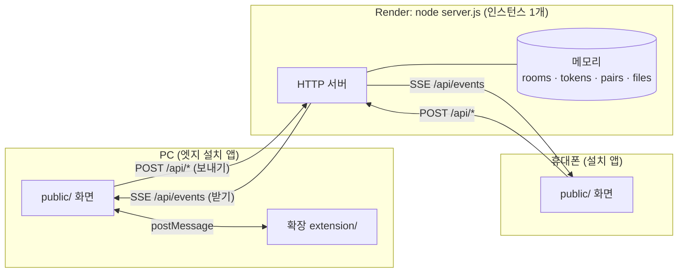
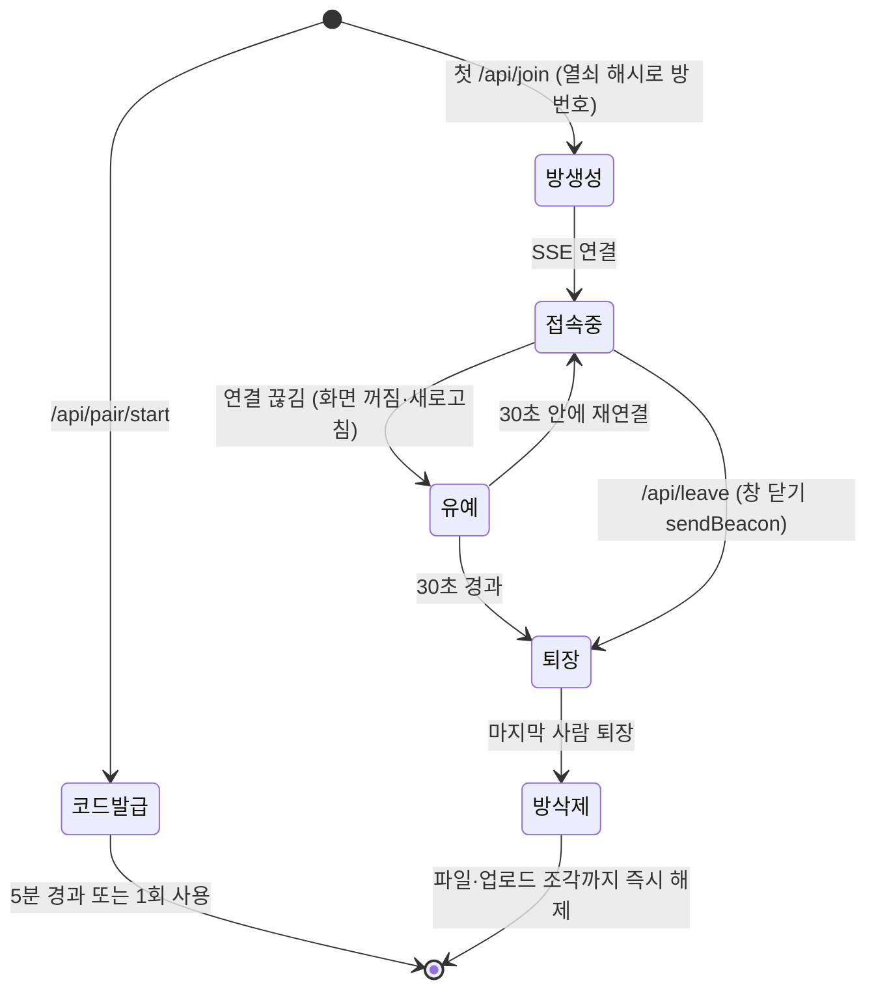
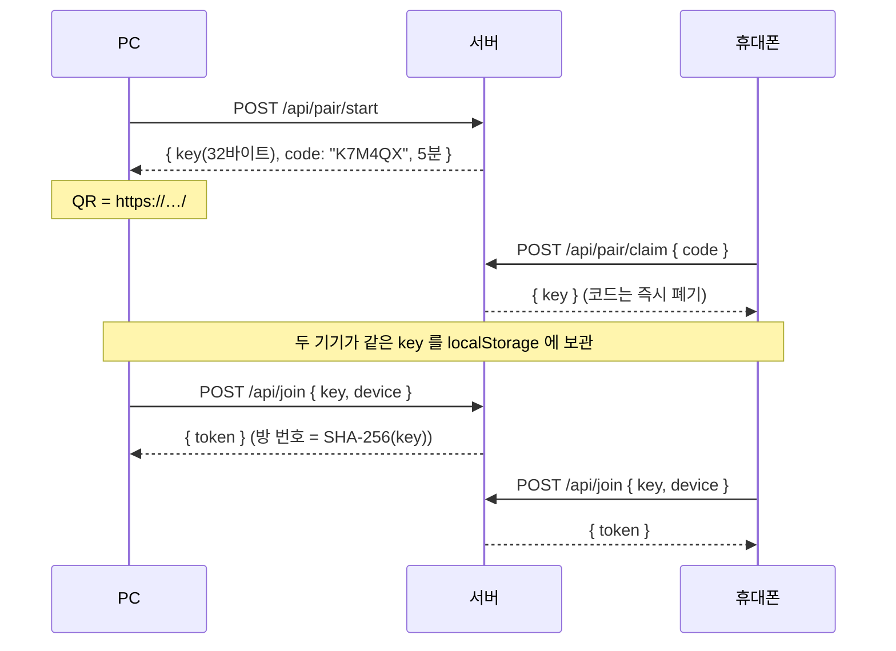
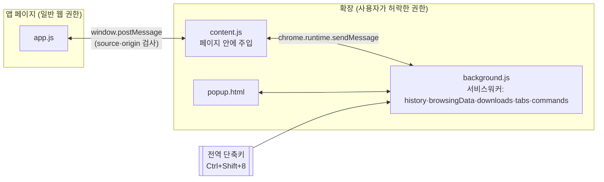
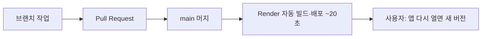

# text-tunnel 아키텍처 공부 노트

> 작성 2026-10-20 · 이 프로젝트를 만들며 실제로 부딪힌 설계 문제를 주제별로 정리한 학습 자료.
> 각 주제는 **무엇을 골랐나 → 왜 → 다른 선택지 → 코드 위치 → 더 공부할 키워드** 순서다.
> 코드 위치의 줄 번호는 2026-10-20 main 기준이며, 이후 바뀔 수 있다.
> **코드가 실제로 어떤 순서로 무슨 메시지를 주고받는지**(API 명세, 짝 맺기·메시지·업로드·확장 연결의 단계별 흐름)는 [FLOWS.md](FLOWS.md) 에 있다.

## 목차
1. [전체 그림: 상태를 가진 단일 서버](#1-전체-그림-상태를-가진-단일-서버)
2. [실시간 통신: SSE + POST](#2-실시간-통신-sse--post)
3. [메모리 상태와 생명주기](#3-메모리-상태와-생명주기)
4. [인증·보안 모델: 열쇠가 곧 권한](#4-인증보안-모델-열쇠가-곧-권한)
5. [접속 상태(presence)와 장애 감지](#5-접속-상태presence와-장애-감지)
6. [파일 전송: 조각 업로드, Range, 캐시](#6-파일-전송-조각-업로드-range-캐시)
7. [PWA: 웹을 앱처럼](#7-pwa-웹을-앱처럼)
8. [프레임워크 없는 클라이언트 구조](#8-프레임워크-없는-클라이언트-구조)
9. [브라우저 확장: 권한이 다른 세 세계](#9-브라우저-확장-권한이-다른-세-세계)
10. [배포·운영: PaaS와 12-Factor](#10-배포운영-paas와-12-factor)
11. [시험 전략](#11-시험-전략)
12. [한계와 다음 단계 (공부 거리)](#12-한계와-다음-단계-공부-거리)

---

## 1. 전체 그림: 상태를 가진 단일 서버

**무엇을 골랐나**: Node 프로세스 **하나**가 정적 파일(화면)과 API를 함께 내보내고, 모든 상태를 **자기 메모리**에 둔다. DB·Redis·외부 서비스 없음.

**왜**: 요구사항이 "DB 없이, 기록 없이"였다. 상태가 메모리에만 있으면 프로세스가 내려가는 순간 전부 사라진다. 보통은 단점이지만 여기서는 **그 휘발성이 곧 기능**이다.

**핵심 개념: stateful vs stateless 서버**
- **Stateless(무상태)** 서버는 요청마다 필요한 상태를 외부(DB, 캐시)에서 읽는다. 인스턴스를 몇 개 띄워도 상관없어서 수평 확장이 쉽다. 서버리스(Vercel, Lambda)가 이 모델이다.
- **Stateful(상태 보유)** 서버는 상태를 자기 메모리에 들고 있다. 빠르고 단순하지만 **인스턴스가 하나여야** 모두가 같은 상태를 본다.
- 이 프로젝트에서 **Vercel이 안 된 진짜 이유**가 이것이다. 휴대폰 요청은 인스턴스 A, PC 요청은 인스턴스 B로 가면 A의 메모리에 있는 방을 B는 모른다. 해결하려면 Redis Pub/Sub나 Pusher 같은 **외부 메시지 브로커**가 필요한데, 그게 곧 "외부 서비스"라 요구사항과 충돌했다.

**다른 선택지**: 서버리스 + 외부 브로커(Pusher/Ably/Redis) / P2P(WebRTC) / 상시 VM(오라클). 비교는 [WORKLOG §1](WORKLOG.md#1-요구사항과-결정).

**코드**: 라우터 전체가 `http.createServer` 콜백 하나 — [server.js:202](../server.js#L202) 이후. `/api/` 가 아니면 정적 파일 — `serveStatic` [server.js:127](../server.js#L127).

**키워드**: stateful vs stateless, horizontal scaling, sticky session, pub/sub, message broker

---

## 2. 실시간 통신: SSE + POST

| 방식 | 방향 | 특징 | 여기서 |
|---|---|---|---|
| Polling | 클라 → 서버 반복 질문 | 단순, 지연·낭비 큼 | ✗ |
| Long polling | 서버가 응답을 붙잡고 있다가 보냄 | 호환성 좋음, 구현 번거로움 | ✗ |
| **SSE** (Server-Sent Events) | **서버 → 클라 한 방향 스트림** | 그냥 HTTP 응답, 브라우저가 **자동 재연결**, 라이브러리 불필요 | ✅ 받기 |
| WebSocket | 양방향 | 강력, 서버에 `ws` 같은 라이브러리 필요 | ✗ |
| WebRTC | 기기 ↔ 기기 직접 | 서버 부담 없음, NAT 통과 실패 가능 | ✗ |

**무엇을 골랐나**: **받기는 SSE, 보내기는 평범한 POST**.

**왜**:
- Node 기본 모듈만으로 구현 가능 (의존성 0 원칙). SSE는 `Content-Type: text/event-stream` 응답을 끝내지 않고 계속 `data: ...\n\n` 을 써 주는 것뿐이다.
- 메신저는 "보내기"가 드물고 "받기 대기"가 길다. 받기만 스트림이면 충분하다.
- 일반 HTTP라 회사 프록시·방화벽을 잘 통과한다.

**함정과 대응**
- **프록시의 유휴 연결 끊기**: 아무것도 안 보내면 중간 장비가 연결을 끊는다 → 25초마다 주석 줄 `: ping` 을 보낸다 [server.js:283](../server.js#L283).
- **프록시 버퍼링**: 응답을 모아 두었다가 보내면 실시간이 깨진다 → `X-Accel-Buffering: no` [server.js:277](../server.js#L277).
- **재연결 간격**: `retry: 2000` 으로 브라우저 자동 재연결 주기를 지정.
- **EventSource는 헤더를 못 붙인다** → 인증 토큰을 쿼리스트링으로 보낸다 (`/api/events?token=`). 대신 토큰은 짧은 수명의 세션 토큰으로 분리했다(§4).

**코드**: 서버 [server.js:276-293](../server.js#L276) · 클라이언트 `connect()` (public/app.js, `new EventSource`) · 브로드캐스트 `broadcast()` [server.js:55](../server.js#L55).

**키워드**: Server-Sent Events, EventSource, WebSocket vs SSE, head-of-line blocking, proxy buffering, keepalive

---

## 3. 메모리 상태와 생명주기

**자료구조** [server.js:22-26](../server.js#L22)
| Map | 키 → 값 | 수명 |
|---|---|---|
| `rooms` | 방 번호(열쇠 SHA-256) → { members, files, uploads } | 마지막 사람이 나갈 때까지 |
| `tokens` | 세션 토큰 → 방 번호 | 그 기기가 방에 있는 동안 |
| `pairs` | 6자리 코드 → 열쇠 | 5분 또는 1회 사용 |
| `misses` | IP → 틀린 코드 횟수 | 10분 |
| 방 안 `files` | 파일 ID → Buffer | 10분, 대화 지우기, 방 삭제 |

**설계 포인트**
- **모든 상태에 끝이 있다(TTL)**. `setTimeout` 으로 만료를 예약하고, 먼저 끝나면 `clearTimeout` 으로 취소한다. 타이머를 안 지우면 이미 지운 객체를 다시 건드리거나 메모리가 새는 버그가 생긴다.
- **메모리 상한과 거절(back-pressure)**: 서버가 들고 있는 파일 총량 `fileBytes` 를 세고, 넘치면 업로드를 `507` 로 거절한다 [server.js:328](../server.js#L328). 무료 서버(512MB)가 메모리 부족으로 죽지 않게 하는 장치다. 방 개수도 `MAX_ROOMS` 로 제한.
- **휘발성 = 개인정보 보호**: 저장하지 않는 데이터는 유출될 수도 없다(data minimization).

**키워드**: TTL, resource lifecycle, memory leak via timers, back-pressure, load shedding, data minimization

---

## 4. 인증·보안 모델: 열쇠가 곧 권한

**무엇을 골랐나**: 아이디·비밀번호 계정이 없다. **긴 비밀 열쇠를 가진 기기 = 권한 있는 기기**(capability 방식).

**설계 포인트**
- **장기 비밀과 세션 토큰 분리**: 열쇠(key)는 방을 찾는 장기 비밀이고, 실제 API 호출은 입장할 때마다 새로 받는 **세션 토큰**으로 한다. URL에 실리는 것은 토큰뿐이라, 노출돼도 그 접속에만 영향이 있다.
- **서버는 열쇠 원문을 보관하지 않는다**: 방 번호로 `SHA-256(key)` 만 쓴다 [server.js:244](../server.js#L244). 메모리를 들여다봐도 열쇠는 없다.
- **짧은 코드의 무차별 대입 계산**: 6자리 × 31글자 = 약 8.9억 가지, 유효 5분, 1회용, **IP당 10번 틀리면 10분 차단** [server.js:90](../server.js#L90). 짧아서 입력하기 쉬운 코드를 안전하게 쓰는 전형적인 방법(rate limiting + 짧은 수명 + 1회성)이다.
- **헷갈리는 글자 제외**: 0/O, 1/I/L 을 뺀 문자 집합 [server.js:81](../server.js#L81). 보안이 아니라 사용성 설계다.
- **인원 제한도 보안 장치**: 방은 최대 2대. 열쇠가 새도 내 두 기기가 접속해 있으면 세 번째는 못 들어온다.
- **XSS 방지**: 받은 메시지는 절대 `innerHTML` 로 넣지 않고 `textContent` 와 DOM API로만 그린다(링크도 `<a>` 를 직접 만들어 넣음). 상대가 보낸 문자열이 코드로 실행될 수 없다.
- (초기 버전) 비밀번호 비교에 `crypto.timingSafeEqual` 을 썼다. 문자열 비교 시간이 일치 길이에 따라 달라지는 **타이밍 공격**을 막는 습관.

**위협 모델에서 의도적으로 못 막는 것**: 회사 네트워크의 접속 기록, 회사 보안 프로그램, Render 플랫폼 로그, **서버가 메시지를 평문으로 중계한다는 점**(§12의 종단간 암호화 참고).

**키워드**: capability-based security, bearer token, session token, hashing vs encryption, brute force & rate limiting, entropy, XSS, timing attack, threat modeling

---

## 5. 접속 상태(presence)와 장애 감지

분산 시스템의 근본 문제: **상대가 죽었는지, 느린 건지 구분할 수 없다.** 그래서 시간 제한으로 판단한다.

| 장치 | 값 | 목적 | 코드 |
|---|---|---|---|
| SSE 끊김 감지 | `req.on('close')` | 정상 종료·새로고침 감지 | [server.js:284](../server.js#L284) |
| 유예 시간(grace) | 30초 | 화면 꺼짐·새로고침 때 바로 쫓아내지 않기 | `GRACE` |
| 살아 있음 신호(heartbeat) | 20초마다 `/api/ping` | 프록시 뒤라 서버가 끊김을 못 볼 때 대비 | public/app.js `setInterval` |
| 유령 판정(stale) | 90초 무신호 | 방이 꽉 찼을 때만, 가장 오래된 유령부터 비움 | [server.js:247-252](../server.js#L247) |
| 기기 ID | localStorage | 같은 기기 재입장은 자리를 이어받음(멱등 입장) | `/api/join` |
| 즉시 퇴장 | `sendBeacon` on `pagehide` | 창 닫힘을 바로 알림 | public/app.js `leaveNow` |

**실제로 겪은 장애**: 앱을 강제 종료하면 Render 프록시가 서버 쪽 연결을 열어 둔 채로 있어서 서버는 휴대폰이 아직 있다고 믿었다(**유령**). 재접속한 휴대폰은 "이미 두 기기"로 막혔다. → heartbeat + stale 판정으로 해결 (PR #2).

**왜 유령을 "꽉 찼을 때만" 정리하나**: PC 브라우저는 백그라운드 탭의 타이머를 1분에 한 번으로 늦춘다. 평소에 90초 기준으로 잘라 내면 멀쩡한 PC가 쫓겨날 수 있다. 필요할 때만, 가장 오래된 것부터 정리하는 것이 안전하다.

**키워드**: failure detection, heartbeat, timeout, phi accrual failure detector, idempotency, presence system

---

## 6. 파일 전송: 조각 업로드, Range, 캐시

**조각 업로드(chunked upload)** — public/app.js `uploadOne`, [server.js:321](../server.js#L321)
- 브라우저가 파일을 **8MB씩** 순서대로 POST: `?uid&offset&total`. 서버는 `offset` 이 지금까지 받은 양과 정확히 같아야 받는다(아니면 `409`). 마지막 조각이 오면 합쳐서 알린다.
- 이유: 터널·프록시는 **요청 하나의 크기 제한**(예: 100MB)이 있다. 조각으로 나누면 제한과 상관없고, 진행률 표시도 쉽다.
- 더 나아가면: 실패한 조각만 다시 보내는 **재개 가능 업로드**(tus 프로토콜, S3 multipart).

**HTTP Range (206 Partial Content)** — `serveFile` [server.js:139](../server.js#L139)
- 아이폰 사파리는 동영상을 `Range: bytes=0-1` 처럼 **부분 요청**으로만 재생한다. 요청 구간만 잘라 `206` 으로 응답해야 재생된다.

**캐시 제어**: 파일 응답은 `Cache-Control: no-store` → 브라우저 캐시 폴더에 사진이 남지 않는다. 화면 파일은 `no-cache`(매번 확인) → 배포하면 앱을 다시 열 때 바로 새 버전.

**클라이언트 이미지 압축** — public/app.js `shrink`
- 큰 사진은 `createImageBitmap` → `<canvas>` 에 긴 변 2048px로 다시 그려 JPEG 0.85 로 내보냄. 서버 부담·전송 시간을 **보내는 쪽에서** 줄이는 설계(edge processing).

**묶음(batch) ID**: 한 번에 고른 사진에 같은 ID를 붙여 서버가 그대로 전달 → 받는 쪽이 같은 ID 끼리 앨범 말풍선으로 묶는다. 서버는 의미를 몰라도 되고 **표현은 클라이언트가 결정**.

**키워드**: chunked/resumable upload, multipart upload, HTTP Range requests, Content-Disposition, Cache-Control (no-store vs no-cache), client-side compression

---

## 7. PWA: 웹을 앱처럼

| 구성 | 역할 | 이 프로젝트 |
|---|---|---|
| `manifest.json` | 이름·아이콘·전체화면 모드·공유 대상 선언 | `display: standalone`, `share_target` |
| Service Worker `sw.js` | 네트워크 요청 가로채기, 오프라인, 설치 조건 | **일부러 캐시 안 함**(항상 최신·기록 최소화), 공유 메뉴 POST만 처리 |
| HTTPS | 서비스워커·설치·클립보드의 필수 조건 | Render 가 자동 제공 |

**배운 것**
- **Share Target**: 안드로이드 공유 메뉴에서 앱으로 사진을 보내면 브라우저가 `POST /share` 를 만든다. 서비스워커가 받아 Cache Storage 에 잠깐 넣고 페이지로 넘긴다. 열쇠는 페이지만 알기 때문에 실제 업로드는 페이지가 한다.
- **설치 프롬프트**: 안드로이드 크롬은 `beforeinstallprompt` 이벤트를 붙잡아 두었다가 우리 버튼에서 띄운다. 아이폰은 이 API가 없어 안내 문구로 대신한다.
- **저장소 분리(storage partitioning)**: 아이폰은 사파리와 홈 화면 앱의 `localStorage` 가 따로다 → 설치한 앱에서 코드를 한 번 더 입력하는 흐름이 필요했다. 안드로이드 카메라·렌즈의 **인앱 브라우저**도 저장소가 따로라 같은 문제가 생겼다.
- **자동 업데이트**: 캐시를 안 쓰니 서버 배포 = 다음 실행부터 새 버전.

**키워드**: Progressive Web App, Web App Manifest, Service Worker lifecycle, Cache Storage, Web Share Target, storage partitioning, in-app browser

---

## 8. 프레임워크 없는 클라이언트 구조

**무엇을 골랐나**: React 없이 HTML 하나 + JS 하나(`public/app.js`).

- **화면 전환**: 모든 화면이 HTML에 미리 있고 `show(id)` 가 하나만 보이게 한다. 단순한 **상태 기계(state machine)**: 깨우기 → 처음 → (코드·QR·설치) → 대화.
- **상태**: 모듈 최상위 변수 몇 개(`key`, `token`, `peers`, `tray` 등). 상태가 바뀌면 그 부분 DOM을 직접 고친다.
- **이벤트 중심**: 서버 이벤트(SSE) → `add()` / `onPresence()`, 사용자 이벤트 → 핸들러.
- **데모 모드**: `/#demo-chat` 처럼 주소로 장면을 지정하면 서버 없이 예시 데이터로 화면이 뜬다. UI 개발·시안·스크린샷 시험에 썼다(테스트 더블의 일종).
- **장점/한계**: 번들러·빌드 없음, 수 KB. 화면이 더 커지면 컴포넌트·상태 관리 라이브러리가 필요해지는 지점이 온다 — 지금 `app.js` 가 그 경계쯤이다.

**키워드**: vanilla JS, DOM manipulation, UI state machine, event-driven UI, test double, when to adopt a framework

---

## 9. 브라우저 확장: 권한이 다른 세 세계

**왜 필요했나**: 웹페이지는 보안상 **브라우저 방문 기록을 읽거나 지울 수 없다**. 사용자가 직접 설치하며 권한을 준 확장만 가능하다 → **권한 상승이 필요한 일만 확장으로 분리**.

**설계 포인트**
- **세 실행 환경**: 페이지(일반 권한) / content script(페이지에 붙지만 확장 API 일부 사용) / background 서비스워커(전체 확장 API). 서로 **메시지로만** 대화한다.
- **메시지 검증**: `e.source === window`, `source: 'tt-app' | 'tt-ext'` 확인, `postMessage(…, location.origin)` 으로 대상 출처 고정 — 다른 출처의 위조 메시지를 무시한다.
- **최소 범위**: 지울 대상을 `isOurs` / `isOurSearch` 함수로 엄격히 한정(우리 주소, 우리 검색어, 8787 포트만). 다른 사이트 기록은 절대 건드리지 않는다.
- **전역 단축키와 OS 자원 경쟁**: 전역 단축키는 Windows에서 **한 프로그램만** 등록할 수 있다. 크롬과 엣지에 같은 확장을 깔면 먼저 켜진 쪽이 키를 가져가고, 나머지는 **조용히 실패**했다. → 앱 창이 앞에 있으면 페이지가 직접 키를 받는 **이중화(fallback)** 를 넣었다.
- **배포의 한계**: 스토어를 거치지 않은 확장은 개발자 모드로만 설치되고 자동 업데이트가 없다. 그래서 앱이 확장 버전을 확인해 업데이트 안내를 띄운다(버전 협상).

**키워드**: Manifest V3, content script isolation, message passing, principle of least privilege, global hotkey contention, graceful degradation

---

## 10. 배포·운영: PaaS와 12-Factor

- **PaaS(Render)**: 서버 관리 없이 `git push` → 배포. HTTPS·도메인 자동. 무료는 15분 미사용 시 잠들고 첫 요청에 깨어난다(**cold start**) → 화면에 "서버 깨우는 중".
- **12-Factor 설정**: 포트·한도는 **환경변수**(`PORT`, `MAX_MB`, `MEM_MB`, `MAX_ROOMS`, `STALE_SEC`)로 받고 코드엔 기본값만 둔다.
- **헬스 체크**: `/api/health` — 깨우기 화면과 배포 확인에 사용.
- **로그 최소화**: 운영 로그에 개인정보가 남지 않게 시작 문구 외 아무것도 쓰지 않는다(privacy by design).
- **단일 인스턴스 전제**: 이 구조는 인스턴스가 1개일 때만 맞다. Render 에서 인스턴스를 늘리면 §1의 Vercel 문제가 그대로 생긴다.
- **브랜치 전략과 함정**: 쌓아 올린 PR(stacked PR)에서 아래 PR을 머지하며 브랜치를 지우면 위 PR이 닫힌다 → 머지 전 기준 브랜치를 main 으로 돌린다.

**키워드**: PaaS, continuous deployment, cold start, 12-Factor App, health check, privacy by design, stacked pull requests

---

## 11. 시험 전략

| 층 | 방법 | 예 |
|---|---|---|
| 단위 | 순수 함수를 Node `vm` 으로 떼어 시험 | 검색어 판별 14케이스, 단축키 문자열 해석, 버전 비교 |
| API 통합 | 서버를 띄우고 `fetch` + SSE 를 여는 Node 스크립트 | 짝 맺기 16항목, 유령 정리(`STALE_SEC=3` 으로 시간 압축) |
| 실제 배포 회귀 | 같은 스크립트를 Render 주소에 | 머지 후 15항목 (IP 차단 시험은 제외) |
| 브라우저 E2E | 헤드리스 Edge + `--load-extension` + **CDP**(원격 디버깅 프로토콜)로 탭 열기·키 입력·결과 확인 | 단축키 완전 정리 |
| 시각 | 헤드리스 스크린샷, 데모 장면 | 화면 깨짐·레이아웃 |

**배운 것**: 시간이 걸리는 로직(유예·유령)은 **시간을 설정값으로 빼 두면** 시험에서 줄일 수 있다. 시험 환경이 실제와 다르면(포트 8799 vs 8787) 시험이 거짓 실패한다.

**키워드**: test pyramid, integration test, end-to-end test, Chrome DevTools Protocol, time injection

---

## 12. 한계와 다음 단계 (공부 거리)

| 주제 | 지금 | 더 나아가면 |
|---|---|---|
| **종단간 암호화(E2EE)** | HTTPS로 전송 구간은 암호화되지만 **서버 메모리에선 평문** | 짝 맺을 때 공유한 열쇠로 브라우저에서 암호화(Web Crypto AES-GCM) → 서버는 암호문만 중계. Signal 프로토콜 공부 |
| 전달 보장 | 받는 쪽이 없으면 사라짐 (at-most-once) | 메시지 ID + 확인 응답(ack) + 재전송, 순서 번호 |
| 수평 확장 | 인스턴스 1개 전제 | Redis Pub/Sub 브로커, sticky session, 방 단위 샤딩 |
| 업로드 재개 | 실패 시 처음부터 | tus 프로토콜, 조각 단위 재시도 |
| 실시간 방식 | SSE + POST | WebSocket 으로 양방향 통합, 백프레셔 처리 |
| P2P | 미사용 | WebRTC DataChannel + STUN/TURN, NAT traversal |
| 확장 배포 | 개발자 모드 | 스토어 배포·자동 업데이트, 엔터프라이즈 정책 배포 |
| 네이티브 껍데기 | 미사용 | WebView2/Electron, 트레이 상주, OS 전역 단축키 |
