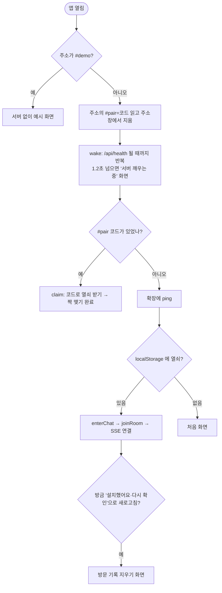
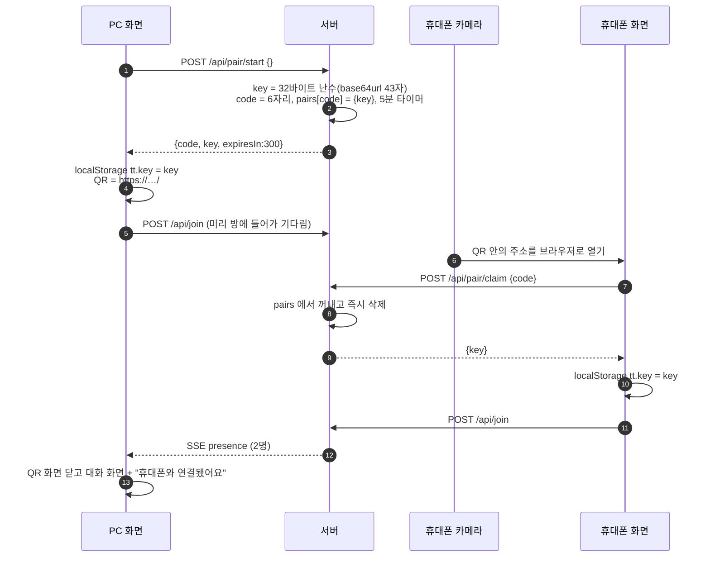
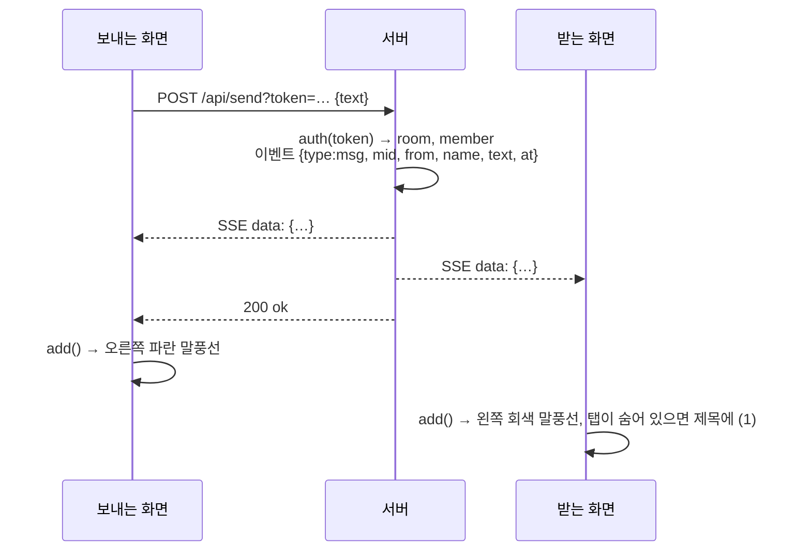
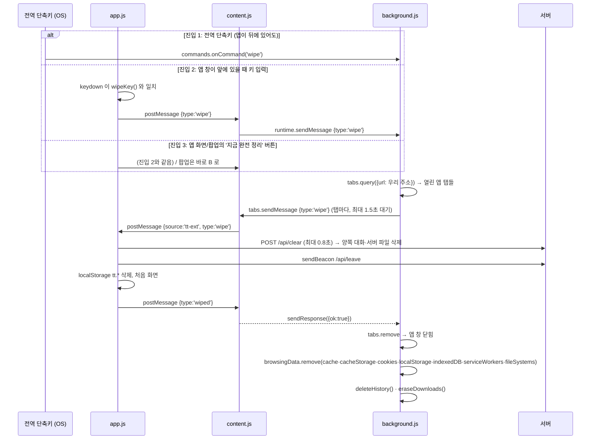

# text-tunnel 흐름별 상세 해설

> 작성 2026-10-20 · [ARCHITECTURE.md](ARCHITECTURE.md)(개념)의 짝 문서. 여기서는 **실제로 코드가 어떤 순서로, 어떤 메시지를 주고받는지**를 한 단계씩 따라간다.
> 코드 발췌는 2026-10-20 main 기준. 줄 번호는 이후 바뀔 수 있다. "요약" 표시가 있는 코드는 이해를 위해 줄인 것이다.
> 각 장 끝의 **📄 실제 코드** 를 누르면 그 기능의 실제 코드 전체가 펼쳐진다. 파일에서 그대로 잘라 넣은 2026-10-20 시점의 사본이다.
> 다음에 공부할 것과 실습 과제는 [STUDY.md](STUDY.md).

## 목차
- [A. API 전체 명세](#a-api-전체-명세)
- [B. 실시간 이벤트(SSE) 형식](#b-실시간-이벤트sse-형식)
- [C. 앱이 켜질 때 일어나는 일](#c-앱이-켜질-때-일어나는-일)
- [D. 짝 맺기 상세](#d-짝-맺기-상세)
- [E. 입장·재입장·유령 정리](#e-입장재입장유령-정리)
- [F. 텍스트 메시지 한 개의 일생](#f-텍스트-메시지-한-개의-일생)
- [G. 사진 여러 장 보내기](#g-사진-여러-장-보내기)
- [H. 대화 지우기·휴지통](#h-대화-지우기휴지통)
- [I. 확장 프로그램 연결 — 처음부터 끝까지](#i-확장-프로그램-연결--처음부터-끝까지)
- [J. 안드로이드 공유 메뉴로 보내기](#j-안드로이드-공유-메뉴로-보내기)
- [K. 서버 내부 구조](#k-서버-내부-구조)
- [L. 직접 따라 해 보기](#l-직접-따라-해-보기)

---

## A. API 전체 명세

모든 API는 `/api/` 로 시작한다. **인증이 필요한 API는 쿼리스트링 `?token=` 으로 세션 토큰**을 보낸다(EventSource 가 헤더를 못 붙이기 때문에 전부 같은 방식으로 통일).

| 메서드 · 경로 | 인증 | 요청 | 성공 응답 | 실패 |
|---|---|---|---|---|
| `GET /api/health` | ✗ | — | `200 ok` | — |
| `POST /api/pair/start` | ✗ | `{ key? }` 열쇠가 있으면 그 열쇠로 새 코드, 없으면 새 열쇠 생성 | `{ code, key, expiresIn: 300 }` | — |
| `POST /api/pair/claim` | ✗ | `{ code }` 대소문자·공백 무관 | `{ key }` 코드는 즉시 폐기 | `404` 틀림·만료, `429` 10번 틀려 10분 차단 |
| `POST /api/join` | ✗ (열쇠가 인증) | `{ key, name, device }` | `{ token, id }` | `400` 열쇠 형식, `409` 이미 2대, `429` 방 너무 많음 |
| `GET /api/events` | ✓ | — | SSE 스트림 (B 참고) | `401` |
| `GET /api/ping` | ✓ | — | `200 ok` (살아 있음 신호 겸 토큰 확인) | `401` |
| `POST /api/send` | ✓ | `{ text }` 최대 64KB | `200 ok` | `400` 빈 글, `413` 너무 김 |
| `POST /api/upload` | ✓ | 쿼리 `uid, offset, total, name, batch?` + 본문 = 파일 조각(원본 바이트) | 중간 조각 `200 more`, 마지막 `200 done` | `409` 순서 어긋남, `413` 크기 초과, `507` 서버 메모리 가득, `410` 방 사라짐 |
| `GET /api/file/:fid` | ✓ | `Range` 헤더 가능 | `200` 전체 또는 `206` 부분 | `410` 만료, `416` 범위 오류 |
| `POST /api/clear` | ✓ | — | `200 ok` + 양쪽에 `clear` 이벤트 | `401` |
| `POST /api/leave` | ✓ | — | `200 ok` | `401` |
| `GET /text-tunnel-cleaner.zip` | ✗ | — | 확장 프로그램 zip | `404` (extension 폴더 없을 때) |

`401` 은 "이 토큰을 모른다"는 뜻이다. 서버가 재시작됐거나, 방이 사라졌거나, 다른 탭이 같은 기기 자리를 가져간 경우다. 화면은 401을 받으면 **열쇠로 다시 입장**한다.

---

## B. 실시간 이벤트(SSE) 형식

`GET /api/events` 응답은 끝나지 않는 텍스트다. 실제로 오가는 바이트는 이렇게 생겼다.

```
HTTP/1.1 200 OK
Content-Type: text/event-stream
Cache-Control: no-store
X-Accel-Buffering: no

retry: 2000

data: {"type":"presence","users":[{"id":"a1…","name":"PC"},{"id":"b2…","name":"휴대폰"}]}

: ping

data: {"type":"msg","mid":"…","from":"b2…","name":"휴대폰","text":"안녕","at":1792…}

data: {"type":"file","mid":"…","fid":"f9…","fname":"IMG_1.jpg","mime":"image/jpeg","size":812345,"batch":"7c…","from":"b2…","name":"휴대폰","at":1792…}

data: {"type":"clear","from":"a1…","name":"PC","at":1792…}
```

- `data:` 한 줄 + 빈 줄 = 이벤트 하나. 브라우저 `EventSource` 가 `onmessage` 로 넘겨 준다.
- `: ping` 처럼 콜론으로 시작하는 줄은 **주석**이라 무시된다. 25초마다 보내서 프록시가 연결을 끊지 않게 한다.
- `retry: 2000` 은 끊겼을 때 2초 뒤 자동 재연결하라는 지시.
- `from` 은 보낸 기기의 **이번 접속 ID**. 화면은 자기 `myId` 와 비교해 내 말풍선(오른쪽)인지 판단한다.

| type | 언제 | 화면 처리 |
|---|---|---|
| `presence` | 누가 들어오거나 나갈 때, SSE 가 열릴 때 | `onPresence()` — 헤더 상태, "연결됨/나감" 안내, 대기 QR |
| `msg` | 누군가 텍스트를 보냄 (보낸 사람에게도 옴) | `add()` |
| `file` | 업로드가 다 모였을 때 | `add()` — 사진이면 같은 `batch` 앨범에 합침 |
| `clear` | 누군가 대화 지우기 | `clearList()` + 알림 |

**보낸 사람에게도 이벤트가 돌아온다**는 점이 중요하다. 화면은 보내기 버튼을 눌렀을 때 말풍선을 직접 그리지 않고, 서버에서 돌아온 이벤트로만 그린다. 그래서 양쪽 화면 순서가 항상 같고, 서버에 실제로 도착한 것만 보인다.

---

## C. 앱이 켜질 때 일어나는 일

[public/app.js:850](../public/app.js#L850) 의 즉시 실행 함수가 시작점이다.

```js
(async () => {
  if (DEMO) return startDemo(DEMO);
  const pairCode = /^#pair=([A-Za-z0-9]{6})$/.exec(location.hash)?.[1];
  if (location.hash) history.replaceState(null, '', location.pathname + location.search);
  await wake();
  if (pairCode) { show('codeForm'); $('codeInput').value = `${pairCode.slice(0, 3)} ${pairCode.slice(3)}`; return claim(pairCode); }
  toExt({ type: 'ping' });
  let reopenExt = false;
  try { reopenExt = sessionStorage.getItem('tt.openExt') === '1'; sessionStorage.removeItem('tt.openExt'); } catch {}
  if (key) enterChat();
  if (reopenExt) return openExt();
  if (key) return;
  show('welcome');
})();
```



- **주소창에서 `#pair=` 를 바로 지우는 이유**: 1회용 코드가 방문 기록·스크린샷에 남지 않게.
- **wake 가 먼저인 이유**: Render 무료 서버가 잠들어 있으면 첫 요청이 최대 1분 걸린다. 다른 요청을 보내기 전에 서버가 깨어난 것을 확인한다.
- **이 기기에 저장되는 것**(`localStorage`): `tt.key`(열쇠), `tt.name`(기기 이름), `tt.device`(기기 ID). 대화는 저장하지 않는다.

**실제 코드**

<details>
<summary>📄 실제 코드 — <code>public/app.js</code> 850–863 · 앱 시작 (즉시 실행 함수)</summary>

[GitHub에서 보기](../public/app.js#L850-L863)

```js
(async () => {
  if (DEMO) return startDemo(DEMO);
  const pairCode = /^#pair=([A-Za-z0-9]{6})$/.exec(location.hash)?.[1];
  if (location.hash) history.replaceState(null, '', location.pathname + location.search);
  await wake();
  if (pairCode) { show('codeForm'); $('codeInput').value = `${pairCode.slice(0, 3)} ${pairCode.slice(3)}`; return claim(pairCode); }
  toExt({ type: 'ping' });
  let reopenExt = false;
  try { reopenExt = sessionStorage.getItem('tt.openExt') === '1'; sessionStorage.removeItem('tt.openExt'); } catch {}
  if (key) enterChat();
  if (reopenExt) return openExt();
  if (key) return;
  show('welcome');
})();
```

</details>

<details>
<summary>📄 실제 코드 — <code>public/app.js</code> 47–55 · wake: 서버 깨우기</summary>

[GitHub에서 보기](../public/app.js#L47-L55)

```js
async function wake() {
  const slow = setTimeout(() => show('boot'), 1200);
  for (;;) {
    const r = await fetch('/api/health', { cache: 'no-store' }).catch(() => null);
    if (r?.ok) break;
    await new Promise((ok) => setTimeout(ok, 2000));
  }
  clearTimeout(slow);
}
```

</details>


---

## D. 짝 맺기 상세



**서버 코드** ([server.js:214](../server.js#L214) 부근, 요약)
```js
// 시작: 열쇠가 오면 그 열쇠로(새 기기 연결), 없으면 새 열쇠
const key = 유효한_열쇠(j?.key) ? j.key : crypto.randomBytes(32).toString('base64url');
const code = newCode();                       // 헷갈리는 글자 뺀 31자 중 6개
pairs.set(code, { key, timer: setTimeout(() => pairs.delete(code), PAIR_TTL) });

// 완료: 코드는 한 번 쓰면 사라진다
if (blocked(ip)) return 429;                  // 10분 안에 10번 틀리면 차단
const pair = pairs.get(code);
if (!pair) { miss(ip); return 404; }
clearTimeout(pair.timer); pairs.delete(code);
send(res, 200, { key: pair.key });
```

**"새 기기 연결"과 대기 화면 QR**은 이미 가진 열쇠를 `pair/start` 에 넣어 **같은 열쇠의 새 코드**를 받는다. 그래서 새 휴대폰이나 열쇠를 잃은 휴대폰이 같은 방으로 들어온다. 대기 화면은 코드가 끝나기 15초 전에 새 코드를 받는다(`refreshWaitQr`, [public/app.js:80](../public/app.js#L80)).

**아이폰의 추가 단계**: 사파리에서 짝을 맺고 "홈 화면에 추가"하면 홈 화면 앱은 **다른 저장소**를 쓴다. 그래서 설치한 앱을 처음 열면 열쇠가 없고, PC의 "새 기기 연결" 코드를 한 번 입력한다(`claim`).

**실제 코드**

<details>
<summary>📄 실제 코드 — <code>server.js</code> 80–98 · 짝 코드 생성·IP 차단</summary>

[GitHub에서 보기](../server.js#L80-L98)

```js
// 헷갈리는 글자(0/O, 1/I/L)를 뺀 6자리
const CODE_CHARS = '23456789ABCDEFGHJKMNPQRSTUVWXYZ';
function newCode() {
  let c;
  do c = [...crypto.randomBytes(6)].map((b) => CODE_CHARS[b % CODE_CHARS.length]).join('');
  while (pairs.has(c));
  return c;
}

const clientIp = (req) => (req.headers['x-forwarded-for'] || '').split(',')[0].trim() || req.socket.remoteAddress;
function blocked(ip) {
  const m = misses.get(ip);
  return m && m.until > Date.now() && m.n >= 10;
}
function miss(ip) {
  const m = misses.get(ip);
  if (!m || m.until < Date.now()) misses.set(ip, { n: 1, until: Date.now() + 10 * 60 * 1000 });
  else m.n++;
}
```

</details>

<details>
<summary>📄 실제 코드 — <code>server.js</code> 213–235 · /api/pair/start · /api/pair/claim</summary>

[GitHub에서 보기](../server.js#L213-L235)

```js
  // 짝 맺기 시작: 열쇠를 가진 기기가 6자리 코드를 받는다. { key? } — 없으면 새 열쇠를 만든다
  if (p === '/api/pair/start' && req.method === 'POST') {
    return readJson(req, (j) => {
      const key = typeof j?.key === 'string' && /^[A-Za-z0-9_-]{43}$/.test(j.key) ? j.key : crypto.randomBytes(32).toString('base64url');
      const code = newCode();
      pairs.set(code, { key, timer: setTimeout(() => pairs.delete(code), PAIR_TTL) });
      send(res, 200, { code, key, expiresIn: PAIR_TTL / 1000 });
    });
  }

  // 짝 맺기 완료: 다른 기기가 코드를 내고 열쇠를 받는다. 코드는 한 번 쓰면 사라진다
  if (p === '/api/pair/claim' && req.method === 'POST') {
    const ip = clientIp(req);
    if (blocked(ip)) return send(res, 429, { error: '코드를 너무 많이 틀렸어요. 10분 뒤에 다시 해 주세요' });
    return readJson(req, (j) => {
      const code = String(j?.code || '').toUpperCase().replace(/[^A-Z0-9]/g, '');
      const pair = pairs.get(code);
      if (!pair) { miss(ip); return send(res, 404, { error: '코드가 맞지 않거나 시간이 지났어요. PC에서 새 코드를 받아 주세요' }); }
      clearTimeout(pair.timer);
      pairs.delete(code);
      send(res, 200, { key: pair.key });
    });
  }
```

</details>

<details>
<summary>📄 실제 코드 — <code>public/app.js</code> 58–123 · 화면: QR 띄우기·대기 QR·코드로 짝 맺기</summary>

[GitHub에서 보기](../public/app.js#L58-L123)

```js
async function openQr() {
  show('qrScreen');
  $('qrBox').innerHTML = ''; $('qrCode').textContent = '······'; $('qrTimer').textContent = ''; $('qrRenew').hidden = true;
  if (DEMO) return drawQr('K7M4QX', 300);
  const r = await post('pair/start', key ? { key } : {}).catch(() => null);
  if (!r?.ok) { $('qrTimer').textContent = '코드를 받지 못했어요. 잠시 뒤 다시 해 주세요'; $('qrRenew').hidden = false; return; }
  const j = await r.json();
  if (!key) { key = j.key; store.set('tt.key', key); }
  drawQr(j.code, j.expiresIn);
  if (!token) joinRoom(); // 미리 방에 들어가 있다가 상대가 오면 바로 대화 화면으로
}

const fmtCode = (code) => `${code.slice(0, 3)} ${code.slice(3)}`;
function renderQr(box, code) {
  const qr = qrcode(0, 'M');
  qr.addData(`${location.origin}/#pair=${code}`); qr.make();
  box.innerHTML = qr.createSvgTag({ scalable: true, margin: 0 });
  box.querySelector('svg').setAttribute('aria-hidden', 'true');
}

// 상대를 기다리는 동안 대기 화면에 다시 연결용 QR을 띄워 둔다. 코드는 5분짜리라 끝나기 전에 새로 받는다
let waitTimer = null;
async function refreshWaitQr() {
  clearTimeout(waitTimer); waitTimer = null;
  if (DEMO) { renderQr($('waitQr'), 'K7M4QX'); $('waitCode').textContent = fmtCode('K7M4QX'); return; }
  if (others || !key || document.hidden || $('chat').hidden) return;
  const r = await post('pair/start', { key }).catch(() => null);
  if (!r?.ok || others) return;
  const j = await r.json();
  renderQr($('waitQr'), j.code);
  $('waitCode').textContent = fmtCode(j.code);
  waitTimer = setTimeout(refreshWaitQr, (j.expiresIn - 15) * 1000);
}

function drawQr(code, seconds) {
  renderQr($('qrBox'), code);
  $('qrCode').textContent = fmtCode(code);
  const end = Date.now() + seconds * 1000;
  clearInterval(qrTimer);
  const tick = () => {
    const left = Math.max(0, Math.round((end - Date.now()) / 1000));
    $('qrTimer').textContent = left ? `${Math.floor(left / 60)}:${String(left % 60).padStart(2, '0')} 동안 쓸 수 있어요` : '시간이 지났어요';
    if (!left) { clearInterval(qrTimer); $('qrBox').style.opacity = .25; $('qrRenew').hidden = false; }
  };
  $('qrBox').style.opacity = 1;
  tick(); qrTimer = setInterval(tick, 1000);
}

function closeQr() {
  clearInterval(qrTimer);
  if (key) enterChat(); else show('welcome');
}

async function claim(code) {
  code = code.toUpperCase().replace(/[^A-Z0-9]/g, '');
  if (code.length !== 6) return ($('codeErr').textContent = '6자리를 입력하세요');
  $('codeBtn').disabled = true; $('codeErr').textContent = '';
  const r = await post('pair/claim', { code }).catch(() => null);
  $('codeBtn').disabled = false;
  if (!r) return ($('codeErr').textContent = '서버에 연결할 수 없어요');
  const j = await r.json().catch(() => ({}));
  if (!r.ok) { show('codeForm'); $('codeErr').textContent = j.error || '연결하지 못했어요'; return; }
  key = j.key; store.set('tt.key', key);
  joinRoom();
  if (IS_MOBILE && !STANDALONE) showInstall(); else enterChat();
}
```

</details>


---

## E. 입장·재입장·유령 정리

**서버** [server.js:238-268](../server.js#L238)
```js
const id = crypto.createHash('sha256').update(key).digest('hex');   // 방 번호
let room = rooms.get(id);
if (!room) { … room = { id, members: new Map(), files: new Map(), uploads: new Map() }; }
// 같은 기기가 다시 들어오면(새로고침·앱 재실행) 이전 자리를 비운다
for (const [t, m] of room.members) if (m.device === device) dropMember(room, t);
// 꽉 찼으면 소식이 끊긴 자리(앱 강제 종료 등으로 남은 유령)를 가장 오래된 것부터 비운다
if (room.members.size >= ROOM_SIZE) {
  const stale = [...room.members].filter(([, m]) => Date.now() - m.seen > STALE).sort(([, a], [, b]) => a.seen - b.seen);
  if (stale.length) { dropMember(room, stale[0][0]); presence(room); }
}
if (room.members.size >= ROOM_SIZE) return send(res, 409, …);
const token = crypto.randomBytes(24).toString('base64url');
const member = { id: crypto.randomUUID(), device, name, res: null, timer: null, seen: Date.now() };
member.timer = setTimeout(() => removeMember(room, token), GRACE); // 연결을 안 열면 정리
```

- `member.res` = 이 기기의 SSE 응답 객체. `null` 이면 "자리는 있지만 지금 연결은 없음".
- `member.seen` = 마지막으로 인증된 요청 시각. `auth()` 가 매 요청마다 갱신한다 ([server.js:65](../server.js#L65)).
- `member.timer` = 유예 타이머. SSE 가 열리면 취소, 닫히면 다시 30초.

**화면** [public/app.js:144-182](../public/app.js#L144)
```js
async function joinRoom() {
  …
  const r = await post('join', { key, name: myName, device }).catch(() => null);
  if (!r) { setStatus('off'); return setTimeout(joinRoom, 3000); }        // 서버 연결 안 됨 → 3초 뒤
  if (!r.ok) { … if (r.status === 409 || r.status === 429) setTimeout(joinRoom, 15000); return; } // 꽉 참 → 15초 뒤
  token = j.token; myId = j.id; peers = null;
  connect();
}
function connect() {
  es = new EventSource(api('events'));
  es.onerror = async () => {                       // 끊김: 브라우저가 알아서 재연결하지만
    const r = await fetch(api('ping')).catch(() => null);
    if (r?.status === 401) { es.close(); token = null; setTimeout(joinRoom, 500); } // 토큰이 죽었으면 새로 입장
  };
  …
}
```

**재연결 경로 정리**
| 상황 | 감지 | 복구 |
|---|---|---|
| 잠깐 네트워크 끊김 | EventSource onerror | 브라우저 자동 재연결 (`retry: 2000`) |
| 서버 재시작·배포 | ping 이 401 | `joinRoom()` 으로 새 토큰 |
| 화면 꺼졌다 켜짐 | `visibilitychange` | 토큰 없거나 SSE 닫혔으면 재입장 |
| 뒤로가기 캐시 복원 | `pageshow` persisted | 재입장 |
| 창 닫기 | `pagehide` | `sendBeacon(/api/leave)` 로 즉시 퇴장 |
| 앱 강제 종료(유령) | 20초 신호 끊김 | 다른 기기가 들어올 때 90초 넘은 유령 정리 |

**실제 코드**

<details>
<summary>📄 실제 코드 — <code>server.js</code> 35–77 · 방·멤버 정리 도구와 auth</summary>

[GitHub에서 보기](../server.js#L35-L77)

```js
function destroyRoom(id) {
  const room = rooms.get(id);
  if (!room) return;
  for (const [t, m] of room.members) { tokens.delete(t); clearTimeout(m.timer); m.res?.end(); }
  for (const f of room.files.values()) { clearTimeout(f.timer); fileBytes -= f.buf.length; }
  for (const u of room.uploads.values()) clearTimeout(u.timer);
  rooms.delete(id);
}

function removeMember(room, token) {
  const m = room.members.get(token);
  if (!m) return;
  clearTimeout(m.timer);
  m.res?.end();
  room.members.delete(token);
  tokens.delete(token);
  if (!room.members.size) destroyRoom(room.id);
  else presence(room);
}

function broadcast(room, ev) {
  const line = `data: ${JSON.stringify(ev)}\n\n`;
  for (const m of room.members.values()) m.res?.write(line);
}

function presence(room) {
  const users = [...room.members.values()].filter((m) => m.res).map((m) => ({ id: m.id, name: m.name }));
  broadcast(room, { type: 'presence', users });
}

function auth(url) {
  const token = url.searchParams.get('token') || '';
  const room = rooms.get(tokens.get(token));
  const member = room?.members.get(token);
  if (member) member.seen = Date.now(); // 앱은 20초마다 /api/ping 으로 살아 있음을 알린다
  return member ? { room, member, token } : null;
}

function dropMember(room, token) {
  const m = room.members.get(token);
  clearTimeout(m.timer); m.res?.end();
  room.members.delete(token); tokens.delete(token);
}
```

</details>

<details>
<summary>📄 실제 코드 — <code>server.js</code> 237–292 · /api/join · 인증 · /api/ping · /api/events</summary>

[GitHub에서 보기](../server.js#L237-L292)

```js
  // 방 입장: { key, name, device } — 방 번호는 열쇠의 해시. 열쇠 자체는 어디에도 보관하지 않는다
  if (p === '/api/join' && req.method === 'POST') {
    return readJson(req, (j) => {
      const key = String(j?.key || '');
      const device = String(j?.device || '').slice(0, 64);
      const name = String(j?.name || '').trim().slice(0, 20) || '기기';
      if (!/^[A-Za-z0-9_-]{43}$/.test(key) || !device) return send(res, 400, { error: '연결 정보가 올바르지 않아요. 다시 연결해 주세요' });
      const id = crypto.createHash('sha256').update(key).digest('hex');

      let room = rooms.get(id);
      if (!room) {
        if (rooms.size >= MAX_ROOMS) return send(res, 429, { error: '서버가 붐벼요. 잠시 뒤에 다시 열어 주세요' });
        room = { id, members: new Map(), files: new Map(), uploads: new Map() };
        rooms.set(id, room);
      }
      // 같은 기기가 다시 들어오면(새로고침·앱 재실행) 이전 자리를 비운다
      for (const [t, m] of room.members) if (m.device === device) dropMember(room, t);
      // 꽉 찼으면 소식이 끊긴 자리(앱 강제 종료 등으로 남은 유령)를 가장 오래된 것부터 비운다
      if (room.members.size >= ROOM_SIZE) {
        const stale = [...room.members].filter(([, m]) => Date.now() - m.seen > STALE).sort(([, a], [, b]) => a.seen - b.seen);
        if (stale.length) { dropMember(room, stale[0][0]); presence(room); }
      }
      if (room.members.size >= ROOM_SIZE) return send(res, 409, { error: '이미 두 기기가 연결돼 있어요' });

      const token = crypto.randomBytes(24).toString('base64url');
      const member = { id: crypto.randomUUID(), device, name, res: null, timer: null, seen: Date.now() };
      member.timer = setTimeout(() => removeMember(room, token), GRACE); // 연결을 안 열면 정리
      room.members.set(token, member);
      tokens.set(token, id);
      send(res, 200, { token, id: member.id });
    });
  }

  const a = auth(url);
  if (!a) return send(res, 401, '다시 연결해야 해요');
  const { room, member, token } = a;

  if (p === '/api/ping') return send(res, 200, 'ok');

  if (p === '/api/events' && req.method === 'GET') {
    res.writeHead(200, { 'Content-Type': 'text/event-stream', 'Cache-Control': 'no-store', Connection: 'keep-alive', 'X-Accel-Buffering': 'no' });
    res.write('retry: 2000\n\n');
    clearTimeout(member.timer);
    member.res?.end(); // 같은 탭이 재접속하면 이전 연결을 정리
    member.res = res;
    presence(room);
    const ping = setInterval(() => res.write(': ping\n\n'), 25000);
    req.on('close', () => {
      clearInterval(ping);
      if (member.res !== res) return;
      member.res = null;
      presence(room);
      member.timer = setTimeout(() => removeMember(room, token), GRACE);
    });
    return;
  }
```

</details>

<details>
<summary>📄 실제 코드 — <code>public/app.js</code> 144–196 · 화면: 입장·SSE 연결·퇴장·접속 상태</summary>

[GitHub에서 보기](../public/app.js#L144-L196)

```js
async function joinRoom() {
  if (joining || !key) return;
  joining = true;
  const r = await post('join', { key, name: myName, device }).catch(() => null);
  joining = false;
  if (!r) { setStatus('off'); return setTimeout(joinRoom, 3000); }
  const j = await r.json().catch(() => ({}));
  if (!r.ok) {
    // 꽉 찬 경우: 남아 있던 유령 자리는 서버가 90초 안에 비워 주므로 조금 뒤 다시 시도
    setStatus('full', r.status === 409 ? '이미 두 기기가 연결돼 있어요 · 잠시 뒤 다시 시도' : j.error);
    if (r.status === 409 || r.status === 429) setTimeout(joinRoom, 15000);
    return;
  }
  token = j.token; myId = j.id; peers = null;
  connect();
}

function connect() {
  es?.close();
  es = new EventSource(api('events'));
  es.onerror = async () => {
    setStatus('off');
    // 서버가 재시작됐거나 방이 정리됐으면 다시 들어간다
    const r = await fetch(api('ping')).catch(() => null);
    if (r?.status === 401) { es.close(); token = null; setTimeout(joinRoom, 500); }
  };
  es.onmessage = (ev) => {
    const m = JSON.parse(ev.data);
    if (m.type === 'presence') onPresence(m.users);
    else if (m.type === 'clear') { clearList(); toast(m.from === myId ? '대화를 지웠어요' : `${m.name}에서 대화를 지웠어요`); }
    else add(m);
  };
}

function leaveNow() {
  if (!token || DEMO) return;
  navigator.sendBeacon?.(api('leave')) || fetch(api('leave'), { method: 'POST', keepalive: true }).catch(() => {});
  es?.close(); token = null;
}

function onPresence(users) {
  const now = new Map(users.filter((u) => u.id !== myId).map((u) => [u.id, u.name]));
  if (peers) {
    for (const [id, n] of now) if (!peers.has(id)) sys(`${n} 연결됨`);
    for (const [id, n] of peers) if (!now.has(id)) sys(`${n} 나감`);
  }
  const first = !peers?.size && now.size;
  peers = now;
  others = now.size;
  setStatus(others ? 'on' : 'alone', [...now.values()]);
  // QR 화면을 띄워 둔 채 상대가 들어오면 바로 대화로
  if (first && !$('qrScreen').hidden) { clearInterval(qrTimer); enterChat(); toast(`${[...now.values()][0]}와 연결됐어요`); }
}
```

</details>

<details>
<summary>📄 실제 코드 — <code>public/app.js</code> 788–803 · 화면: 다시 보이기·창 닫기·살아 있음 신호</summary>

[GitHub에서 보기](../public/app.js#L788-L803)

```js
document.addEventListener('visibilitychange', () => {
  if (document.hidden) return;
  unread = 0; document.title = 'Text Tunnel';
  if (!others && key) refreshWaitQr();
  if (!DEMO && key && (!token || es?.readyState === 2)) { token = null; joinRoom(); }
});
// 창·앱을 닫으면 바로 나가서, 둘 다 닫으면 방이 즉시 사라지게 한다
addEventListener('pagehide', leaveNow);
addEventListener('pageshow', (e) => { if (e.persisted && key && !DEMO) { token = null; joinRoom(); } });

// 20초마다 살아 있다고 알린다. 서버는 이 신호가 끊긴 자리를 유령으로 보고, 방이 꽉 찼을 때 비워 준다
setInterval(async () => {
  if (DEMO || !token || document.hidden) return;
  const r = await fetch(api('ping')).catch(() => null);
  if (r?.status === 401) { es?.close(); token = null; joinRoom(); }
}, 20000);
```

</details>


---

## F. 텍스트 메시지 한 개의 일생



1. `sendText()` — 입력창을 비우고 `fetch(api('send'), { method:'POST', body: JSON.stringify({ text }) })`. 실패하면 글을 입력창에 되돌린다. 상대가 없으면 "아무도 받지 못했어요" 알림.
2. 서버 — 64KB 넘으면 413. `broadcast(room, ev)` 가 방의 모든 `member.res` 에 `data: …\n\n` 을 쓴다([server.js:55](../server.js#L55)). **어디에도 저장하지 않는다.**
3. `add(m)` → `row(m)` — 직전 줄과 `보낸사람|분` 이 같으면 `cont` 클래스로 묶고 앞 말풍선의 시간을 지운다(카톡식). 본문은 `linkify()` 가 `textContent`/`<a>` 로만 만든다(XSS 방지). 말풍선을 누르면 복사.
4. 받는 사람이 그 순간 연결돼 있지 않으면 **메시지는 사라진다**(at-most-once). 설계상 의도다.

**실제 코드**

<details>
<summary>📄 실제 코드 — <code>server.js</code> 308–317 · /api/send</summary>

[GitHub에서 보기](../server.js#L308-L317)

```js
  if (p === '/api/send' && req.method === 'POST') {
    return readBody(req, 64 * 1024, (err, body) => {
      if (err) return send(res, 413, '메시지가 너무 길어요');
      let m;
      try { m = JSON.parse(body); } catch { return send(res, 400, 'bad json'); }
      if (typeof m.text !== 'string' || !m.text.trim()) return send(res, 400, 'empty');
      broadcast(room, { type: 'msg', mid: crypto.randomUUID(), from: member.id, name: member.name, text: m.text, at: Date.now() });
      send(res, 200, 'ok');
    });
  }
```

</details>

<details>
<summary>📄 실제 코드 — <code>server.js</code> 55–63 · broadcast · presence</summary>

[GitHub에서 보기](../server.js#L55-L63)

```js
function broadcast(room, ev) {
  const line = `data: ${JSON.stringify(ev)}\n\n`;
  for (const m of room.members.values()) m.res?.write(line);
}

function presence(room) {
  const users = [...room.members.values()].filter((m) => m.res).map((m) => ({ id: m.id, name: m.name }));
  broadcast(room, { type: 'presence', users });
}
```

</details>

<details>
<summary>📄 실제 코드 — <code>public/app.js</code> 345–355 · 화면: sendText</summary>

[GitHub에서 보기](../public/app.js#L345-L355)

```js
async function sendText(e) {
  e.preventDefault();
  sendTray(); // 미리보기에 골라 둔 사진·파일도 같이 보낸다
  const text = $('text').value;
  if (!text.trim()) return;
  $('text').value = ''; syncInput();
  if (DEMO) return add({ type: 'msg', from: myId, text, at: Date.now() });
  const r = await fetch(api('send'), { method: 'POST', body: JSON.stringify({ text }) }).catch(() => null);
  if (!r?.ok) { $('text').value = text; syncInput(); return toast('보내지 못했어요'); }
  if (!others) toast('상대 기기가 없어서 아무도 받지 못했어요');
}
```

</details>

<details>
<summary>📄 실제 코드 — <code>public/app.js</code> 227–261 · 화면: 말풍선 묶음·링크</summary>

[GitHub에서 보기](../public/app.js#L227-L261)

```js
// 같은 사람이 같은 분에 연달아 보내면 이름·시간을 한 번만 보여주는 카톡식 묶음
function row(m) {
  const mine = m.from === myId;
  const li = el('li', `row ${mine ? 'mine' : 'theirs'}`);
  li.dataset.group = `${m.from}|${Math.floor(m.at / 60000)}`;
  const prev = $('list').lastElementChild;
  if (prev?.dataset.group === li.dataset.group) {
    li.classList.add('cont');
    prev.classList.add('has-next');
    prev.querySelector('time')?.remove();
  }
  if (!mine) li.append(el('div', 'name', m.name));
  const line = el('div', 'line');
  li.append(line);
  return { li, line };
}

function place(li) {
  const sc = $('scroller');
  const atBottom = sc.scrollHeight - sc.scrollTop - sc.clientHeight < 80;
  $('list').append(li);
  sc.classList.add('has-msgs');
  if (atBottom || li.classList.contains('mine')) sc.scrollTop = sc.scrollHeight;
}

function linkify(node, text) {
  let last = 0;
  for (const m of text.matchAll(/https?:\/\/[^\s<>"']+/g)) {
    node.append(text.slice(last, m.index));
    const a = el('a', null, m[0]); a.href = m[0]; a.target = '_blank'; a.rel = 'noopener';
    node.append(a);
    last = m.index + m[0].length;
  }
  node.append(text.slice(last));
}
```

</details>

<details>
<summary>📄 실제 코드 — <code>public/app.js</code> 295–340 · 화면: add (메시지 그리기)</summary>

[GitHub에서 보기](../public/app.js#L295-L340)

```js
function add(m) {
  if (m.type === 'file' && m.batch && m.mime.startsWith('image/')) {
    const album = [...$('list').querySelectorAll('.bubble.album')].find((b) => b.dataset.batch === m.batch);
    if (album) {
      const sc = $('scroller'); const atBottom = sc.scrollHeight - sc.scrollTop - sc.clientHeight < 80;
      addToAlbum(album, m.src || api(`file/${m.fid}`), m);
      if (atBottom) sc.scrollTop = sc.scrollHeight;
      return;
    }
  }
  const { li, line } = row(m);
  let bubble;

  if (m.type === 'msg') {
    bubble = el('div', 'bubble text');
    linkify(bubble, m.text);
    bubble.title = '눌러서 복사';
    bubble.onclick = (e) => {
      if (e.target.closest('a') || getSelection().toString()) return;
      copy(m.text, '복사했어요');
    };
  } else {
    const src = m.src || api(`file/${m.fid}`);
    const isImg = m.mime.startsWith('image/');
    const isVid = m.mime.startsWith('video/');
    if (isImg) {
      bubble = el('div', 'bubble album n1');
      bubble.dataset.batch = m.batch || m.mid || String(Math.random());
      addToAlbum(bubble, src, m);
    } else if (isVid) {
      bubble = el('div', 'bubble media');
      const v = el('video'); v.src = src; v.controls = true; v.playsInline = true; v.preload = 'metadata';
      bubble.append(v, saveLink(src, m.fname, 'save-chip'));
    } else {
      bubble = el('div', 'bubble doc');
      const ic = el('div', 'doc-icon'); ic.append(svg(ICON_FILE));
      const meta = el('div', 'doc-meta');
      meta.append(el('b', null, m.fname), el('small', null, `${fmtSize(m.size)} · 10분 뒤 만료`));
      bubble.append(ic, meta, saveLink(src, m.fname, 'save'));
    }
  }

  line.append(bubble, el('time', null, fmtTime(m.at)));
  place(li);
  if (m.from !== myId && document.hidden) { unread++; document.title = `(${unread}) Text Tunnel`; }
}
```

</details>


---

## G. 사진 여러 장 보내기

```mermaid
flowchart LR
  P[+ → 앨범<br/>input accept=image/*,video/*] --> T[미리보기 tray<br/>썸네일·✕·화질]
  T -->|보내기| F[sendFiles]
  F --> Z[shrink: 1.5MB 넘는 사진<br/>긴 변 2048px JPEG]
  Z --> U[uploadOne × N<br/>8MB 조각 순서대로]
  U --> S[(서버: 조각 합치기<br/>files[fid]=Buffer, 10분)]
  S -->|SSE file + batch| R[받는 화면 add]
  R --> AL[같은 batch 앨범에 합치기]
```

**1) 고르기** — `+` 는 패널을 열고, 각 버튼은 숨겨진 `<input type=file>` 을 누른다.
- 앨범: `accept="image/*,video/*" multiple` → 안드로이드는 **사진 선택 화면**을 띄운다(파일 관리자 대신).
- 카메라: `accept="image/*" capture="environment"` → 후면 카메라 바로 실행.
- 파일: 제한 없음.
- PC: 끌어다 놓기(`drop`), 붙여 넣기(`paste` 의 `clipboardData.files`)도 모두 `addToTray()` 로.

**2) 미리보기** — `tray` 배열에 `{ file, url: URL.createObjectURL(file) }`. 브라우저 메모리의 파일을 가리키는 임시 주소라 업로드 없이 썸네일을 보여 준다. 빼거나 보낸 뒤 `URL.revokeObjectURL` 로 해제.

**3) 줄이기** — `shrink(file)` ([public/app.js:361](../public/app.js#L361)): `createImageBitmap(file, { imageOrientation: 'from-image' })`(휴대폰 사진의 회전 정보 반영) → `<canvas>` → `toBlob('image/jpeg', 0.85)`. 줄인 게 더 크면 원본. "원본 화질"을 켜면 건너뜀.

**4) 올리기** — `uploadOne(file, batch, onProgress)` ([public/app.js:377](../public/app.js#L377))
```js
// 요약
const sendChunk = (offset) => {
  const part = file.slice(offset, offset + CHUNK);          // 8MB
  xhr.open('POST', api('upload', { uid, offset, total: file.size, name: file.name, batch }));
  xhr.upload.onprogress = (e) => onProgress(offset + e.loaded);   // 진행률 (fetch 는 업로드 진행률이 없어 XHR 사용)
  xhr.onload = () => xhr.responseText === 'done' ? resolve() : sendChunk(offset + part.size);
  xhr.send(part);
};
```
서버([server.js:321](../server.js#L321))는 `uploads[uid].received === offset` 일 때만 받아 `chunks` 에 쌓고, 다 모이면 `Buffer.concat` → `files[fid]` → `file` 이벤트(묶음 `batch` 포함).

**5) 받기** — `add(m)` ([public/app.js:295](../public/app.js#L295)) 는 사진이면서 `batch` 가 같은 앨범 말풍선이 이미 있으면 거기에 이미지를 붙인다(`addToAlbum`). 장수에 따라 `n1/n2/n3/n4/nmany` 클래스로 바둑판 열 수가 바뀐다. 사진을 누르면 `openViewer` — 화면의 모든 앨범 사진을 순서대로 넘겨 본다.

**6) 내려받기** — 이미지 주소는 `/api/file/:fid?token=…`. 응답은 `Cache-Control: no-store`, 동영상은 `Range` 요청에 `206` 으로 응답.

**실제 코드**

<details>
<summary>📄 실제 코드 — <code>public/app.js</code> 269–293 · 화면: 앨범 말풍선</summary>

[GitHub에서 보기](../public/app.js#L269-L293)

```js
// 사진은 앨범 말풍선에 담는다. 한 번에 고른 사진(같은 batch)은 같은 말풍선에 이어 붙인다
function addToAlbum(album, src, m) {
  const img = new Image(); img.src = src; img.alt = m.fname; img.loading = 'lazy';
  img.dataset.fname = m.fname;
  img.onclick = () => openViewer(img);
  const foot0 = album.querySelector('.album-foot');
  if (foot0) foot0.before(img); else album.append(img);
  const n = album.querySelectorAll('img').length;
  album.className = `bubble album ${n === 1 ? 'n1' : n === 2 ? 'n2' : n === 3 ? 'n3' : n === 4 ? 'n4' : 'nmany'}`;
  if (n >= 2) {
    let foot = album.querySelector('.album-foot');
    if (!foot) {
      foot = el('div', 'album-foot'); foot.append(el('span'), el('button', null, '모두 저장'));
      foot.querySelector('button').onclick = () => saveAll(album);
      album.append(foot);
    }
    foot.querySelector('span').textContent = `사진 ${n}장`;
  }
}

function saveAll(album) {
  for (const img of album.querySelectorAll('img')) {
    const a = el('a'); a.href = img.src; a.download = img.dataset.fname; document.body.append(a); a.click(); a.remove();
  }
}
```

</details>

<details>
<summary>📄 실제 코드 — <code>public/app.js</code> 357–432 · 화면: 줄이기·조각 업로드·묶음 보내기</summary>

[GitHub에서 보기](../public/app.js#L357-L432)

```js
const randId = () => crypto.randomUUID?.() || String(Math.random()).slice(2) + Date.now();
const kindOf = (f) => (f.type.startsWith('image/') ? 'image' : f.type.startsWith('video/') ? 'video' : 'file');

// 카톡 '일반 화질'처럼 큰 사진은 긴 변 2048px JPEG로 줄인다. 줄일 수 없거나 더 커지면 원본 그대로
async function shrink(file) {
  if (!/^image\/(jpeg|png|webp)$/.test(file.type) || file.size < 1.5 * 1024 * 1024) return file;
  try {
    const bmp = await createImageBitmap(file, { imageOrientation: 'from-image' });
    const scale = Math.min(1, 2048 / Math.max(bmp.width, bmp.height));
    const c = document.createElement('canvas');
    c.width = Math.round(bmp.width * scale); c.height = Math.round(bmp.height * scale);
    c.getContext('2d').drawImage(bmp, 0, 0, c.width, c.height);
    bmp.close?.();
    const blob = await new Promise((ok) => c.toBlob(ok, 'image/jpeg', 0.85));
    if (!blob || blob.size >= file.size) return file;
    return new File([blob], file.name.replace(/\.[^.]+$/, '') + '.jpg', { type: 'image/jpeg' });
  } catch { return file; }
}

// 파일 하나를 8MB 조각으로 순서대로 올린다. 서버가 다 모이면 상대에게 알린다
function uploadOne(file, batch, onProgress) {
  const CHUNK = 8 * 1024 * 1024;
  const uid = randId();
  return new Promise((resolve, reject) => {
    const sendChunk = (offset) => {
      const part = file.slice(offset, offset + CHUNK);
      const xhr = new XMLHttpRequest();
      xhr.open('POST', api('upload', { uid, offset, total: file.size, name: file.name, ...(batch ? { batch } : {}) }));
      xhr.setRequestHeader('Content-Type', file.type || 'application/octet-stream');
      xhr.upload.onprogress = (e) => onProgress(offset + e.loaded);
      xhr.onload = () => {
        if (xhr.status !== 200) return reject(new Error(xhr.responseText || '실패'));
        if (xhr.responseText === 'done') resolve(); else sendChunk(offset + part.size);
      };
      xhr.onerror = () => reject(new Error('연결이 끊겼어요'));
      xhr.send(part);
    };
    sendChunk(0);
  });
}

// 고른 파일들을 한 묶음으로 보낸다. 사진은 같은 batch로 올려 받는 쪽에서 앨범 하나로 묶이게 한다
async function sendFiles(files, original) {
  files = files.filter((f) => f.size > 0);
  if (!files.length) return;
  const batch = randId().replace(/[^\w-]/g, '').slice(0, 40);
  if (DEMO) {
    for (const f of files) add({ type: 'file', from: myId, fname: f.name, mime: f.type, size: f.size, batch, at: Date.now(), src: URL.createObjectURL(f) });
    return;
  }
  const imgs = files.filter((f) => kindOf(f) === 'image').length;
  const what = imgs === files.length ? `사진 ${imgs}장` : `${files.length}개`;
  const li = el('li', 'row mine');
  const line = el('div', 'line');
  const b = el('div', 'bubble pending');
  const label = el('div', null, `${what} 보내는 중…`);
  const bar = el('div', 'bar'); const fill = el('i'); bar.append(fill);
  b.append(label, bar); line.append(b); li.append(line);
  place(li);

  const prepared = [];
  for (const f of files) prepared.push(original || kindOf(f) !== 'image' ? f : await shrink(f));
  const total = prepared.reduce((s, f) => s + f.size, 0);
  let done = 0;
  const failed = [];
  for (const [i, f] of prepared.entries()) {
    if (files.length > 1) label.textContent = `${what} 보내는 중… ${i + 1}/${files.length}`;
    try {
      await uploadOne(f, kindOf(f) === 'image' ? batch : null, (sent) => { fill.style.width = `${((done + sent) / total) * 100}%`; });
    } catch (e) { failed.push(`${f.name}: ${e.message}`); }
    done += f.size;
  }
  if (!failed.length) return li.remove();
  b.classList.add('failed'); bar.remove();
  label.textContent = `${failed.length}개를 못 보냈어요 · ${failed.join(', ')}`;
}
```

</details>

<details>
<summary>📄 실제 코드 — <code>public/app.js</code> 434–487 · 화면: 보내기 전 미리보기</summary>

[GitHub에서 보기](../public/app.js#L434-L487)

```js
/* ── 보내기 전 미리보기 (트레이) ─────────── */
let tray = []; // { file, url }
function addToTray(files) {
  const list = [...files];
  if (list.some((f) => !f.size)) toast('빈 파일은 뺐어요');
  for (const file of list.filter((f) => f.size)) {
    tray.push({ file, url: kindOf(file) === 'file' ? null : URL.createObjectURL(file) });
  }
  closeAttach();
  renderTray();
}

function renderTray() {
  $('tray').hidden = !tray.length;
  const list = $('trayList'); list.innerHTML = '';
  tray.forEach((t, i) => {
    const th = el('div', 'thumb');
    const k = kindOf(t.file);
    if (k === 'image') { const img = new Image(); img.src = t.url; img.alt = t.file.name; th.append(img); }
    else if (k === 'video') {
      const v = el('video'); v.src = t.url + '#t=0.1'; v.muted = true; v.preload = 'metadata'; v.playsInline = true;
      th.append(v, el('span', 'badge', '동영상'));
    } else {
      const d = el('div', 'doc-thumb'); d.append(svg(ICON_FILE), el('span', null, t.file.name)); th.append(d);
    }
    const x = el('button', 'remove'); x.type = 'button'; x.setAttribute('aria-label', `${t.file.name} 빼기`); x.append(svg('M6 6l12 12M18 6L6 18'));
    x.onclick = () => { if (t.url) URL.revokeObjectURL(t.url); tray.splice(i, 1); renderTray(); };
    th.append(x);
    list.append(th);
  });
  const imgs = tray.filter((t) => kindOf(t.file) === 'image').length;
  const vids = tray.filter((t) => kindOf(t.file) === 'video').length;
  const docs = tray.length - imgs - vids;
  $('originalWrap').hidden = !imgs;
  $('trayInfo').textContent = [imgs && `사진 ${imgs}`, vids && `동영상 ${vids}`, docs && `파일 ${docs}`].filter(Boolean).join(' · ')
    + ` · ${fmtSize(tray.reduce((s, t) => s + t.file.size, 0))}`;
  $('traySend').textContent = `${tray.length}개 보내기`;
  syncInput();
  list.scrollLeft = list.scrollWidth; // 방금 고른 것이 보이게 (scrollIntoView 는 바깥 페이지까지 움직여서 쓰지 않음)
}

function clearTray() {
  for (const t of tray) if (t.url) URL.revokeObjectURL(t.url);
  tray = []; renderTray();
}

function sendTray() {
  if (!tray.length) return;
  const files = tray.map((t) => t.file);
  const original = $('original').checked;
  clearTray();
  sendFiles(files, original);
}
```

</details>

<details>
<summary>📄 실제 코드 — <code>server.js</code> 319–365 · /api/upload · /api/file</summary>

[GitHub에서 보기](../server.js#L319-L365)

```js
  // 파일은 8MB 조각으로 순서대로 올라온다 (프록시의 요청 크기 제한을 피하려고)
  // ?uid=업로드ID&offset=시작바이트&total=전체크기&name=파일명
  if (p === '/api/upload' && req.method === 'POST') {
    const uid = url.searchParams.get('uid');
    const offset = Number(url.searchParams.get('offset'));
    const total = Number(url.searchParams.get('total'));
    if (!uid || !Number.isInteger(offset) || !Number.isInteger(total) || total <= 0) return send(res, 400, 'bad params');
    if (total > MAX_MB * 1024 * 1024) return send(res, 413, `파일은 ${MAX_MB}MB까지 보낼 수 있어요`);

    let up = room.uploads.get(uid);
    if (offset === 0 && !up) {
      if (fileBytes + total > MEM_MB * 1024 * 1024) return send(res, 507, '서버가 파일을 더 들고 있을 수 없어요. 잠시 뒤에 보내 주세요');
      up = {
        chunks: [], received: 0, total,
        name: (url.searchParams.get('name') || 'file').slice(0, 200),
        batch: /^[\w-]{1,40}$/.test(url.searchParams.get('batch') || '') ? url.searchParams.get('batch') : undefined, // 한 번에 고른 사진 묶음
        mime: req.headers['content-type'] || 'application/octet-stream',
        timer: setTimeout(() => room.uploads.delete(uid), FILE_TTL),
      };
      room.uploads.set(uid, up);
    }
    if (!up || up.total !== total || up.received !== offset) return send(res, 409, '업로드 순서가 어긋났어요. 다시 보내 주세요');

    return readBody(req, Math.min(CHUNK_MAX, total - offset), (err, buf) => {
      if (err) { clearTimeout(up.timer); room.uploads.delete(uid); return send(res, 413, 'chunk too large'); }
      if (!rooms.has(room.id)) return send(res, 410, '연결이 끝났어요');
      up.chunks.push(buf);
      up.received += buf.length;
      if (up.received < up.total) return send(res, 200, 'more');

      clearTimeout(up.timer);
      room.uploads.delete(uid);
      const fid = crypto.randomUUID();
      const file = { buf: Buffer.concat(up.chunks), mime: up.mime, name: up.name };
      fileBytes += file.buf.length;
      file.timer = setTimeout(() => { room.files.delete(fid); fileBytes -= file.buf.length; }, FILE_TTL);
      room.files.set(fid, file);
      broadcast(room, { type: 'file', mid: crypto.randomUUID(), fid, fname: file.name, mime: file.mime, size: file.buf.length, batch: up.batch, from: member.id, name: member.name, at: Date.now() });
      send(res, 200, 'done');
    });
  }

  if (p.startsWith('/api/file/') && req.method === 'GET') {
    const f = room.files.get(p.slice(10));
    if (!f) return send(res, 410, '만료된 파일이에요');
    return serveFile(f, req, res);
  }
```

</details>

<details>
<summary>📄 실제 코드 — <code>server.js</code> 138–156 · serveFile (Range 206)</summary>

[GitHub에서 보기](../server.js#L138-L156)

```js
// 동영상은 iOS Safari가 Range 요청으로만 재생하므로 부분 응답을 지원한다.
function serveFile(f, req, res) {
  const total = f.buf.length;
  const head = {
    'Content-Type': f.mime,
    'Accept-Ranges': 'bytes',
    'Cache-Control': 'no-store', // 사진·동영상이 브라우저 캐시 폴더에 남지 않게
    'Content-Disposition': `inline; filename*=UTF-8''${encodeURIComponent(f.name)}`,
  };
  const m = /bytes=(\d*)-(\d*)/.exec(req.headers.range || '');
  if (!m) { res.writeHead(200, { ...head, 'Content-Length': total }); return res.end(f.buf); }
  const start = m[1] ? Number(m[1]) : total - Number(m[2]);
  const end = m[1] && m[2] ? Number(m[2]) : total - 1;
  if (start < 0 || start >= total || end >= total || start > end) {
    res.writeHead(416, { 'Content-Range': `bytes */${total}` }); return res.end();
  }
  res.writeHead(206, { ...head, 'Content-Range': `bytes ${start}-${end}/${total}`, 'Content-Length': end - start + 1 });
  res.end(f.buf.subarray(start, end + 1));
}
```

</details>


---

## H. 대화 지우기·휴지통

```
휴지통 클릭 ─┐
메뉴 → 대화 지우기 → 확인 ─┤→ clearChat() → POST /api/clear
                            │      서버: 방의 files·uploads 즉시 해제, fileBytes 감소
                            │      서버: SSE {type:clear} → 양쪽 화면 clearList()
                            └→ 연결이 끊겨 실패하면: 이 화면만 clearList() + "상대 화면은 그대로" 알림
```
화면이 "보내기 버튼을 누를 때 말풍선을 그리지 않는" 원칙(B)과 같은 이유로, 지우기도 **서버의 `clear` 이벤트를 받은 뒤에** 양쪽이 동시에 지운다.

**실제 코드**

<details>
<summary>📄 실제 코드 — <code>server.js</code> 294–306 · /api/clear · /api/leave</summary>

[GitHub에서 보기](../server.js#L294-L306)

```js
  // 대화 지우기: 서버에 남은 사진·파일과 올라오던 조각을 즉시 버리고, 양쪽 화면도 비우게 한다
  if (p === '/api/clear' && req.method === 'POST') {
    for (const f of room.files.values()) { clearTimeout(f.timer); fileBytes -= f.buf.length; }
    for (const u of room.uploads.values()) clearTimeout(u.timer);
    room.files.clear(); room.uploads.clear();
    broadcast(room, { type: 'clear', from: member.id, name: member.name, at: Date.now() });
    return send(res, 200, 'ok');
  }

  if (p === '/api/leave' && req.method === 'POST') {
    removeMember(room, token);
    return send(res, 200, 'ok');
  }
```

</details>

<details>
<summary>📄 실제 코드 — <code>public/app.js</code> 517–530 · 화면: clearList · clearChat</summary>

[GitHub에서 보기](../public/app.js#L517-L530)

```js
function clearList() {
  closeViewer();
  $('list').innerHTML = '';
  $('scroller').classList.remove('has-msgs');
}

async function clearChat() {
  closeSheets();
  if (DEMO) { clearList(); return toast('대화를 지웠어요'); }
  const r = token ? await fetch(api('clear'), { method: 'POST' }).catch(() => null) : null;
  // 연결돼 있으면 화면은 서버가 보내는 'clear' 알림을 받아 양쪽에서 같이 비운다.
  // 연결이 끊겼으면 적어도 이 화면은 바로 비운다
  if (!r?.ok) { clearList(); toast('이 화면만 지웠어요 · 연결이 끊겨 상대 화면은 그대로예요'); }
}
```

</details>

<details>
<summary>📄 실제 코드 — <code>public/app.js</code> 744–749 · 화면: 헤더 휴지통</summary>

[GitHub에서 보기](../public/app.js#L744-L749)

```js
// 헤더 휴지통: 확인 없이 바로 양쪽 대화·서버 파일 삭제
$('trashBtn').onclick = () => {
  if (!$('scroller').classList.contains('has-msgs') && !tray.length) return toast('지울 대화가 없어요');
  clearTray();
  clearChat();
};
```

</details>


---

## I. 확장 프로그램 연결 — 처음부터 끝까지

### I-1. 파일 구성과 manifest 해설

```
extension/
├─ manifest.json   ← 확장의 신분증: 이름·버전·권한·각 파일의 역할
├─ background.js   ← 서비스워커: 실제로 기록을 지우는 곳 (확장 API 전부 사용 가능)
├─ content.js      ← Text Tunnel 페이지 안에 주입되는 다리
├─ popup.html/js   ← 확장 아이콘을 누르면 뜨는 작은 창
└─ icon.png
```

```jsonc
{
  "manifest_version": 3,                         // 현행 규격 MV3: background 가 '서비스워커'(필요할 때만 깨어남)
  "version": "1.2.0",                            // 앱의 EXT_LATEST 와 비교해 업데이트 안내
  "permissions": [
    "history",       // chrome.history.search / deleteUrl / onVisited — 방문·검색 기록 지우기
    "browsingData",  // chrome.browsingData.remove — 캐시·쿠키·localStorage 등 사이트 데이터 지우기
    "storage",       // chrome.storage.local — '자동 삭제' 설정, 마지막 정리 시각 저장
    "downloads"      // chrome.downloads.erase — 다운로드 '목록'에서 항목 제거 (파일은 그대로)
  ],
  "host_permissions": ["https://text-tunnel.onrender.com/*", "http://localhost/*"],
                     // 이 주소의 탭을 찾아(tabs.query url) 메시지 보내고 닫을 수 있는 권한
  "background": { "service_worker": "background.js" },
  "action": { "default_popup": "popup.html" },   // 아이콘 클릭 시 팝업
  "commands": {
    "wipe": {
      "suggested_key": { "default": "Ctrl+Shift+9" },
      "global": true                             // 브라우저가 앞에 없어도 OS 전체에서 받는 단축키
    }
  },
  "content_scripts": [{
    "matches": ["https://text-tunnel.onrender.com/*", "http://localhost/*"],
    "js": ["content.js"],
    "run_at": "document_start"                   // 페이지 스크립트보다 먼저 주입
  }]
}
```

**실제 코드**

<details>
<summary>📄 실제 코드 — <code>extension/manifest.json</code> 전체 · 확장 신분증</summary>

[GitHub에서 보기](../extension/manifest.json)

```json
{
  "manifest_version": 3,
  "name": "Text Tunnel 흔적 지우기",
  "version": "1.2.0",
  "description": "Text Tunnel 방문 기록·관련 검색 기록·다운로드 목록·캐시를 지웁니다. 단축키를 누르면 대화·연결·기록을 모두 지우고 앱을 닫습니다.",
  "permissions": ["history", "browsingData", "storage", "downloads"],
  "host_permissions": ["https://text-tunnel.onrender.com/*", "http://localhost/*"],
  "background": { "service_worker": "background.js" },
  "action": { "default_popup": "popup.html", "default_title": "Text Tunnel 흔적 지우기" },
  "commands": {
    "wipe": {
      "suggested_key": { "default": "Ctrl+Shift+9" },
      "description": "Text Tunnel 흔적 완전 정리 (대화·연결·기록 삭제 후 앱 닫기)",
      "global": true
    }
  },
  "content_scripts": [
    {
      "matches": ["https://text-tunnel.onrender.com/*", "http://localhost/*"],
      "js": ["content.js"],
      "run_at": "document_start"
    }
  ],
  "icons": { "128": "icon.png" }
}
```

</details>

<details>
<summary>📄 실제 코드 — <code>extension/popup.js</code> 전체 · 팝업 창 동작</summary>

[GitHub에서 보기](../extension/popup.js)

```js
const $ = (id) => document.getElementById(id);

chrome.storage.local.get(['auto', 'lastClean', 'lastWipe']).then(({ auto = true, lastClean, lastWipe }) => {
  $('auto').checked = auto;
  const last = Math.max(lastClean || 0, lastWipe || 0);
  if (last) $('result').textContent = `마지막으로 지운 시각: ${new Date(last).toLocaleString('ko-KR')}`;
});
chrome.commands.getAll().then((cmds) => {
  const k = cmds.find((c) => c.name === 'wipe')?.shortcut;
  $('key').textContent = k || '단축키 없음 (chrome://extensions/shortcuts 에서 지정)';
});

$('auto').onchange = (e) => chrome.storage.local.set({ auto: e.target.checked });

$('clean').onclick = async () => {
  $('clean').disabled = true;
  const r = await chrome.runtime.sendMessage({ type: 'clean' });
  $('clean').disabled = false;
  $('result').textContent = r?.error ? `지우지 못했어요: ${r.error}` : `기록 ${r.count}개, 다운로드 목록 ${r.downloads}개, 캐시를 지웠어요`;
};

let armed = false;
$('wipe').onclick = async () => {
  if (!armed) { armed = true; $('wipe').textContent = '한 번 더 누르면 완전 정리'; return; }
  $('wipe').disabled = true;
  const r = await chrome.runtime.sendMessage({ type: 'wipe' });
  $('result').textContent = r?.error ? `정리하지 못했어요: ${r.error}` : `앱 ${r.closed}개를 닫고 기록 ${r.count}개, 다운로드 목록 ${r.downloads}개를 지웠어요`;
};
```

</details>


### I-2. zip 배포: 서버가 직접 만든다

`/text-tunnel-cleaner.zip` 은 저장소에 zip 파일로 두지 않고, **서버가 시작할 때 `extension/` 폴더를 묶어 메모리에 만든다**([server.js:160-200](../server.js#L160)). 확장 파일만 고치면 배포와 동시에 zip 도 최신이 된다. 라이브러리 없이 ZIP 형식을 직접 쓴다.

```
[파일1 로컬 헤더 30바이트][파일명][데이터] [파일2 …] … [중앙 디렉터리: 파일마다 46바이트+파일명] [끝 레코드 22바이트]
```
- 각 헤더에 **CRC-32**(데이터 무결성 검사값)와 크기, 날짜를 적는다. CRC 표를 미리 만들어 바이트마다 갱신(`crc32()`).
- **압축 방식 0(저장만)**: 6개 작은 파일이라 압축할 이득이 거의 없고, 구현이 단순하다.
- 플래그 `0x0800` = 파일명이 UTF-8 임을 표시.
- 압축을 풀면 `text-tunnel-cleaner/` 폴더 하나가 나오도록 경로 앞에 폴더명을 붙였다.

**실제 코드**

<details>
<summary>📄 실제 코드 — <code>server.js</code> 158–200 · CRC-32 · makeZip · 시작할 때 zip 만들기</summary>

[GitHub에서 보기](../server.js#L158-L200)

```js
/* ── 크롬 확장 zip (extension/ 폴더를 시작할 때 한 번 묶어 둔다) ─── */
// 압축 없이 저장만 하는 최소 ZIP. 크롬 '압축해제된 확장 프로그램 로드'에 쓸 폴더 하나가 나온다
const CRC_TABLE = Array.from({ length: 256 }, (_, n) => {
  let c = n;
  for (let k = 0; k < 8; k++) c = c & 1 ? 0xedb88320 ^ (c >>> 1) : c >>> 1;
  return c >>> 0;
});
const crc32 = (buf) => { let c = 0xffffffff; for (const b of buf) c = CRC_TABLE[(c ^ b) & 0xff] ^ (c >>> 8); return (c ^ 0xffffffff) >>> 0; };

function makeZip(entries) { // [{ name, data }]
  const locals = [], centrals = [];
  let offset = 0;
  const DOS_TIME = 0, DOS_DATE = (46 << 9) | (10 << 5) | 20; // 2026-10-20
  for (const { name, data } of entries) {
    const nameBuf = Buffer.from(name, 'utf8');
    const crc = crc32(data);
    const local = Buffer.alloc(30);
    local.writeUInt32LE(0x04034b50, 0); local.writeUInt16LE(20, 4); local.writeUInt16LE(0x0800, 6); // UTF-8 이름
    local.writeUInt16LE(0, 8); local.writeUInt16LE(DOS_TIME, 10); local.writeUInt16LE(DOS_DATE, 12);
    local.writeUInt32LE(crc, 14); local.writeUInt32LE(data.length, 18); local.writeUInt32LE(data.length, 22);
    local.writeUInt16LE(nameBuf.length, 26); local.writeUInt16LE(0, 28);
    const central = Buffer.alloc(46);
    central.writeUInt32LE(0x02014b50, 0); central.writeUInt16LE(20, 4); central.writeUInt16LE(20, 6); central.writeUInt16LE(0x0800, 8);
    central.writeUInt16LE(0, 10); central.writeUInt16LE(DOS_TIME, 12); central.writeUInt16LE(DOS_DATE, 14);
    central.writeUInt32LE(crc, 16); central.writeUInt32LE(data.length, 20); central.writeUInt32LE(data.length, 24);
    central.writeUInt16LE(nameBuf.length, 28); central.writeUInt32LE(offset, 42);
    locals.push(local, nameBuf, data);
    centrals.push(central, nameBuf);
    offset += 30 + nameBuf.length + data.length;
  }
  const cd = Buffer.concat(centrals);
  const end = Buffer.alloc(22);
  end.writeUInt32LE(0x06054b50, 0); end.writeUInt16LE(entries.length, 8); end.writeUInt16LE(entries.length, 10);
  end.writeUInt32LE(cd.length, 12); end.writeUInt32LE(offset, 16);
  return Buffer.concat([...locals, cd, end]);
}

const EXT_DIR = path.join(__dirname, 'extension');
let extZip = null;
try {
  extZip = makeZip(fs.readdirSync(EXT_DIR).sort().map((f) => ({ name: `text-tunnel-cleaner/${f}`, data: fs.readFileSync(path.join(EXT_DIR, f)) })));
} catch { /* extension 폴더가 없으면 다운로드만 비활성 */ }
```

</details>

<details>
<summary>📄 실제 코드 — <code>server.js</code> 202–208 · zip 내려주기</summary>

[GitHub에서 보기](../server.js#L202-L208)

```js
const server = http.createServer((req, res) => {
  const url = new URL(req.url, 'http://x');
  const p = url.pathname;
  if (p === '/text-tunnel-cleaner.zip' && extZip) {
    res.writeHead(200, { 'Content-Type': 'application/zip', 'Content-Length': extZip.length, 'Content-Disposition': 'attachment; filename="text-tunnel-cleaner.zip"', 'Cache-Control': 'no-cache' });
    return res.end(extZip);
  }
```

</details>


### I-3. 설치되면 무엇이 일어나나

1. 사용자가 개발자 모드에서 **압축 풀린 폴더를 로드** → 브라우저가 manifest 를 읽고 권한을 등록, `background.js` 서비스워커 등록, 단축키 등록.
2. **이후에 열리는 페이지**의 주소가 `matches` 와 맞으면 `content.js` 가 주입된다.
3. **이미 열려 있던 페이지에는 주입되지 않는다.** 그래서 앱 화면에 "설치했어요 · 다시 확인" 버튼이 있다:
   ```js
   $('extReload').onclick = () => { sessionStorage.setItem('tt.openExt', '1'); location.reload(); };
   ```
   새로고침 → 시작 코드(C)가 `tt.openExt` 를 보고 방문 기록 지우기 화면을 다시 연다 → 이번엔 content.js 가 붙어 있다.

**세 실행 환경의 차이**
| | 앱 페이지 `app.js` | `content.js` | `background.js` |
|---|---|---|---|
| 어디서 | Text Tunnel 탭 | 같은 탭 안, **격리된 별도 JS 세계** | 브라우저 뒤편 서비스워커 |
| DOM·window | ✓ | ✓ (같은 DOM 공유, JS 변수는 공유 안 함) | ✗ |
| `chrome.history` 등 | ✗ | ✗ (`runtime`, `storage` 정도만) | ✓ |
| 서로 대화 | `window.postMessage` | `postMessage` ↔ 페이지, `chrome.runtime.sendMessage` ↔ background | `runtime.onMessage`, `tabs.sendMessage` |

content.js 는 페이지와 확장 사이의 **통역사**다. 페이지는 확장 API 를 못 쓰고, background 는 페이지 DOM 을 못 본다.

**실제 코드**

<details>
<summary>📄 실제 코드 — <code>public/app.js</code> 736–737 · 화면: 설치했어요 · 다시 확인</summary>

[GitHub에서 보기](../public/app.js#L736-L737)

```js
$('extReload').onclick = () => { try { sessionStorage.setItem('tt.openExt', '1'); } catch {} location.reload(); };
$('extRecheck').onclick = () => $('extReload').onclick();
```

</details>


### I-4. 인식 핸드셰이크 (설치됨 표시)

```mermaid
sequenceDiagram
  participant P as app.js (페이지)
  participant C as content.js
  participant B as background.js
  Note over C: document_start 에 주입되자마자 ready 한 번 보냄 (페이지가 아직 못 들을 수 있음)
  P->>C: postMessage {source:'tt-app', type:'ping'}
  C->>C: storage.local 에서 auto 설정 읽기
  C->>B: runtime.sendMessage {type:'info'}
  B->>B: commands.getAll() → wipe 단축키 문자열
  B-->>C: {shortcut:'Ctrl+Shift+8'}
  C->>P: postMessage {source:'tt-ext', type:'ready', version:'1.2.0', auto:true, shortcut:'Ctrl+Shift+8'}
  P->>P: ext = {...}; renderExt() → "● 설치됨 v1.2.0", 단축키 표시, 버전 낮으면 업데이트 안내
```

**content.js** ([extension/content.js](../extension/content.js))
```js
const post = (m) => window.postMessage({ source: 'tt-ext', ...m }, location.origin);
const reply = async (m) => {
  const { auto = true } = await chrome.storage.local.get('auto');
  const { shortcut = '' } = (await chrome.runtime.sendMessage({ type: 'info' }).catch(() => null)) || {};
  post({ version: chrome.runtime.getManifest().version, auto, shortcut, ...m });
};
window.addEventListener('message', async (e) => {
  if (e.source !== window || e.data?.source !== 'tt-app') return;   // 같은 창, 우리 앱이 보낸 것만
  if (e.data.type === 'ping') reply({ type: 'ready' });
  …
});
```

**app.js** ([public/app.js:577-587](../public/app.js#L577))
```js
const toExt = (m) => window.postMessage({ source: 'tt-app', ...m }, location.origin);
addEventListener('message', (e) => {
  if (e.source !== window || e.data?.source !== 'tt-ext') return;
  if (e.data.type === 'wipe') { wipeHere().then(() => toExt({ type: 'wiped' })); return; }
  ext = { ...ext, ...e.data };
  …
  renderExt();
});
```

**메시지 보안 포인트**
- `postMessage(…, location.origin)` — 대상 출처를 `*` 가 아닌 **자기 출처로 고정**. 다른 사이트 iframe 으로 새지 않는다.
- `e.source !== window` — 같은 창에서 온 메시지만 받는다.
- `source: 'tt-app' / 'tt-ext'` 꼬리표 — 같은 창의 다른 스크립트 메시지와 구분.
- 페이지가 보낼 수 있는 명령은 `ping / clean / wipe / auto` 넷뿐이고, **무엇을 지울지는 background 가 자기 규칙(`isOurs`)으로 정한다.** 페이지가 "다른 사이트 기록도 지워"라고 요청할 방법이 없다.

**실제 코드**

<details>
<summary>📄 실제 코드 — <code>extension/content.js</code> 전체 · 페이지 ↔ 확장 다리</summary>

[GitHub에서 보기](../extension/content.js)

```js
// Text Tunnel 페이지와 확장 프로그램 사이의 연결고리.
// 페이지 → 확장: { source: 'tt-app', type: 'ping' | 'clean' | 'wipe' | 'auto' }
// 확장 → 페이지: { source: 'tt-ext', type: 'ready' | 'cleaned' | 'wipe' }
const post = (m) => window.postMessage({ source: 'tt-ext', ...m }, location.origin);
const reply = async (m) => {
  const { auto = true } = await chrome.storage.local.get('auto');
  const { shortcut = '' } = (await chrome.runtime.sendMessage({ type: 'info' }).catch(() => null)) || {};
  post({ version: chrome.runtime.getManifest().version, auto, shortcut, ...m });
};

window.addEventListener('message', async (e) => {
  if (e.source !== window || e.data?.source !== 'tt-app') return;
  if (e.data.type === 'ping') reply({ type: 'ready' });
  if (e.data.type === 'clean') reply({ type: 'cleaned', ...(await chrome.runtime.sendMessage({ type: 'clean' })) });
  if (e.data.type === 'wipe') chrome.runtime.sendMessage({ type: 'wipe' }); // 이 탭도 닫힌다
  if (e.data.type === 'auto') { await chrome.storage.local.set({ auto: !!e.data.on }); reply({ type: 'ready' }); }
});

// 단축키로 완전 정리할 때: 페이지가 대화 지우기·연결 해제를 마칠 때까지 잠깐 기다린다
chrome.runtime.onMessage.addListener((msg, _sender, sendResponse) => {
  if (msg?.type !== 'wipe') return;
  const done = (e) => {
    if (e.source !== window || e.data?.source !== 'tt-app' || e.data.type !== 'wiped') return;
    window.removeEventListener('message', done);
    sendResponse({ ok: true });
  };
  window.addEventListener('message', done);
  post({ type: 'wipe' });
  return true;
});

reply({ type: 'ready' });
```

</details>

<details>
<summary>📄 실제 코드 — <code>public/app.js</code> 569–622 · 화면: 확장과 대화·설치 표시·완전 정리 준비</summary>

[GitHub에서 보기](../public/app.js#L569-L622)

```js
// 확장의 content.js 가 { source: 'tt-ext' } 메시지로 응답한다. 설치 전에 열린 페이지에는 붙지 않아 새로고침이 필요하다
let ext = null;
const EXT_LATEST = '1.2.0'; // extension/manifest.json 의 version 과 맞춘다
const older = (a = '0', b = '0') => {
  const [x, y] = [a, b].map((v) => v.split('.').map(Number));
  for (let i = 0; i < 3; i++) if ((x[i] || 0) !== (y[i] || 0)) return (x[i] || 0) < (y[i] || 0);
  return false;
};
const toExt = (m) => window.postMessage({ source: 'tt-app', ...m }, location.origin);
addEventListener('message', (e) => {
  if (e.source !== window || e.data?.source !== 'tt-ext') return;
  if (e.data.type === 'wipe') { wipeHere().then(() => toExt({ type: 'wiped' })); return; }
  ext = { ...ext, ...e.data };
  if (e.data.type === 'cleaned') {
    $('extClean').disabled = false;
    $('extResult').textContent = e.data.error ? `지우지 못했어요: ${e.data.error}` : `기록 ${e.data.count}개, 다운로드 목록 ${e.data.downloads ?? 0}개, 캐시를 지웠어요`;
  }
  renderExt();
});

function renderExt() {
  $('extOn').hidden = !ext;
  $('extOff').hidden = !!ext;
  if (ext) {
    $('extVer').textContent = `v${ext.version}`;
    $('extAuto').checked = ext.auto !== false;
    $('extKey').textContent = ext.shortcut || '단축키 없음';
    // 1.0 확장은 완전 정리를 모른다
    $('extWipe').disabled = !ext.shortcut && ext.version === '1.0.0';
    $('extUpdate').hidden = !older(ext.version, EXT_LATEST);
    $('extLatest').textContent = `v${EXT_LATEST}`;
  }
}

// 단축키(확장)로 완전 정리할 때 페이지가 먼저 하는 일: 양쪽 대화·서버 파일 지우기, 방 나가기, 이 기기 연결 정보 삭제.
// 그다음 확장이 창을 닫고 사이트 데이터·캐시·방문 기록을 지운다
async function wipeHere() {
  if (token && !DEMO) {
    await Promise.race([fetch(api('clear'), { method: 'POST' }).catch(() => null), new Promise((ok) => setTimeout(ok, 800))]);
    leaveNow();
  }
  try { for (const k of Object.keys(localStorage)) if (k.startsWith('tt.')) localStorage.removeItem(k); } catch {}
  try { sessionStorage.clear(); } catch {}
  key = null;
  clearList(); clearTray(); closeAttach(); closeSheets();
  show('welcome');
}

function openExt() {
  closeSheets();
  show('extScreen');
  $('extUrl').textContent = /Edg\//.test(navigator.userAgent) ? 'edge://extensions' : 'chrome://extensions';
  renderExt(); toExt({ type: 'ping' });
}
```

</details>


### I-5. "지금 지우기"

```
app.js  toExt({type:'clean'})
  → content.js  runtime.sendMessage({type:'clean'})
    → background.js  clean():
        deleteHistory()   검색어 6개(text-tunnel, Text Tunnel, text tunnel, tunnel, onrender, 8787)로
                          history.search → 결과 중 shouldDelete(url) 인 것만 모아 deleteUrl
        eraseDownloads()  downloads.erase({ urlRegex: 'text-tunnel\\.onrender\\.com|localhost:8787' })
        browsingData.remove({ origins: [우리 주소들] }, { cache, cacheStorage })   ← localStorage 는 안 지움(열쇠 유지)
        storage.local.set({ lastClean })
      → { count, downloads }
  → content.js  post({type:'cleaned', count, downloads})
→ app.js  "기록 N개, 다운로드 목록 N개, 캐시를 지웠어요"
```

**무엇을 지울지 판별** ([extension/background.js:6-26](../extension/background.js#L6))
```js
function isOurs(url) {            // 우리 앱 주소
  const u = new URL(url);
  if (u.hostname === 'text-tunnel.onrender.com') return true;
  return (u.hostname === 'localhost' || /^192\.168\./.test(u.hostname)) && u.port === '8787'; // 개발 서버는 8787만
}
const SEARCH_HOST = /(^|\.)google\.[a-z.]+$|(^|\.)bing\.com$|^search\.naver\.com$|^m\.search\.naver\.com$|^search\.daum\.net$|^m\.search\.daum\.net$/;
const OUR_TERMS = /text[\s\-_+.]*tunnel|onrender/i;
function isOurSearch(url) {       // 검색엔진 결과 페이지 중 검색어가 우리 앱인 것
  const u = new URL(url);
  if (!SEARCH_HOST.test(u.hostname)) return false;
  return OUR_TERMS.test(u.searchParams.get('q') || u.searchParams.get('query') || '');
}
```
- `history.search` 의 `text` 는 주소·제목 **부분 일치 검색**이라 넓게 걸러 온 뒤 `shouldDelete` 로 정확히 거른다(넓게 찾고, 엄격하게 지운다).
- `tunnel vision` 같은 일반 검색, `naver.com/?query=…` 같은 비검색 페이지, `localhost:3000` 같은 다른 개발 서버는 지우지 않는다(단위 시험 14케이스).

**실제 코드**

<details>
<summary>📄 실제 코드 — <code>extension/background.js</code> 전체 · 실제로 지우는 곳 (지금 지우기·자동 삭제·완전 정리·단축키)</summary>

[GitHub에서 보기](../extension/background.js)

```js
// Text Tunnel 의 흔적(방문 기록·관련 검색 기록·다운로드 목록·캐시)을 지우고, 단축키로 완전히 정리한다.
// 다른 사이트 기록과 다른 검색어는 건드리지 않는다.
const ORIGINS = ['https://text-tunnel.onrender.com', 'http://localhost:8787'];
const TAB_URLS = ['https://text-tunnel.onrender.com/*', 'http://localhost/*'];

function isOurs(url) {
  try {
    const u = new URL(url);
    if (u.hostname === 'text-tunnel.onrender.com') return true;
    // 개발용 로컬 서버는 8787 포트만 (다른 localhost 개발 기록은 남긴다)
    return (u.hostname === 'localhost' || /^192\.168\./.test(u.hostname)) && u.port === '8787';
  } catch { return false; }
}

// 검색엔진 결과 페이지 중 검색어에 Text Tunnel 이 들어간 것만
const SEARCH_HOST = /(^|\.)google\.[a-z.]+$|(^|\.)bing\.com$|^search\.naver\.com$|^m\.search\.naver\.com$|^search\.daum\.net$|^m\.search\.daum\.net$/;
const OUR_TERMS = /text[\s\-_+.]*tunnel|onrender/i;
function isOurSearch(url) {
  try {
    const u = new URL(url);
    if (!SEARCH_HOST.test(u.hostname)) return false;
    const q = u.searchParams.get('q') || u.searchParams.get('query') || '';
    return OUR_TERMS.test(q);
  } catch { return false; }
}
const shouldDelete = (url) => isOurs(url) || isOurSearch(url);

async function deleteHistory() {
  const seen = new Set();
  for (const text of ['text-tunnel', 'Text Tunnel', 'text tunnel', 'tunnel', 'onrender', '8787']) {
    const items = await chrome.history.search({ text, startTime: 0, maxResults: 100000 });
    for (const it of items) if (shouldDelete(it.url)) seen.add(it.url);
  }
  for (const url of seen) await chrome.history.deleteUrl({ url });
  return seen.size;
}

// 다운로드 목록에서만 뺀다 (받은 파일은 그대로)
async function eraseDownloads() {
  const erased = await chrome.downloads.erase({ urlRegex: 'text-tunnel\\.onrender\\.com|localhost:8787' }).catch(() => []);
  return erased.length;
}

// 방문 기록·검색 기록·다운로드 목록 + 캐시. 연결 열쇠(localStorage)는 지우지 않는다 (다시 짝 맺을 필요 없게)
async function clean() {
  const count = await deleteHistory();
  const downloads = await eraseDownloads();
  await chrome.browsingData.remove({ origins: ORIGINS }, { cache: true, cacheStorage: true });
  await chrome.storage.local.set({ lastClean: Date.now() });
  return { count, downloads };
}

// 완전 정리: 열린 앱에 대화 지우기·연결 해제를 시키고, 창을 닫고, 사이트 데이터·캐시·기록을 모두 지운다
async function wipe() {
  const tabs = (await chrome.tabs.query({ url: TAB_URLS })).filter((t) => isOurs(t.url));
  await Promise.all(tabs.map((t) => Promise.race([
    chrome.tabs.sendMessage(t.id, { type: 'wipe' }).catch(() => null),
    new Promise((ok) => setTimeout(ok, 1500)), // 응답이 늦어도 정리는 계속한다
  ])));
  await Promise.all(tabs.map((t) => chrome.tabs.remove(t.id).catch(() => null)));
  await chrome.browsingData.remove({ origins: ORIGINS }, {
    cache: true, cacheStorage: true, cookies: true, localStorage: true, indexedDB: true, serviceWorkers: true, fileSystems: true,
  });
  const count = await deleteHistory();
  const downloads = await eraseDownloads();
  await chrome.storage.local.set({ lastWipe: Date.now() });
  return { count, downloads, closed: tabs.length };
}

async function shortcut() {
  const cmd = (await chrome.commands.getAll()).find((c) => c.name === 'wipe');
  return cmd?.shortcut || '';
}

chrome.commands.onCommand.addListener((name) => { if (name === 'wipe') wipe(); });

// 자동 모드(기본 켜짐): 앱 방문이나 관련 검색을 하는 즉시 그 기록을 지운다
chrome.history.onVisited.addListener(async (item) => {
  if (!shouldDelete(item.url)) return;
  const { auto = true } = await chrome.storage.local.get('auto');
  if (auto) chrome.history.deleteUrl({ url: item.url });
});

chrome.runtime.onMessage.addListener((msg, _sender, sendResponse) => {
  const run = { clean, wipe, info: async () => ({ shortcut: await shortcut() }) }[msg?.type];
  if (!run) return;
  run().then(sendResponse, (e) => sendResponse({ error: String(e) }));
  return true;
});
```

</details>


### I-6. 자동 삭제

```js
chrome.history.onVisited.addListener(async (item) => {
  if (!shouldDelete(item.url)) return;
  const { auto = true } = await chrome.storage.local.get('auto');
  if (auto) chrome.history.deleteUrl({ url: item.url });
});
```
방문 기록이 **생기는 순간** 그 항목만 지운다. 앱을 열거나 관련 검색을 해도 기록 목록에 쌓이지 않는다. 설정은 앱 화면·팝업의 체크박스 → `storage.local.auto`.

### I-7. 완전 정리 — 진입점 세 개, 처리 하나



**왜 페이지에 먼저 시키나**: 서버의 대화·파일을 지우고 방에서 나가는 일은 **세션 토큰을 가진 페이지만** 할 수 있다. 확장은 토큰을 모른다. 그래서 "페이지가 서버 정리 → 확장이 브라우저 정리" 두 단계다.

**왜 기다리는 시간에 상한이 있나**: 페이지가 멈춰 있거나 네트워크가 느려도 정리는 반드시 끝나야 한다. `Promise.race([작업, 타이머])` 로 페이지 응답은 1.5초, 서버 지우기는 0.8초까지만 기다리고 넘어간다.

**content.js 의 기다리기** — background 의 `tabs.sendMessage` 에 바로 답하지 않고, 페이지가 `wiped` 를 보낼 때까지 `return true` 로 응답 채널을 열어 둔다:
```js
chrome.runtime.onMessage.addListener((msg, _sender, sendResponse) => {
  if (msg?.type !== 'wipe') return;
  const done = (e) => { if (… e.data.type === 'wiped') { window.removeEventListener('message', done); sendResponse({ ok: true }); } };
  window.addEventListener('message', done);
  post({ type: 'wipe' });
  return true;   // "나중에 답하겠다" — 비동기 응답
});
```

### I-8. 단축키 동기화와 OS 충돌

- **전역 단축키는 OS 자원**이다. Windows 에서 같은 조합은 **먼저 등록한 프로그램 하나만** 받는다. 크롬과 엣지에 같은 확장이 있으면 먼저 켜진 브라우저가 가져가고, 다른 쪽은 오류 없이 조용히 실패한다. 사용자 PC 에서 Ctrl+Shift+9 가 이렇게 실패했고, Ctrl+Shift+8 로 바꿔 해결했다.
- 전역 단축키로 쓸 수 있는 조합은 `Ctrl+Shift+숫자` 로 제한된다.
- **이중화**: 앱 창이 앞에 있을 때는 페이지가 직접 키를 받는다 ([public/app.js:758](../public/app.js#L758) `wipeKey`).
  ```js
  function wipeKey() {
    const parts = (ext?.shortcut || 'Ctrl+Shift+9').split('+').map((s) => s.trim());  // 확장이 알려 준 키를 따라감
    const last = parts.pop() || '';
    const code = /^\d$/.test(last) ? `Digit${last}` : /^[A-Z]$/i.test(last) ? `Key${last.toUpperCase()}` : last;
    return { code, ctrl: parts.includes('Ctrl'), shift: parts.includes('Shift'), alt: parts.includes('Alt') };
  }
  ```
  `e.key` 가 아니라 `e.code`(물리 키 위치)로 비교한다. 한글 입력 상태나 Shift 로 `9` 가 `(` 로 바뀌어도 같은 키로 인식된다.

**실제 코드**

<details>
<summary>📄 실제 코드 — <code>public/app.js</code> 754–770 · 화면: 앱 창이 앞에 있을 때 단축키 받기</summary>

[GitHub에서 보기](../public/app.js#L754-L770)

```js
// 앱 창이 앞에 있을 때의 완전 정리 단축키. 확장의 전역 단축키는 다른 프로그램이 같은 키를 먼저 잡으면
// Windows 가 소리 없이 무시하므로, 앱이 직접 받아 확실히 동작하게 한다.
// 확장에 설정된 단축키(예: 'Ctrl+Shift+8')를 따라가고, 확장이 없으면 Ctrl+Shift+9.
// 키보드 배열·한글 입력과 상관없게 e.code(물리 키 위치)로 비교한다
function wipeKey() {
  const parts = (ext?.shortcut || 'Ctrl+Shift+9').split('+').map((s) => s.trim());
  const last = parts.pop() || '';
  const code = /^\d$/.test(last) ? `Digit${last}` : /^[A-Z]$/i.test(last) ? `Key${last.toUpperCase()}` : last;
  return { code, ctrl: parts.includes('Ctrl'), shift: parts.includes('Shift'), alt: parts.includes('Alt') };
}
document.addEventListener('keydown', (e) => {
  const k = wipeKey();
  if (e.code !== k.code || e.ctrlKey !== k.ctrl || e.shiftKey !== k.shift || e.altKey !== k.alt) return;
  e.preventDefault();
  if (ext) return toExt({ type: 'wipe' }); // 확장이 앱 창 닫기·사이트 데이터·방문 기록까지 지운다
  wipeHere().then(() => { try { window.close(); } catch {} }); // 확장이 없으면 대화·연결 정보까지만
}, true);
```

</details>


### I-9. 버전 확인 (자동 업데이트가 없으니)

스토어 밖 확장은 자동 업데이트가 안 된다. 그래서 앱이 직접 확인한다.
```js
const EXT_LATEST = '1.2.0';                       // extension/manifest.json 과 맞춰 올린다
const older = (a = '0', b = '0') => { /* 1.10.0 > 1.2.0 처럼 숫자 단위 비교 */ };
$('extUpdate').hidden = !older(ext.version, EXT_LATEST);   // 낮으면 'zip 다시 받기 → 덮어쓰기 → 새로고침' 안내
```
**확장 버전을 올릴 때 할 일**: `extension/manifest.json` version ↑ → `public/app.js` 의 `EXT_LATEST` ↑ → 배포. 사용자는 앱 화면 안내대로 재설치.

### I-10. 디버깅하는 법

| 보고 싶은 것 | 방법 |
|---|---|
| background 로그·오류 | `edge://extensions` → 개발자 모드 → 확장 카드의 **"서비스 워커"(검사)** 링크 → 개발자 도구 콘솔 |
| content.js 로그 | 앱 페이지에서 F12 → 콘솔 위 컨텍스트 드롭다운에서 **확장 이름** 선택 |
| 페이지↔확장 메시지 | 앱 페이지 콘솔에서 `addEventListener('message', e => console.log(e.data))` 후 `postMessage({source:'tt-app',type:'ping'}, location.origin)` |
| 단축키 등록 상태 | `edge://extensions/shortcuts` (범위가 "전역"인지) |
| 확장 수정 반영 | 파일 수정 → 확장 카드 **새로고침 ↻** → 앱 페이지 새로고침 (content script 재주입) |

---

## J. 안드로이드 공유 메뉴로 보내기

1. `manifest.json` 의 `share_target` 이 "이 앱은 `POST /share` 로 `title, text, url, files` 를 받는다"고 선언 → 설치된 앱이 안드로이드 공유 목록에 나타남.
2. 갤러리에서 공유 → 브라우저가 `POST /share` (multipart) 요청을 만든다. **서버까지 가지 않고** 서비스워커가 가로챈다([public/sw.js:7](../public/sw.js#L7)):
   ```js
   self.addEventListener('fetch', (e) => {
     const url = new URL(e.request.url);
     if (e.request.method !== 'POST' || url.pathname !== '/share') return;   // 그 밖의 요청은 손대지 않음 = 캐시 없음
     e.respondWith((async () => {
       const form = await e.request.formData();
       const cache = await caches.open('tt-share');
       // 글은 /shared/text, 파일은 /shared/file-0,1… 로 Cache Storage 에 잠깐 보관
       …
       return Response.redirect('/?shared=1', 303);
     })());
   });
   ```
3. `/?shared=1` 로 열린 페이지가 입장(토큰 확보)을 기다렸다가 `sendShared()` 로 캐시에서 꺼내 보내고 캐시를 지운다.
**왜 서비스워커가 직접 안 보내나**: 열쇠와 토큰은 페이지만 안다. 서비스워커는 받아서 넘기기만 한다.

**실제 코드**

<details>
<summary>📄 실제 코드 — <code>public/sw.js</code> 전체 · 서비스워커</summary>

[GitHub에서 보기](../public/sw.js)

```js
// 앱 설치(PWA)용 서비스워커. 페이지는 캐시하지 않는다 — 항상 서버에서 받아온다.
self.addEventListener('install', () => self.skipWaiting());
self.addEventListener('activate', (e) => e.waitUntil(self.clients.claim()));

// 안드로이드 "공유" 메뉴로 들어온 글·파일을 잠깐 캐시에 넣고 앱을 연다.
// 실제 전송은 비밀번호를 아는 페이지(app.js의 sendShared)가 한다.
self.addEventListener('fetch', (e) => {
  const url = new URL(e.request.url);
  if (e.request.method !== 'POST' || url.pathname !== '/share') return;
  e.respondWith((async () => {
    const form = await e.request.formData();
    const cache = await caches.open('tt-share');
    const text = [form.get('title'), form.get('text'), form.get('url')].filter(Boolean).join('\n');
    if (text) await cache.put('/shared/text', new Response(text));
    let i = 0;
    for (const f of form.getAll('files')) {
      if (!(f instanceof File)) continue;
      await cache.put(`/shared/file-${i++}`, new Response(f, {
        headers: { 'Content-Type': f.type || 'application/octet-stream', 'x-name': encodeURIComponent(f.name) },
      }));
    }
    return Response.redirect('/?shared=1', 303);
  })());
});
```

</details>

<details>
<summary>📄 실제 코드 — <code>public/app.js</code> 647–667 · 화면: 공유 메뉴로 들어온 것 보내기</summary>

[GitHub에서 보기](../public/app.js#L647-L667)

```js
// 안드로이드 공유 메뉴로 들어온 것: 서비스워커가 캐시에 넣어 두고 /?shared=1 로 연다
async function sendShared() {
  if (DEMO || !new URLSearchParams(location.search).has('shared')) return;
  history.replaceState(null, '', '/');
  while (!token) await new Promise((ok) => setTimeout(ok, 300));
  const cache = await caches.open('tt-share').catch(() => null);
  if (!cache) return;
  const files = [];
  for (const req of await cache.keys()) {
    const r = await cache.match(req);
    if (req.url.endsWith('/shared/text')) {
      const text = await r.text();
      if (text.trim()) await fetch(api('send'), { method: 'POST', body: JSON.stringify({ text }) }).catch(() => {});
    } else {
      const blob = await r.blob();
      files.push(new File([blob], decodeURIComponent(r.headers.get('x-name') || 'file'), { type: blob.type }));
    }
    await cache.delete(req);
  }
  sendFiles(files, false); // 공유 메뉴로 보낸 사진들도 앨범 하나로
}
```

</details>


---

## K. 서버 내부 구조

**요청 처리 순서** ([server.js:202](../server.js#L202) 이후)
1. `/text-tunnel-cleaner.zip` → 메모리의 zip
2. `/api/` 가 아니면 → `serveStatic` (경로 정규화 후 `public/` 밖이면 403 — **경로 탈출 공격 방지**)
3. 인증 없는 API: `health`, `pair/start`, `pair/claim`, `join`
4. `auth(url)` — 토큰 → 방·멤버. 없으면 401. 있으면 `member.seen` 갱신
5. 인증 API: `ping`, `events`, `clear`, `leave`, `send`, `upload`, `file/:fid`

**작은 도구들**
| 함수 | 하는 일 |
|---|---|
| `readBody(req, limit, cb)` | 본문을 모으다 `limit` 넘으면 즉시 끊고 413 — 거대한 요청으로 메모리를 채우는 공격 방지 |
| `send(res, code, body)` | 객체면 JSON, 아니면 텍스트. 모든 API 응답 `no-store` |
| `broadcast(room, ev)` | 방의 연결된 모든 SSE 에 이벤트 쓰기 |
| `presence(room)` | 연결 중인 멤버 목록 이벤트 |
| `dropMember` / `removeMember` | 자리 비우기 / 비우고 방이 비면 `destroyRoom` |
| `destroyRoom(id)` | 토큰·타이머·파일·업로드 조각 전부 해제, `fileBytes` 차감 |
| `newCode` / `blocked` / `miss` | 짝 코드 생성 / IP 차단 확인 / 틀린 횟수 기록 |
| `serveFile` | Range 해석, 200/206/416 |
| `makeZip` / `crc32` | 확장 zip 생성 |

**모든 것이 한 스레드**: Node 는 이벤트 루프 하나로 돌아서 `rooms` Map 을 동시에 고치는 경쟁 상태(race)가 없다. 락이 필요 없는 이유다. 대신 오래 걸리는 동기 작업(큰 `Buffer.concat` 등)은 그동안 다른 요청을 멈춘다.

**실제 코드**

<details>
<summary>📄 실제 코드 — <code>server.js</code> 100–136 · 본문 읽기·응답·정적 파일</summary>

[GitHub에서 보기](../server.js#L100-L136)

```js
/* ── HTTP 도구 ──────────────────────────── */
function readBody(req, limit, cb) {
  const chunks = [];
  let size = 0, over = false;
  req.on('data', (c) => {
    if (over) return;
    size += c.length;
    if (size > limit) { over = true; cb(new Error('too large')); req.destroy(); return; }
    chunks.push(c);
  });
  req.on('end', () => { if (!over) cb(null, Buffer.concat(chunks)); });
  req.on('error', (e) => { if (!over) cb(e); });
}

function readJson(req, cb) {
  readBody(req, 4096, (err, body) => {
    if (err) return cb(null);
    try { cb(JSON.parse(body)); } catch { cb(null); }
  });
}

function send(res, code, body) {
  const json = typeof body === 'object';
  res.writeHead(code, { 'Content-Type': json ? 'application/json; charset=utf-8' : 'text/plain; charset=utf-8', 'Cache-Control': 'no-store' });
  res.end(json ? JSON.stringify(body) : body);
}

function serveStatic(url, res) {
  const rel = url.pathname === '/' ? 'index.html' : url.pathname.slice(1);
  const file = path.join(PUB, path.normalize(rel));
  if (!file.startsWith(PUB)) return send(res, 403, 'forbidden');
  fs.readFile(file, (err, data) => {
    if (err) return send(res, 404, 'not found');
    res.writeHead(200, { 'Content-Type': MIME[path.extname(file)] || 'application/octet-stream', 'Cache-Control': 'no-cache' });
    res.end(data);
  });
}
```

</details>

<details>
<summary>📄 실제 코드 — <code>server.js</code> 202–212 · 라우터 시작</summary>

[GitHub에서 보기](../server.js#L202-L212)

```js
const server = http.createServer((req, res) => {
  const url = new URL(req.url, 'http://x');
  const p = url.pathname;
  if (p === '/text-tunnel-cleaner.zip' && extZip) {
    res.writeHead(200, { 'Content-Type': 'application/zip', 'Content-Length': extZip.length, 'Content-Disposition': 'attachment; filename="text-tunnel-cleaner.zip"', 'Cache-Control': 'no-cache' });
    return res.end(extZip);
  }
  if (!p.startsWith('/api/')) return serveStatic(url, res);

  if (p === '/api/health') return send(res, 200, 'ok');
```

</details>


---

## L. 직접 따라 해 보기

```bash
# 1) 로컬 서버
node server.js                      # http://localhost:8787
# 2) 화면만 보기 (서버 응답 없이 예시 데이터)
#    http://localhost:8787/#demo-chat   #demo-tray  #demo-attach  #demo-viewer  #demo-wait  #demo-qr  #demo-ext  #demo-welcome
# 3) API 직접 두드리기
curl -X POST localhost:8787/api/pair/start -d '{}'                 # → {code,key}
curl -X POST localhost:8787/api/join -d '{"key":"<위 key>","name":"curl","device":"d1"}'   # → {token,id}
curl -N "localhost:8787/api/events?token=<token>"                  # SSE 스트림이 열린 채로 유지됨
curl -X POST "localhost:8787/api/send?token=<token>" -d '{"text":"hi"}'   # 위 스트림에 msg 이벤트가 찍힘
# 4) 시험 스크립트 (tests/ 폴더) — 서버를 띄워 둔 다른 터미널에서
node tests/pair.test.js http://localhost:8787                    # 16항목 (마지막은 IP 10분 차단 시험)
SKIP_RL=1 node tests/pair.test.js https://text-tunnel.onrender.com   # 실제 서버는 차단 시험 빼고
# 유령 정리 시험은 시간을 줄인 서버로:   STALE_SEC=3 node server.js   (터미널 1)
node tests/rejoin.test.js http://localhost:8787                  # (터미널 2)
```
확장을 고쳐 볼 때: `extension/` 수정 → `edge://extensions` 에서 ↻ → 앱 새로고침 → I-10 의 방법으로 로그 확인.
