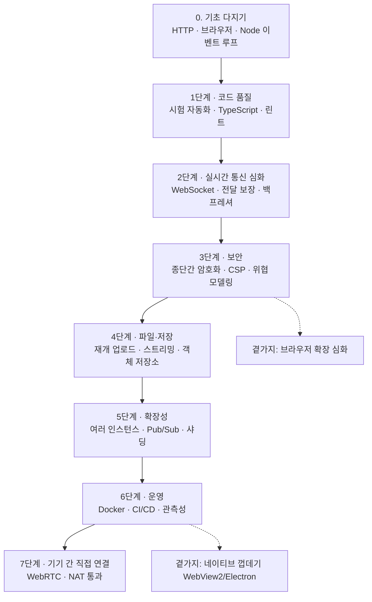

# text-tunnel로 이어 가는 공부 로드맵

> 작성 2026-10-20 · [ARCHITECTURE.md](ARCHITECTURE.md)(개념)와 [FLOWS.md](FLOWS.md)(흐름·실제 코드)를 읽은 다음 단계.
> 주제마다 **왜 공부하나 → 핵심 개념 → 이 프로젝트에서 직접 해 볼 실습 → 다 했는지 확인하는 기준 → 참고 자료** 순서다.
> 실습은 모두 기능 브랜치에서 하고 PR 로 올리면 된다(main 머지 = 실제 서비스 배포이므로 주의).
> 단계마다 **📄 지금 코드** 를 누르면 그 실습에서 손대게 될 현재 코드가 펼쳐진다 (2026-10-20 시점 사본).

## 한눈에 보는 순서



| 단계 | 주제 | 대략 기간 | 난이도 |
|---|---|---|---|
| 0 | HTTP·브라우저·Node 기초 | 1~2주 | ★ |
| 1 | 시험 자동화·TypeScript | 1~2주 | ★★ |
| 2 | 실시간 통신 심화 | 2주 | ★★★ |
| 3 | 보안·종단간 암호화 | 2~3주 | ★★★★ |
| 4 | 파일 전송·저장 | 1~2주 | ★★★ |
| 5 | 확장성(여러 서버) | 2주 | ★★★★ |
| 6 | 운영(Docker·CI·관측성) | 1~2주 | ★★★ |
| 7 | WebRTC | 2~3주 | ★★★★ |

---

## 0단계. 기초 다지기

**왜**: 이 프로젝트의 모든 부분이 HTTP 요청·응답, 브라우저 API, Node 의 이벤트 루프 위에 있다. 여기가 흐리면 나머지가 다 외우는 공부가 된다.

**핵심 개념**
- HTTP 메서드·상태 코드(200/206/401/404/409/413/416/429/507 — 이 프로젝트가 실제로 쓰는 것), 헤더(`Content-Type`, `Cache-Control`, `Range`, `Content-Disposition`)
- HTTPS·TLS 가 무엇을 지켜 주고 무엇은 못 지켜 주는가(회사 네트워크가 도메인은 보는 이유: SNI)
- 브라우저 저장소: `localStorage` / `sessionStorage` / Cache Storage / IndexedDB / 쿠키의 차이와 수명
- 같은 출처 정책(Same-Origin Policy), CORS
- Node 이벤트 루프: 왜 락이 없어도 `rooms` Map 이 안전한가, 왜 큰 동기 작업은 위험한가

**실습**
1. `curl -v` 로 [FLOWS.md L장](FLOWS.md#l-직접-따라-해-보기)의 API 를 하나씩 호출하고, 응답 헤더를 전부 읽어 보기
2. 브라우저 개발자 도구 **Network** 탭에서 `/api/events` 를 열어 SSE 이벤트가 쌓이는 모습 보기 (EventStream 탭)
3. **Application** 탭에서 `localStorage` 의 `tt.key` 를 지워 보고, 앱이 어떻게 반응하는지 FLOWS C장과 비교
4. `server.js` 의 `readBody` 에 `console.time` 을 넣고 9MB 업로드 때 `Buffer.concat` 이 얼마나 걸리는지 재 보기

**확인 기준**: FLOWS.md A장의 상태 코드 표를 보지 않고 설명할 수 있다.

**자료**
- MDN Web Docs — HTTP 개요, HTTP 상태 코드, Range requests, Cache-Control (https://developer.mozilla.org/ko/docs/Web/HTTP)
- Ilya Grigorik, *High Performance Browser Networking* (온라인 무료, https://hpbn.co) — TCP·TLS·HTTP/2·SSE·WebSocket·WebRTC 까지 이 프로젝트 범위를 거의 다 다룸
- Node.js 공식 문서 — The Node.js Event Loop (https://nodejs.org/en/learn/asynchronous-work/event-loop-timers-and-nexttick)

**지금 코드 (이 실습의 출발점)**

<details>
<summary>📄 실제 코드 — <code>server.js</code> 100–125 · readBody · readJson · send — HTTP 를 손으로 다루는 부분</summary>

[GitHub에서 보기](../server.js#L100-L125)

```js
/* ── HTTP 도구 ──────────────────────────── */
function readBody(req, limit, cb) {
  const chunks = [];
  let size = 0, over = false;
  req.on('data', (c) => {
    if (over) return;
    size += c.length;
    if (size > limit) { over = true; cb(new Error('too large')); req.destroy(); return; }
    chunks.push(c);
  });
  req.on('end', () => { if (!over) cb(null, Buffer.concat(chunks)); });
  req.on('error', (e) => { if (!over) cb(e); });
}

function readJson(req, cb) {
  readBody(req, 4096, (err, body) => {
    if (err) return cb(null);
    try { cb(JSON.parse(body)); } catch { cb(null); }
  });
}

function send(res, code, body) {
  const json = typeof body === 'object';
  res.writeHead(code, { 'Content-Type': json ? 'application/json; charset=utf-8' : 'text/plain; charset=utf-8', 'Cache-Control': 'no-store' });
  res.end(json ? JSON.stringify(body) : body);
}
```

</details>

<details>
<summary>📄 실제 코드 — <code>server.js</code> 138–156 · 상태 코드 200/206/416 과 헤더</summary>

[GitHub에서 보기](../server.js#L138-L156)

```js
// 동영상은 iOS Safari가 Range 요청으로만 재생하므로 부분 응답을 지원한다.
function serveFile(f, req, res) {
  const total = f.buf.length;
  const head = {
    'Content-Type': f.mime,
    'Accept-Ranges': 'bytes',
    'Cache-Control': 'no-store', // 사진·동영상이 브라우저 캐시 폴더에 남지 않게
    'Content-Disposition': `inline; filename*=UTF-8''${encodeURIComponent(f.name)}`,
  };
  const m = /bytes=(\d*)-(\d*)/.exec(req.headers.range || '');
  if (!m) { res.writeHead(200, { ...head, 'Content-Length': total }); return res.end(f.buf); }
  const start = m[1] ? Number(m[1]) : total - Number(m[2]);
  const end = m[1] && m[2] ? Number(m[2]) : total - 1;
  if (start < 0 || start >= total || end >= total || start > end) {
    res.writeHead(416, { 'Content-Range': `bytes */${total}` }); return res.end();
  }
  res.writeHead(206, { ...head, 'Content-Range': `bytes ${start}-${end}/${total}`, 'Content-Length': end - start + 1 });
  res.end(f.buf.subarray(start, end + 1));
}
```

</details>


---

## 1단계. 코드 품질: 시험 자동화 · TypeScript

**왜**: 지금 시험은 스크립트가 PASS/FAIL 을 찍을 뿐이고, 사람이 실행해야 한다. 기능을 바꿀 때마다 깨진 걸 자동으로 알려 주는 장치가 있어야 큰 변경(2~5단계)을 겁 없이 할 수 있다.

**핵심 개념**: 시험 피라미드(단위 → 통합 → E2E), 시험 러너, 타입 시스템, 정적 분석

**실습**
1. `tests/*.test.js` 를 Node 기본 시험 러너 **`node:test` + `node:assert`** 로 바꾸기 (`node --test tests/`). 서버를 시험 안에서 띄우고 끄기(`before`/`after`)
2. `extension/background.js` 의 `isOurs` / `isOurSearch` 를 별도 모듈로 빼고 단위 시험 작성 (FLOWS I-5 의 14케이스를 옮기기)
3. GitHub Actions 로 **PR 마다 시험 자동 실행** (`.github/workflows/test.yml`)
4. `server.js` 에 JSDoc 타입 주석 + `// @ts-check` 를 넣어 VS Code 가 타입 오류를 잡게 하기 → 익숙해지면 TypeScript 로 옮기기
5. Playwright 로 "PC 탭과 휴대폰 탭을 띄워 메시지 주고받기" E2E 시험 (지금은 CDP 를 손으로 다룸)

**확인 기준**: PR 을 올리면 GitHub 에 초록 체크가 뜨고, 일부러 버그를 넣으면 빨간 X 가 뜬다.

**자료**
- Node.js 문서 — Test runner (`node:test`)
- Playwright 공식 문서 (https://playwright.dev)
- GitHub Actions 문서 — Building and testing Node.js
- TypeScript Handbook (https://www.typescriptlang.org/docs/handbook/)

**지금 코드 (이 실습의 출발점)**

<details>
<summary>📄 실제 코드 — <code>tests/pair.test.js</code> 전체 · 지금 시험 (PASS/FAIL 만 찍음 → node:test 로)</summary>

[GitHub에서 보기](../tests/pair.test.js)

```js
// 짝 맺기 시험: node tests/pair.test.js http://localhost:8787
// 마지막 항목은 이 PC 의 IP 를 10분간 짝 코드 차단 상태로 만든다. 실제 서버에서는 SKIP_RL=1 로 건너뛸 것
const crypto = require('crypto');
const B = process.argv[2];
const ok = (c, msg) => console.log(c ? 'PASS' : 'FAIL', msg);
const sleep = (ms) => new Promise((r) => setTimeout(r, ms));
const post = (p, body) => fetch(`${B}/api/${p}`, { method: 'POST', body: JSON.stringify(body) }).then(async (r) => ({ status: r.status, ...(await r.json().catch(() => ({}))) }));

function listen(token) {
  const events = [];
  const ac = new AbortController();
  fetch(`${B}/api/events?token=${token}`, { signal: ac.signal }).then(async (r) => {
    const dec = new TextDecoder();
    for await (const c of r.body) for (const l of dec.decode(c).split('\n')) if (l.startsWith('data: ')) events.push(JSON.parse(l.slice(6)));
  }).catch(() => {});
  return { events, close: () => ac.abort() };
}
const lastPresence = (l) => l.events.filter((e) => e.type === 'presence').pop()?.users.map((u) => u.name) || [];

(async () => {
  // PC가 QR을 띄움
  const s = await post('pair/start', {});
  ok(s.status === 200 && /^[2-9A-Z]{6}$/.test(s.code) && s.key.length === 43, `짝 코드 발급 (${s.code})`);
  ok((await post('pair/claim', { code: 'AAAAAA' })).status === 404, '틀린 코드 → 404');
  const c = await post('pair/claim', { code: s.code.toLowerCase().replace(/(...)/, '$1 ') });
  ok(c.status === 200 && c.key === s.key, '휴대폰이 코드로 같은 열쇠 받음 (소문자·띄어쓰기 허용)');
  ok((await post('pair/claim', { code: s.code })).status === 404, '같은 코드 두 번 못 씀');

  // 둘 다 열쇠로 입장
  const pc = await post('join', { key: s.key, name: 'PC', device: 'dev-pc' });
  const ph = await post('join', { key: c.key, name: '휴대폰', device: 'dev-phone' });
  ok(pc.status === 200 && ph.status === 200, 'PC·휴대폰 입장');
  const lpc = listen(pc.token), lph = listen(ph.token);
  await sleep(1500);
  ok(lastPresence(lpc).length === 2, `접속자 2명 (${lastPresence(lpc)})`);

  const third = await post('join', { key: s.key, name: '남의폰', device: 'dev-x' });
  ok(third.status === 409, '세 번째 기기는 못 들어옴 (409)');

  await fetch(`${B}/api/send?token=${ph.token}`, { method: 'POST', body: JSON.stringify({ text: '안녕 PC' }) });
  await sleep(500);
  ok(lpc.events.some((e) => e.type === 'msg' && e.text === '안녕 PC'), 'PC가 휴대폰 메시지 받음');

  // 같은 기기가 다시 열면 자리를 이어받는다 (새로고침·앱 재실행)
  const pc2 = await post('join', { key: s.key, name: 'PC', device: 'dev-pc' });
  ok(pc2.status === 200, '같은 기기 재입장 허용');
  ok((await fetch(`${B}/api/ping?token=${pc.token}`)).status === 401, '이전 입장권은 무효');
  const lpc2 = listen(pc2.token);
  await sleep(1500);
  ok(lastPresence(lpc2).length === 2, `재입장 후에도 2명 (${lastPresence(lpc2)})`);

  // 새 기기 연결: 기존 열쇠로 코드 다시 발급
  const s2 = await post('pair/start', { key: s.key });
  const c2 = await post('pair/claim', { code: s2.code });
  ok(c2.key === s.key, '새 기기 연결 시 같은 열쇠 전달');

  // 다른 짝은 서로 안 보임
  const other = await post('pair/start', {});
  const o = await post('join', { key: other.key, name: '남', device: 'dev-o' });
  const lo = listen(o.token); await sleep(800);
  await fetch(`${B}/api/send?token=${pc2.token}`, { method: 'POST', body: JSON.stringify({ text: '비밀' }) });
  await sleep(500);
  ok(!lo.events.some((e) => e.type === 'msg'), '다른 짝에게는 전달 안 됨');

  // 둘 다 나가면 방 폭파 → 다음 입장은 빈 방
  await fetch(`${B}/api/leave?token=${pc2.token}`, { method: 'POST' });
  await fetch(`${B}/api/leave?token=${ph.token}`, { method: 'POST' });
  await sleep(300);
  const again = await post('join', { key: s.key, name: 'PC', device: 'dev-pc' });
  const la = listen(again.token); await sleep(1000);
  ok(again.status === 200 && lastPresence(la).length === 1, '둘 다 나간 뒤 다시 열면 새 방 (1명)');

  ok((await post('join', { key: 'short', name: 'x', device: 'd' })).status === 400, '이상한 열쇠 → 400');

  // 틀린 코드 반복 시 차단
  let last;
  if (process.env.SKIP_RL) { for (const l of [lpc, lph, lpc2, lo, la]) l.close(); process.exit(0); }
  for (let i = 0; i < 12; i++) last = (await post('pair/claim', { code: 'ZZZZZ' + i })).status;
  ok(last === 429, '틀린 코드 반복하면 잠시 차단 (429)');

  for (const l of [lpc, lph, lpc2, lo, la]) l.close();
  process.exit(0);
})();
```

</details>

<details>
<summary>📄 실제 코드 — <code>extension/background.js</code> 1–26 · 모듈로 떼어 단위 시험할 함수들</summary>

[GitHub에서 보기](../extension/background.js#L1-L26)

```js
// Text Tunnel 의 흔적(방문 기록·관련 검색 기록·다운로드 목록·캐시)을 지우고, 단축키로 완전히 정리한다.
// 다른 사이트 기록과 다른 검색어는 건드리지 않는다.
const ORIGINS = ['https://text-tunnel.onrender.com', 'http://localhost:8787'];
const TAB_URLS = ['https://text-tunnel.onrender.com/*', 'http://localhost/*'];

function isOurs(url) {
  try {
    const u = new URL(url);
    if (u.hostname === 'text-tunnel.onrender.com') return true;
    // 개발용 로컬 서버는 8787 포트만 (다른 localhost 개발 기록은 남긴다)
    return (u.hostname === 'localhost' || /^192\.168\./.test(u.hostname)) && u.port === '8787';
  } catch { return false; }
}

// 검색엔진 결과 페이지 중 검색어에 Text Tunnel 이 들어간 것만
const SEARCH_HOST = /(^|\.)google\.[a-z.]+$|(^|\.)bing\.com$|^search\.naver\.com$|^m\.search\.naver\.com$|^search\.daum\.net$|^m\.search\.daum\.net$/;
const OUR_TERMS = /text[\s\-_+.]*tunnel|onrender/i;
function isOurSearch(url) {
  try {
    const u = new URL(url);
    if (!SEARCH_HOST.test(u.hostname)) return false;
    const q = u.searchParams.get('q') || u.searchParams.get('query') || '';
    return OUR_TERMS.test(q);
  } catch { return false; }
}
const shouldDelete = (url) => isOurs(url) || isOurSearch(url);
```

</details>


---

## 2단계. 실시간 통신 심화

**왜**: 지금 메시지는 "받는 쪽이 없으면 사라짐(at-most-once)"이고, 순서·중복을 따지지 않는다. 메신저의 신뢰성이 어떻게 만들어지는지 배우는 단계다.

**핵심 개념**
- 전달 보장: at-most-once / at-least-once / exactly-once(현실적으로는 at-least-once + 멱등 처리)
- 확인 응답(ACK), 재전송, 메시지 ID 로 중복 제거, 순서 번호(sequence number)
- WebSocket 프로토콜(업그레이드 핸드셰이크, 프레임, ping/pong)과 SSE 의 차이
- 백프레셔: 받는 쪽이 느릴 때 보내는 쪽을 늦추기 (`res.write()` 의 반환값과 `drain` 이벤트)
- 하트비트·타임아웃 기반 장애 감지 심화 (phi accrual failure detector)

**실습**
> ✅ 1번과 3번의 기본형은 이슈 #9 로 구현됐다 — 이벤트 번호(`id: 방시작표시:순번`) + 방별 최근 2분 보관 + `Last-Event-ID` 재전송 + 메시지 ID 중복 제거. `server.js` 의 `broadcast` · `trimLog` · `replay`, `public/app.js` 의 `connect` · `isMine` 을 읽고 시작하면 된다. 남은 과제는 2번(ack·읽음 표시)·4번·5번과, "2분" 이라는 타협을 어떻게 정할지다.

1. 메시지에 순서 번호를 붙이고, 받는 쪽이 번호가 빠지면 알아차리게 하기
2. 받는 쪽이 `ack` 를 보내고, 보낸 쪽 말풍선에 **"읽음/전달됨" 표시** 만들기 (카톡의 1 지우기)
3. 상대가 잠깐 끊긴 동안 온 메시지를 **30초 유예 시간 동안만** 서버 메모리에 줄 세워 두었다가 재연결 때 보내기 — "기록 안 남기기" 원칙과 어떻게 타협할지 직접 정해 보기
4. 같은 기능을 **WebSocket** 으로 다시 구현해 보기 (Node 22+ 는 `ws` 없이 클라이언트만 기본 제공 → 서버는 `ws` 패키지 또는 업그레이드 핸드셰이크 직접 구현)
5. `broadcast()` 에서 `res.write()` 가 `false` 를 돌려줄 때 어떻게 할지(버리기? 끊기?) 정해 구현

**확인 기준**: 휴대폰 비행기 모드를 10초 켰다 꺼도 그 사이 메시지가 빠짐없이, 순서대로, 한 번씩만 도착한다.

**자료**
- *High Performance Browser Networking* — WebSocket, SSE 장
- RFC 6455 (The WebSocket Protocol)
- WHATWG HTML 표준 — Server-sent events
- Martin Kleppmann, *Designing Data-Intensive Applications* (데이터 중심 애플리케이션 설계) — 8장 분산 시스템의 문제, 11장 스트림 처리

**지금 코드 (이 실습의 출발점)**

<details>
<summary>📄 실제 코드 — <code>server.js</code> 55–58 · broadcast — 받는 쪽이 없으면 사라짐, 백프레셔 없음</summary>

[GitHub에서 보기](../server.js#L55-L58)

```js
function broadcast(room, ev) {
  const line = `data: ${JSON.stringify(ev)}\n\n`;
  for (const m of room.members.values()) m.res?.write(line);
}
```

</details>

<details>
<summary>📄 실제 코드 — <code>server.js</code> 308–317 · /api/send — 메시지 ID 는 있지만 순서 번호·ack 없음</summary>

[GitHub에서 보기](../server.js#L308-L317)

```js
  if (p === '/api/send' && req.method === 'POST') {
    return readBody(req, 64 * 1024, (err, body) => {
      if (err) return send(res, 413, '메시지가 너무 길어요');
      let m;
      try { m = JSON.parse(body); } catch { return send(res, 400, 'bad json'); }
      if (typeof m.text !== 'string' || !m.text.trim()) return send(res, 400, 'empty');
      broadcast(room, { type: 'msg', mid: crypto.randomUUID(), from: member.id, name: member.name, text: m.text, at: Date.now() });
      send(res, 200, 'ok');
    });
  }
```

</details>

<details>
<summary>📄 실제 코드 — <code>public/app.js</code> 161–176 · 화면: 이벤트 받기</summary>

[GitHub에서 보기](../public/app.js#L161-L176)

```js
function connect() {
  es?.close();
  es = new EventSource(api('events'));
  es.onerror = async () => {
    setStatus('off');
    // 서버가 재시작됐거나 방이 정리됐으면 다시 들어간다
    const r = await fetch(api('ping')).catch(() => null);
    if (r?.status === 401) { es.close(); token = null; setTimeout(joinRoom, 500); }
  };
  es.onmessage = (ev) => {
    const m = JSON.parse(ev.data);
    if (m.type === 'presence') onPresence(m.users);
    else if (m.type === 'clear') { clearList(); toast(m.from === myId ? '대화를 지웠어요' : `${m.name}에서 대화를 지웠어요`); }
    else add(m);
  };
}
```

</details>


---

## 3단계. 보안: 종단간 암호화(E2EE) · 웹 보안

**왜**: 지금은 HTTPS 로 전송 구간만 암호화되고, **서버 메모리 안에서는 메시지가 평문**이다. 이 앱의 목표("아무 데도 안 남기기")를 끝까지 밀어붙이면 "서버조차 내용을 못 보게" 가 된다.

**핵심 개념**
- 대칭 암호(AES-GCM)와 인증 암호(AEAD), nonce/IV 를 절대 재사용하면 안 되는 이유
- 키 유도(HKDF), 키 교환(ECDH), 순방향 비밀성(forward secrecy)
- 해시 vs 암호화 vs MAC — 지금 방 번호에 SHA-256 을 쓰는 것과의 차이
- 웹 보안: XSS, CSP(Content-Security-Policy), CSRF, 클릭재킹, 보안 헤더
- 위협 모델링(STRIDE): 누구로부터 무엇을 지키나 (회사 네트워크 / Render / 휴대폰 분실 / 열쇠 유출)

**실습**
1. **E2EE 1차**: 짝 맺을 때 공유한 열쇠에서 Web Crypto `HKDF` 로 암호화 키를 만들고, 텍스트를 `AES-GCM` 으로 암호화해 보낸다. 서버 코드는 거의 그대로(암호문만 중계) — 서버 로그에 `console.log(m.text)` 를 찍어 알아볼 수 없는 문자열인지 확인
2. **E2EE 2차**: 사진·파일 조각도 암호화. 조각마다 다른 nonce 를 어떻게 만들지 설계
3. **열쇠 분리**: 지금은 "방 찾기용"과 "암호화용" 열쇠가 같다. HKDF 로 용도별 키를 따로 유도해 서버가 받는 값(방 번호)으로는 암호화 키를 알 수 없게
4. `server.js` 정적 파일 응답에 **CSP 헤더** 추가 (`default-src 'self'` 부터 시작해 깨지는 곳 고치기), `X-Content-Type-Options`, `Referrer-Policy`
5. 이 문서의 ARCHITECTURE §4 "못 막는 것" 목록을 STRIDE 표로 다시 쓰기

**확인 기준**: 서버 코드에 `console.log` 를 아무리 넣어도 메시지·사진 내용을 알 수 없고, 앱은 그대로 동작한다.

**자료**
- MDN — Web Crypto API (SubtleCrypto: `importKey`, `deriveKey`, `encrypt`)
- Signal 프로토콜 문서 — X3DH, Double Ratchet (https://signal.org/docs/)
- OWASP Top 10, OWASP Cheat Sheet Series — XSS Prevention, Content Security Policy
- Dan Boneh & Victor Shoup, *A Graduate Course in Applied Cryptography* (온라인 무료) — 앞부분만 읽어도 AES-GCM·HKDF 이해에 충분

**지금 코드 (이 실습의 출발점)**

<details>
<summary>📄 실제 코드 — <code>public/app.js</code> 345–355 · 평문 전송 지점 (여기서 암호화)</summary>

[GitHub에서 보기](../public/app.js#L345-L355)

```js
async function sendText(e) {
  e.preventDefault();
  sendTray(); // 미리보기에 골라 둔 사진·파일도 같이 보낸다
  const text = $('text').value;
  if (!text.trim()) return;
  $('text').value = ''; syncInput();
  if (DEMO) return add({ type: 'msg', from: myId, text, at: Date.now() });
  const r = await fetch(api('send'), { method: 'POST', body: JSON.stringify({ text }) }).catch(() => null);
  if (!r?.ok) { $('text').value = text; syncInput(); return toast('보내지 못했어요'); }
  if (!others) toast('상대 기기가 없어서 아무도 받지 못했어요');
}
```

</details>

<details>
<summary>📄 실제 코드 — <code>server.js</code> 237–245 · 열쇠 → 방 번호 해시 (용도별 키 분리 실습)</summary>

[GitHub에서 보기](../server.js#L237-L245)

```js
  // 방 입장: { key, name, device } — 방 번호는 열쇠의 해시. 열쇠 자체는 어디에도 보관하지 않는다
  if (p === '/api/join' && req.method === 'POST') {
    return readJson(req, (j) => {
      const key = String(j?.key || '');
      const device = String(j?.device || '').slice(0, 64);
      const name = String(j?.name || '').trim().slice(0, 20) || '기기';
      if (!/^[A-Za-z0-9_-]{43}$/.test(key) || !device) return send(res, 400, { error: '연결 정보가 올바르지 않아요. 다시 연결해 주세요' });
      const id = crypto.createHash('sha256').update(key).digest('hex');
```

</details>

<details>
<summary>📄 실제 코드 — <code>server.js</code> 127–136 · 정적 파일 응답 (CSP 헤더 넣을 곳)</summary>

[GitHub에서 보기](../server.js#L127-L136)

```js
function serveStatic(url, res) {
  const rel = url.pathname === '/' ? 'index.html' : url.pathname.slice(1);
  const file = path.join(PUB, path.normalize(rel));
  if (!file.startsWith(PUB)) return send(res, 403, 'forbidden');
  fs.readFile(file, (err, data) => {
    if (err) return send(res, 404, 'not found');
    res.writeHead(200, { 'Content-Type': MIME[path.extname(file)] || 'application/octet-stream', 'Cache-Control': 'no-cache' });
    res.end(data);
  });
}
```

</details>


---

## 4단계. 파일 전송·저장

**왜**: 지금 업로드는 실패하면 처음부터, 파일 전체를 서버 메모리에 올렸다가 내려준다. 큰 파일·나쁜 네트워크에서 어떻게 버티는지가 실서비스의 핵심이다.

**핵심 개념**
- 재개 가능 업로드(tus 프로토콜), S3 멀티파트 업로드
- 스트리밍: 다 모으지 않고 흘려보내기 (Node Streams, `pipe`, 백프레셔)
- 객체 저장소(S3·R2)와 서명된 URL(presigned URL) — 서버를 거치지 않고 저장소로 바로 올리기
- 콘텐츠 해시로 무결성 확인(업로드 전후 SHA-256 비교)
- 이미지 처리: 화질·크기·EXIF(위치 정보!) 제거

**실습**
1. 조각 하나가 실패하면 **그 조각만 다시 보내기** — 서버에 "어디까지 받았나" 물어보는 `HEAD` 또는 `GET /api/upload?uid=` 추가
2. 받는 쪽이 이미 연결돼 있으면 서버가 **모으지 않고 바로 흘려보내기**(메모리에 전체를 안 올림) — 어려움: 받는 쪽이 둘 이상이거나 나중에 받는 경우
3. 업로드 전 브라우저에서 파일 SHA-256 을 계산해 같이 보내고, 받는 쪽이 검증
4. 일반 화질로 줄일 때 **사진 위치 정보(EXIF GPS)가 빠지는지** 확인하기 — canvas 로 다시 그리면 빠진다. 원본 화질일 때는? (개인정보 관점에서 중요)

**확인 기준**: 100MB 동영상을 보내는 중 Wi-Fi 를 껐다 켜도 이어서 올라간다.

**자료**
- tus.io — Resumable upload protocol
- Node.js 문서 — Stream
- AWS S3 문서 — Multipart upload, Presigned URLs
- MDN — `File`, `Blob.slice`, `ReadableStream`

**지금 코드 (이 실습의 출발점)**

<details>
<summary>📄 실제 코드 — <code>public/app.js</code> 377–396 · 조각 업로드 (실패하면 처음부터)</summary>

[GitHub에서 보기](../public/app.js#L377-L396)

```js
function uploadOne(file, batch, onProgress) {
  const CHUNK = 8 * 1024 * 1024;
  const uid = randId();
  return new Promise((resolve, reject) => {
    const sendChunk = (offset) => {
      const part = file.slice(offset, offset + CHUNK);
      const xhr = new XMLHttpRequest();
      xhr.open('POST', api('upload', { uid, offset, total: file.size, name: file.name, ...(batch ? { batch } : {}) }));
      xhr.setRequestHeader('Content-Type', file.type || 'application/octet-stream');
      xhr.upload.onprogress = (e) => onProgress(offset + e.loaded);
      xhr.onload = () => {
        if (xhr.status !== 200) return reject(new Error(xhr.responseText || '실패'));
        if (xhr.responseText === 'done') resolve(); else sendChunk(offset + part.size);
      };
      xhr.onerror = () => reject(new Error('연결이 끊겼어요'));
      xhr.send(part);
    };
    sendChunk(0);
  });
}
```

</details>

<details>
<summary>📄 실제 코드 — <code>server.js</code> 319–359 · 서버가 조각을 전부 메모리에 모음</summary>

[GitHub에서 보기](../server.js#L319-L359)

```js
  // 파일은 8MB 조각으로 순서대로 올라온다 (프록시의 요청 크기 제한을 피하려고)
  // ?uid=업로드ID&offset=시작바이트&total=전체크기&name=파일명
  if (p === '/api/upload' && req.method === 'POST') {
    const uid = url.searchParams.get('uid');
    const offset = Number(url.searchParams.get('offset'));
    const total = Number(url.searchParams.get('total'));
    if (!uid || !Number.isInteger(offset) || !Number.isInteger(total) || total <= 0) return send(res, 400, 'bad params');
    if (total > MAX_MB * 1024 * 1024) return send(res, 413, `파일은 ${MAX_MB}MB까지 보낼 수 있어요`);

    let up = room.uploads.get(uid);
    if (offset === 0 && !up) {
      if (fileBytes + total > MEM_MB * 1024 * 1024) return send(res, 507, '서버가 파일을 더 들고 있을 수 없어요. 잠시 뒤에 보내 주세요');
      up = {
        chunks: [], received: 0, total,
        name: (url.searchParams.get('name') || 'file').slice(0, 200),
        batch: /^[\w-]{1,40}$/.test(url.searchParams.get('batch') || '') ? url.searchParams.get('batch') : undefined, // 한 번에 고른 사진 묶음
        mime: req.headers['content-type'] || 'application/octet-stream',
        timer: setTimeout(() => room.uploads.delete(uid), FILE_TTL),
      };
      room.uploads.set(uid, up);
    }
    if (!up || up.total !== total || up.received !== offset) return send(res, 409, '업로드 순서가 어긋났어요. 다시 보내 주세요');

    return readBody(req, Math.min(CHUNK_MAX, total - offset), (err, buf) => {
      if (err) { clearTimeout(up.timer); room.uploads.delete(uid); return send(res, 413, 'chunk too large'); }
      if (!rooms.has(room.id)) return send(res, 410, '연결이 끝났어요');
      up.chunks.push(buf);
      up.received += buf.length;
      if (up.received < up.total) return send(res, 200, 'more');

      clearTimeout(up.timer);
      room.uploads.delete(uid);
      const fid = crypto.randomUUID();
      const file = { buf: Buffer.concat(up.chunks), mime: up.mime, name: up.name };
      fileBytes += file.buf.length;
      file.timer = setTimeout(() => { room.files.delete(fid); fileBytes -= file.buf.length; }, FILE_TTL);
      room.files.set(fid, file);
      broadcast(room, { type: 'file', mid: crypto.randomUUID(), fid, fname: file.name, mime: file.mime, size: file.buf.length, batch: up.batch, from: member.id, name: member.name, at: Date.now() });
      send(res, 200, 'done');
    });
  }
```

</details>

<details>
<summary>📄 실제 코드 — <code>public/app.js</code> 359–374 · canvas 로 줄이기 (EXIF 가 빠지는지 확인)</summary>

[GitHub에서 보기](../public/app.js#L359-L374)

```js
// 카톡 '일반 화질'처럼 큰 사진은 긴 변 2048px JPEG로 줄인다. 줄일 수 없거나 더 커지면 원본 그대로
async function shrink(file) {
  if (!/^image\/(jpeg|png|webp)$/.test(file.type) || file.size < 1.5 * 1024 * 1024) return file;
  try {
    const bmp = await createImageBitmap(file, { imageOrientation: 'from-image' });
    const scale = Math.min(1, 2048 / Math.max(bmp.width, bmp.height));
    const c = document.createElement('canvas');
    c.width = Math.round(bmp.width * scale); c.height = Math.round(bmp.height * scale);
    c.getContext('2d').drawImage(bmp, 0, 0, c.width, c.height);
    bmp.close?.();
    const blob = await new Promise((ok) => c.toBlob(ok, 'image/jpeg', 0.85));
    if (!blob || blob.size >= file.size) return file;
    return new File([blob], file.name.replace(/\.[^.]+$/, '') + '.jpg', { type: 'image/jpeg' });
  } catch { return file; }
}
```

</details>


---

## 5단계. 확장성: 서버를 여러 대로

**왜**: 이 프로젝트에서 Vercel 이 안 된 이유가 바로 이 주제다(ARCHITECTURE §1). "왜 안 되는지" 는 알았으니 "어떻게 되게 하는지" 를 직접 만들어 본다.

**핵심 개념**
- 상태를 서버 밖으로 빼기: Redis(키-값 저장소), Pub/Sub
- 로드 밸런서, sticky session(같은 사용자는 같은 서버로)
- 샤딩: 방 번호로 서버를 정하기, consistent hashing
- 서버리스와 엣지 런타임에서 실시간을 하는 방법 (Cloudflare Durable Objects 같은 "상태를 가진 서버리스")

**실습**
1. 로컬에서 서버를 **포트 두 개로 두 번** 띄우고(8787, 8788), PC 는 8787·휴대폰은 8788 에 붙여 메시지가 안 가는 것을 직접 확인 (Vercel 문제 재현)
2. Docker 로 Redis 를 띄우고, `broadcast()` 를 "Redis 채널에 발행 → 각 서버가 구독해서 자기 SSE 들에 전달" 로 바꿔 두 서버 사이에 메시지가 가게 하기
3. 방·토큰·짝 코드 상태도 Redis 로 옮기고(`SET key value EX 300` 으로 TTL), 서버 한 대를 꺼도 다른 서버로 이어지는지 확인
4. 같은 기능을 Cloudflare Workers + Durable Objects 로 만들어 보고 Render 버전과 비교

**확인 기준**: 서버 두 대 중 아무 데나 붙어도 대화가 되고, 한 대를 꺼도 끊긴 쪽이 다른 서버로 재연결된다.

**자료**
- Redis 문서 — Pub/Sub, 키 만료(EXPIRE)
- *Designing Data-Intensive Applications* — 5장 복제, 6장 파티셔닝
- Cloudflare 문서 — Durable Objects, WebSockets
- Alex Xu, *System Design Interview* (가상 면접 사례로 배우는 대규모 시스템 설계 기초) — 채팅 시스템 설계 장

**지금 코드 (이 실습의 출발점)**

<details>
<summary>📄 실제 코드 — <code>server.js</code> 22–26 · 모든 상태가 이 프로세스 메모리에 (밖으로 뺄 대상)</summary>

[GitHub에서 보기](../server.js#L22-L26)

```js
const rooms = new Map();  // roomId -> { members: Map<token, Member>, files: Map, uploads: Map }
const tokens = new Map(); // token -> roomId
const pairs = new Map();  // 6자리 코드 -> { key, timer }
const misses = new Map(); // ip -> { n, until } 틀린 코드 시도 제한
let fileBytes = 0;
```

</details>

<details>
<summary>📄 실제 코드 — <code>server.js</code> 55–63 · 같은 서버의 SSE 에만 전달</summary>

[GitHub에서 보기](../server.js#L55-L63)

```js
function broadcast(room, ev) {
  const line = `data: ${JSON.stringify(ev)}\n\n`;
  for (const m of room.members.values()) m.res?.write(line);
}

function presence(room) {
  const users = [...room.members.values()].filter((m) => m.res).map((m) => ({ id: m.id, name: m.name }));
  broadcast(room, { type: 'presence', users });
}
```

</details>


---

## 6단계. 운영: Docker · CI/CD · 관측성

**왜**: 지금은 Render 가 대신 해 주는 일(빌드·배포·재시작)을 직접 이해해야, 다른 곳으로 옮기거나 문제가 생겼을 때 대응할 수 있다.

**핵심 개념**
- 컨테이너(Dockerfile, 이미지, 레이어), 12-Factor App
- CI/CD 파이프라인: 시험 → 빌드 → 배포 → 상태 확인 → 되돌리기
- 관측성: 로그·지표(metrics)·추적(tracing) — **개인정보를 남기지 않으면서** 운영 상태를 보는 법
- 무중단 배포, 헬스 체크, 우아한 종료(graceful shutdown)

**실습**
1. `Dockerfile` 작성 (`node:22-alpine`, `node server.js`), 로컬에서 `docker run -p 8787:8787` 로 실행
2. `SIGTERM` 을 받으면 열린 SSE 에 "서버 재시작 중" 이벤트를 보내고 닫는 **우아한 종료** 구현 — 배포 때 앱이 더 빨리 재연결하게
3. 내용 없이 숫자만 세는 지표 엔드포인트 `/api/metrics` (방 개수, 연결 수, 서버 메모리의 파일 총량) — 무엇을 세면 개인정보가 되고 무엇은 괜찮은지 판단해 보기
4. GitHub Actions: 시험 통과 → main 머지 → Render 배포 → `/api/health` 로 배포 확인 → 실패 시 알림
5. (선택) 같은 컨테이너를 오라클 무료 VM 에 직접 올려 보기 — Render 가 대신 해 준 일(HTTPS 인증서, 재시작, 포트)을 손으로 해 보면 PaaS 의 가치가 보인다

**확인 기준**: 저장소만 있으면 어떤 서버에서든 명령 한두 줄로 똑같이 띄울 수 있다.

**자료**
- Docker 공식 문서 — Get started, Dockerfile best practices
- The Twelve-Factor App (https://12factor.net/ko/)
- Google SRE Book (온라인 무료, https://sre.google/books/) — 모니터링, 배포 장
- Node.js 문서 — Process signals

**지금 코드 (이 실습의 출발점)**

<details>
<summary>📄 실제 코드 — <code>package.json</code> 전체 · 지금 배포 설정</summary>

[GitHub에서 보기](../package.json)

```json
{
  "name": "text-tunnel",
  "version": "1.0.0",
  "private": true,
  "description": "DB 없이 같은 방에 접속한 기기끼리 텍스트·사진·동영상을 주고받는 메신저",
  "main": "server.js",
  "scripts": {
    "start": "node server.js"
  },
  "engines": {
    "node": ">=20"
  }
}
```

</details>

<details>
<summary>📄 실제 코드 — <code>server.js</code> 10–20 · 환경변수</summary>

[GitHub에서 보기](../server.js#L10-L20)

```js
const PORT = Number(process.env.PORT) || 8787;
const MAX_MB = Number(process.env.MAX_MB) || 100;        // 파일 하나 상한
const MEM_MB = Number(process.env.MEM_MB) || 300;        // 서버가 들고 있는 파일 전체 상한
const MAX_ROOMS = Number(process.env.MAX_ROOMS) || 50;
const ROOM_SIZE = 2;
const FILE_TTL = 10 * 60 * 1000;
const PAIR_TTL = 5 * 60 * 1000;     // 짝 코드 유효 시간
const GRACE = 30 * 1000;            // 연결이 끊긴 기기를 기다려 주는 시간 (화면 꺼짐·새로고침)
const STALE = (Number(process.env.STALE_SEC) || 90) * 1000;          // 이만큼 살아 있다는 신호가 없으면, 방이 꽉 찼을 때 자리를 내준다
const CHUNK_MAX = 16 * 1024 * 1024; // 브라우저는 8MB씩 보낸다. 여유를 둔 상한
const PUB = path.join(__dirname, 'public');
```

</details>

<details>
<summary>📄 실제 코드 — <code>server.js</code> 370–375 · 시작 (우아한 종료가 아직 없음)</summary>

[GitHub에서 보기](../server.js#L370-L375)

```js
server.listen(PORT, () => {
  console.log(`text-tunnel 실행 중: http://localhost:${PORT}`);
  if (process.env.RENDER) return; // Render 안에서는 내부 주소라 의미 없음
  for (const nets of Object.values(require('os').networkInterfaces()))
    for (const n of nets || []) if (n.family === 'IPv4' && !n.internal) console.log(`같은 와이파이에서: http://${n.address}:${PORT}`);
});
```

</details>


---

## 7단계. 기기 간 직접 연결: WebRTC

**왜**: 처음에 검토했다가 "휴대폰 데이터·회사망에서 실패할 수 있어서" 뺀 방식이다. 왜 실패하는지, 어떻게 해결하는지 직접 겪어 보면 네트워크 이해가 한 단계 깊어진다.

**핵심 개념**
- NAT 의 종류, 왜 바깥에서 내 기기로 직접 못 들어오나
- ICE · STUN(바깥 주소 알아내기) · TURN(대신 전달해 주는 중계)
- 시그널링: 연결 정보(SDP)를 교환하는 통로 — **지금 서버의 SSE 가 그대로 시그널링 서버가 될 수 있다**
- DataChannel 로 텍스트·파일 보내기, 신뢰성/순서 옵션

**실습**
1. 지금 서버의 방·SSE 를 시그널링 통로로 써서, 두 기기가 `RTCPeerConnection` + `DataChannel` 로 **직접** 텍스트를 주고받게 하기
2. 같은 와이파이 / 집 와이파이↔휴대폰 데이터 / 회사망 에서 각각 연결되는지 기록 (실패율을 직접 재 보기)
3. 실패할 때 지금의 서버 중계로 **자동 전환**(fallback) — 실서비스들이 쓰는 구조
4. 큰 파일을 DataChannel 로 보내면서 `bufferedAmount` 로 백프레셔 처리

**확인 기준**: 같은 와이파이에서는 서버를 거치지 않고 파일이 오가고(서버 메모리 사용량 0), 안 되는 망에서는 자동으로 서버 중계로 넘어간다.

**자료**
- MDN — WebRTC API, `RTCPeerConnection`, `RTCDataChannel`
- *High Performance Browser Networking* — WebRTC 장
- webrtc.org 샘플 코드

**지금 코드 (이 실습의 출발점)**

<details>
<summary>📄 실제 코드 — <code>server.js</code> 276–292 · SSE — 시그널링 통로로 재사용할 수 있는 부분</summary>

[GitHub에서 보기](../server.js#L276-L292)

```js
  if (p === '/api/events' && req.method === 'GET') {
    res.writeHead(200, { 'Content-Type': 'text/event-stream', 'Cache-Control': 'no-store', Connection: 'keep-alive', 'X-Accel-Buffering': 'no' });
    res.write('retry: 2000\n\n');
    clearTimeout(member.timer);
    member.res?.end(); // 같은 탭이 재접속하면 이전 연결을 정리
    member.res = res;
    presence(room);
    const ping = setInterval(() => res.write(': ping\n\n'), 25000);
    req.on('close', () => {
      clearInterval(ping);
      if (member.res !== res) return;
      member.res = null;
      presence(room);
      member.timer = setTimeout(() => removeMember(room, token), GRACE);
    });
    return;
  }
```

</details>


---

## 곁가지 A. 브라우저 확장 심화

**실습**
1. 확장을 **엣지 추가 기능 스토어**(무료)에 올려 보기 — 개인정보 처리방침 작성, 권한 사용 이유 설명, 심사 대응. 통과하면 자동 업데이트가 생겨 FLOWS I-9 의 수동 버전 확인이 필요 없어진다
2. 권한을 더 줄이기: `host_permissions` 를 `"optional_host_permissions"` 로 바꾸고 필요할 때만 요청
3. 확장의 `background.js` 를 시험 가능하게 나누기(1단계와 연결)

**자료**: Chrome for Developers — Extensions 문서(MV3, Message passing, Permissions), Microsoft Edge Add-ons 게시 문서

**지금 코드 (이 실습의 출발점)**

<details>
<summary>📄 실제 코드 — <code>extension/manifest.json</code> 전체 · 권한 (optional 로 줄일 대상)</summary>

[GitHub에서 보기](../extension/manifest.json)

```json
{
  "manifest_version": 3,
  "name": "Text Tunnel 흔적 지우기",
  "version": "1.2.0",
  "description": "Text Tunnel 방문 기록·관련 검색 기록·다운로드 목록·캐시를 지웁니다. 단축키를 누르면 대화·연결·기록을 모두 지우고 앱을 닫습니다.",
  "permissions": ["history", "browsingData", "storage", "downloads"],
  "host_permissions": ["https://text-tunnel.onrender.com/*", "http://localhost/*"],
  "background": { "service_worker": "background.js" },
  "action": { "default_popup": "popup.html", "default_title": "Text Tunnel 흔적 지우기" },
  "commands": {
    "wipe": {
      "suggested_key": { "default": "Ctrl+Shift+9" },
      "description": "Text Tunnel 흔적 완전 정리 (대화·연결·기록 삭제 후 앱 닫기)",
      "global": true
    }
  },
  "content_scripts": [
    {
      "matches": ["https://text-tunnel.onrender.com/*", "http://localhost/*"],
      "js": ["content.js"],
      "run_at": "document_start"
    }
  ],
  "icons": { "128": "icon.png" }
}
```

</details>


## 곁가지 B. 네이티브 껍데기 (작업 표시줄 숨기기)

**실습**: .NET + WebView2 로 트레이에만 상주하는 창을 만들어 `https://text-tunnel.onrender.com` 을 띄우기. OS 전역 단축키(`RegisterHotKey`)를 직접 등록해 보면 FLOWS I-8 의 "단축키 충돌" 이 OS 수준에서 왜 생기는지 보인다. 서명·자동 업데이트·백신 오탐 문제도 직접 겪어 보기.

**자료**: Microsoft Learn — WebView2 Get started (WinForms/WPF), Win32 `RegisterHotKey`. 비교 대상으로 Electron, Tauri 문서.

**지금 코드 (이 실습의 출발점)**

<details>
<summary>📄 실제 코드 — <code>public/app.js</code> 754–770 · 지금은 웹 페이지가 단축키를 받음 (OS RegisterHotKey 와 비교)</summary>

[GitHub에서 보기](../public/app.js#L754-L770)

```js
// 앱 창이 앞에 있을 때의 완전 정리 단축키. 확장의 전역 단축키는 다른 프로그램이 같은 키를 먼저 잡으면
// Windows 가 소리 없이 무시하므로, 앱이 직접 받아 확실히 동작하게 한다.
// 확장에 설정된 단축키(예: 'Ctrl+Shift+8')를 따라가고, 확장이 없으면 Ctrl+Shift+9.
// 키보드 배열·한글 입력과 상관없게 e.code(물리 키 위치)로 비교한다
function wipeKey() {
  const parts = (ext?.shortcut || 'Ctrl+Shift+9').split('+').map((s) => s.trim());
  const last = parts.pop() || '';
  const code = /^\d$/.test(last) ? `Digit${last}` : /^[A-Z]$/i.test(last) ? `Key${last.toUpperCase()}` : last;
  return { code, ctrl: parts.includes('Ctrl'), shift: parts.includes('Shift'), alt: parts.includes('Alt') };
}
document.addEventListener('keydown', (e) => {
  const k = wipeKey();
  if (e.code !== k.code || e.ctrlKey !== k.ctrl || e.shiftKey !== k.shift || e.altKey !== k.alt) return;
  e.preventDefault();
  if (ext) return toExt({ type: 'wipe' }); // 확장이 앱 창 닫기·사이트 데이터·방문 기록까지 지운다
  wipeHere().then(() => { try { window.close(); } catch {} }); // 확장이 없으면 대화·연결 정보까지만
}, true);
```

</details>


---

## 공부할 때 쓰는 방법

1. **한 번에 하나**: 단계마다 브랜치 하나(`study/2-ack` 처럼), 끝나면 PR 로 정리. PR 설명에 "무엇을 배웠나"를 적어 두면 그게 공부 노트가 된다
2. **먼저 깨뜨려 보기**: 각 실습 전에 "지금 구조로는 어떻게 실패하나"를 직접 재현(5단계 1번처럼). 문제를 눈으로 보면 해결책이 왜 그렇게 생겼는지 이해된다
3. **원칙과의 충돌 기록**: 이 프로젝트의 원칙은 "기록을 남기지 않는다"이다. 전달 보장(2단계)·재개 업로드(4단계)·관측성(6단계)은 모두 "잠깐이라도 남겨야" 해서 원칙과 부딪힌다. 어디서 어떻게 타협했는지 적는 것이 아키텍처 공부의 핵심이다
4. **문서 고치기**: 구조를 바꾸면 ARCHITECTURE·FLOWS 해당 장을 같이 고친다. 문서가 코드와 어긋나면 다음에 읽는 나(또는 Claude)가 헷갈린다
