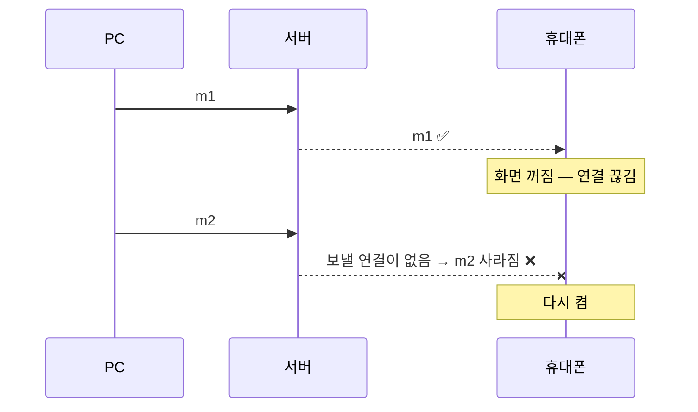

# 놓친 메시지 다시 받기

> 이슈 [#9](https://github.com/esstional-tool/text-tunnel/issues/9) · PR [#10](https://github.com/esstional-tool/text-tunnel/pull/10) · 2026-10-20
> 연결이 잠깐 끊긴 사이 온 메시지를, 다시 연결하면 **빠짐없이·순서대로·한 번씩** 받게 만들었다. 저장소 없이, 서버 메모리에 2분만.

## 어떤 문제였나

실시간 전달은 SSE(서버 → 브라우저로 흘려보내는 연결) 하나에 기대고 있었다. 휴대폰 화면이 꺼지면 이 연결이 끊기는데, 그 사이에 PC가 보낸 메시지는 **보낼 곳이 없어 그냥 사라졌다**. 전달 보장 용어로 *at-most-once*(많아야 한 번 — 못 받을 수도 있음)였다.



## 새로 쓴 기술

### 1. SSE 이벤트 ID 와 `Last-Event-ID`

- **개념**: SSE 는 이벤트마다 `id:` 줄을 붙일 수 있다. 브라우저 `EventSource` 는 마지막으로 받은 id 를 기억하고, 연결이 끊겨 **스스로 다시 연결할 때 `Last-Event-ID` 요청 헤더로 그 값을 보낸다.** 서버는 "그 다음부터" 보내 주면 된다. 표준에 들어 있는 이어받기 장치다.
  ```
  id: 2c9d62fe:8
  data: {"type":"msg","text":"m2",…}
  ```
- **왜 필요했나**: 서버가 "이 기기는 어디까지 받았나"를 따로 기록하지 않아도, 받는 쪽이 알려 주게 하면 된다. 저장소 없이 만들 수 있다.
- **이 코드에서는**: 브라우저가 알아서 다시 연결할 때는 `Last-Event-ID` 헤더를, 앱이 새 입장권으로 **새 EventSource 를 만들 때**(헤더가 안 붙음)는 `?last=` 쿼리로 같은 값을 보낸다. 화면은 `ev.lastEventId` 를 변수에 기억해 둔다.
- **주의할 점**: `EventSource` 는 사용자 헤더를 붙일 수 없다. 그래서 새로 만드는 연결은 쿼리스트링으로 보낼 수밖에 없다.

<!-- code: server.js FROM "// 놓친 이벤트 다시 보내기" TO "replay\(room" | SSE 연결 때 놓친 이벤트 다시 보내기 호출 -->
<details>
<summary>📄 실제 코드 — <code>server.js</code> 310–311 · SSE 연결 때 놓친 이벤트 다시 보내기 호출</summary>

[GitHub에서 보기](../../server.js#L310-L311)

```js
    // 놓친 이벤트 다시 보내기: 브라우저 자동 재연결은 Last-Event-ID 헤더, 앱이 새로 입장할 때는 ?last=
    replay(room, res, url.searchParams.get('last') || req.headers['last-event-id']);
```

</details>
<!-- /code -->
<!-- code: public/app.js FROM "function connect" | 화면: 마지막 번호 기억·재연결 때 보내기·중복 거르기 -->
<details>
<summary>📄 실제 코드 — <code>public/app.js</code> 165–187 · 화면: 마지막 번호 기억·재연결 때 보내기·중복 거르기</summary>

[GitHub에서 보기](../../public/app.js#L165-L187)

```js
function connect() {
  es?.close();
  // 마지막으로 받은 번호를 알려 주면, 끊겨 있던 동안 온 메시지를 서버가 다시 보내 준다
  es = new EventSource(api('events', lastEvent ? { last: lastEvent } : {}));
  es.onerror = async () => {
    setStatus('off');
    // 서버가 재시작됐거나 방이 정리됐으면 다시 들어간다
    const r = await fetch(api('ping')).catch(() => null);
    if (r?.status === 401) { es.close(); token = null; setTimeout(joinRoom, 500); }
  };
  es.onmessage = (ev) => {
    const m = JSON.parse(ev.data);
    if (ev.lastEventId) lastEvent = ev.lastEventId;
    if (m.mid) {
      if (seen.has(m.mid)) return; // 다시 보내 준 것 중 이미 받은 것
      seen.add(m.mid);
      if (seen.size > 2000) seen.delete(seen.values().next().value);
    }
    if (m.type === 'presence') onPresence(m.users);
    else if (m.type === 'clear') { clearList(); toast(isMine(m) ? '대화를 지웠어요' : `${m.name}에서 대화를 지웠어요`); }
    else add(m);
  };
}
```

</details>
<!-- /code -->

### 2. 링 버퍼 / TTL 로그 (최근 것만 들고 있기)

- **개념**: 무한히 쌓지 않고 **오래된 것부터 버리는 줄**. 기준은 시간(2분)과 개수(300개) 두 가지다. 로그 구조 저장소(Kafka 등)의 "보존 기간(retention)" 과 같은 생각이다.
- **왜 필요했나**: "기록을 남기지 않는다" 원칙과 "놓치지 않는다" 요구가 부딪힌다. 타협점은 **짧게, 메모리에만**.
- **이 코드에서는**: 방마다 `room.log`. 메시지·파일·대화 지우기 이벤트만 담고(접속 상태 `presence` 는 "지금 상태"라 다시 보낼 의미가 없어 제외), 보낼 때마다 `trimLog` 로 2분 넘은 것과 300개 넘는 것을 버린다.
- **주의할 점**: 대화 지우기 이벤트가 오면 **로그를 비우고 지우기 이벤트만 남긴다.** 안 그러면 다시 연결한 기기에 지운 메시지가 되살아난다. 방이 사라지면(둘 다 나감) 로그도 같이 사라진다.

<!-- code: server.js FROM "const REPLAYABLE" TO "^}" | 번호 붙이기·로그에 담기·지우기 때 비우기 -->
<details>
<summary>📄 실제 코드 — <code>server.js</code> 59–70 · 번호 붙이기·로그에 담기·지우기 때 비우기</summary>

[GitHub에서 보기](../../server.js#L59-L70)

```js
const REPLAYABLE = new Set(['msg', 'file', 'clear']);
function broadcast(room, ev) {
  let head = '';
  if (REPLAYABLE.has(ev.type)) {
    ev.mid ??= crypto.randomUUID();
    head = `id: ${room.epoch}:${++room.seq}\n`;
    if (ev.type === 'clear') room.log = []; // 지운 대화가 다시 보내지는 일이 없게
  }
  const line = `${head}data: ${JSON.stringify(ev)}\n\n`;
  if (head) { room.log.push({ seq: room.seq, at: Date.now(), line }); trimLog(room); }
  for (const m of room.members.values()) m.res?.write(line);
}
```

</details>
<!-- /code -->
<!-- code: server.js FROM "function trimLog" | 오래된 것 버리기 -->
<details>
<summary>📄 실제 코드 — <code>server.js</code> 72–75 · 오래된 것 버리기</summary>

[GitHub에서 보기](../../server.js#L72-L75)

```js
function trimLog(room) {
  const old = Date.now() - REPLAY;
  while (room.log.length && (room.log[0].at < old || room.log.length > REPLAY_MAX)) room.log.shift();
}
```

</details>
<!-- /code -->

### 3. 세대 번호(epoch) — 다시 시작해도 번호가 섞이지 않게

- **개념**: 순번은 서버 메모리에 있으니 **방이 사라졌다 새로 생기면 1부터 다시 센다.** 그러면 옛 방에서 "50번까지 받았다"는 기기가 새 방의 1~50번을 건너뛰어 버린다. 그래서 번호 앞에 **방이 생길 때마다 새로 뽑는 무작위 값(epoch)**을 붙인다: `2c9d62fe:8`.
- **왜 필요했나**: 같은 열쇠(같은 방 번호)로 방이 몇 번이고 다시 만들어진다. 서버 재시작도 같은 상황이다.
- **이 코드에서는**: `replay()` 가 받은 값의 epoch 가 지금 방과 다르면 "처음부터"(보관분 전부)로 본다.
- **주의할 점**: 분산 시스템에서 리더가 바뀔 때 쓰는 *term*/*generation* 번호와 같은 발상이다. 순번만으로는 "어느 세대의 순번인지" 알 수 없다.

<!-- code: server.js FROM "function replay" | epoch 비교 후 놓친 것만 다시 보내기 -->
<details>
<summary>📄 실제 코드 — <code>server.js</code> 79–84 · epoch 비교 후 놓친 것만 다시 보내기</summary>

[GitHub에서 보기](../../server.js#L79-L84)

```js
function replay(room, res, last) {
  trimLog(room);
  const [epoch, seq] = String(last || '').split(':');
  const after = epoch === room.epoch ? Number(seq) || 0 : 0;
  for (const e of room.log) if (e.seq > after) res.write(e.line);
}
```

</details>
<!-- /code -->

### 4. 중복 제거로 만드는 "정확히 한 번처럼"

- **개념**: 네트워크에서 *exactly-once*(정확히 한 번)는 사실상 만들 수 없다. 대신 **at-least-once(적어도 한 번) 로 보내고, 받는 쪽이 같은 것을 걸러 내면(멱등 처리)** 결과가 "한 번 받은 것처럼" 된다.
- **왜 필요했나**: 다시 보내기는 경계에서 겹칠 수 있다. 번호를 못 보낸 채 새로 연결하면 보관분 전부가 다시 온다.
- **이 코드에서는**: 서버가 이벤트마다 `mid`(메시지 ID)를 붙이고, 화면은 이미 그린 `mid` 를 `Set` 에 기억해 두었다가 건너뛴다. `Set` 이 끝없이 커지지 않게 2000개를 넘으면 오래된 것부터 뺀다.
- **주의할 점**: 걸러 낼 기준(ID)은 **보내는 쪽이 아니라 서버가 한 번만** 만들어야 한다. 다시 보낼 때 같은 줄(`line`)을 그대로 보내기 때문에 ID 가 같다.

### 5. 가명 식별자 — 해시로 "나"를 알아보기

- **개념**: 이전 접속에서 내가 보낸 메시지도 내 말풍선(오른쪽)으로 그려야 한다. 그런데 이벤트의 `from` 은 **접속할 때마다 바뀌는 ID** 라 쓸 수 없다. 변하지 않는 기기 ID 를 쓰면 되지만, 그 값을 상대 기기에 그대로 보여 주면 상대가 그 ID 로 "같은 기기"인 척 들어와 내 자리를 뺏을 수 있다. 그래서 **기기 ID 의 해시 앞 16자리**를 표식(`dev`)으로 쓴다.
- **이 코드에서는**: 서버가 입장 때 `tag = sha256(device)` 를 만들어 나에게만 알려 주고, 이벤트에는 `dev: tag` 를 싣는다. 화면은 `m.from === myId || m.dev === myTag` 면 내 메시지.
- **주의할 점**: 해시는 원래 값을 되돌릴 수 없지만, 값의 종류가 적으면 다 대입해 볼 수 있다. 여기의 기기 ID 는 무작위 UUID 라 괜찮다.

<!-- code: server.js FROM "const tag = crypto" TO "send\(res, 200, \{ token" | 기기 표식 만들기 -->
<details>
<summary>📄 실제 코드 — <code>server.js</code> 288–293 · 기기 표식 만들기</summary>

[GitHub에서 보기](../../server.js#L288-L293)

```js
      const tag = crypto.createHash('sha256').update(device).digest('hex').slice(0, 16); // 이전 접속에서 보낸 내 메시지를 알아보는 표식 (기기 ID 자체는 상대에게 안 보임)
      const member = { id: crypto.randomUUID(), device, tag, name, res: null, timer: null, seen: Date.now() };
      member.timer = setTimeout(() => removeMember(room, token), GRACE); // 연결을 안 열면 정리
      room.members.set(token, member);
      tokens.set(token, id);
      send(res, 200, { token, id: member.id, tag, replaySec: REPLAY / 1000 });
```

</details>
<!-- /code -->
<!-- code: public/app.js FROM "const isMine" TO "isMine" | 내 메시지 판단 -->
<details>
<summary>📄 실제 코드 — <code>public/app.js</code> 239–239 · 내 메시지 판단</summary>

[GitHub에서 보기](../../public/app.js#L239-L239)

```js
const isMine = (m) => m.from === myId || (!!myTag && m.dev === myTag);
```

</details>
<!-- /code -->

## 어떻게 시험했나

- `tests/replay.test.js` (10항목): 서버를 `REPLAY_SEC=3` 으로 띄워 **2분을 3초로 줄여** 만료까지 확인. 놓친 것만 순서대로 · 최신 번호면 다시 안 보냄 · 처음 열면 보관분 전부 · 내 표식 · 지우기 후 '지우기'만 · 만료 · 새 방은 옛 번호 무시.
- 실제 Edge 를 원격 디버깅(CDP)으로 조작해 **화면**에서 확인: PC 앱을 닫아 둔 사이 온 메시지가 열 때 보이고, 내가 보낸 것은 오른쪽, 재연결로 같은 메시지를 다시 받아도 한 번만 그려짐.
- 배운 점: **시간이 걸리는 동작은 시간을 설정값으로 빼 두면 시험에서 줄일 수 있다.**

## 더 공부할 키워드·자료

- WHATWG HTML 표준 — *Server-sent events* (`id`, `retry`, `Last-Event-ID`)
- 전달 보장: at-most-once / at-least-once / exactly-once, idempotency
- Kafka 의 *offset* 과 *retention* — 구독자가 "어디까지 읽었나"를 들고 있는 구조
- Raft 의 *term*, Zookeeper 의 *epoch* — 세대 번호
- Martin Kleppmann, *Designing Data-Intensive Applications* 11장 (스트림 처리)
- 다음 단계: 받는 쪽 **확인 응답(ack)** 으로 "읽음" 표시 만들기 — [STUDY.md 2단계](../STUDY.md)

## 스스로 확인

<details><summary>1. 브라우저가 스스로 다시 연결할 때와 앱이 새 EventSource 를 만들 때, 마지막 번호는 각각 어떻게 서버로 가나?</summary>

자동 재연결은 브라우저가 `Last-Event-ID` 헤더를 붙인다. 새로 만드는 EventSource 에는 헤더를 붙일 수 없어서 `?last=` 쿼리로 보낸다. 서버는 둘 중 있는 것을 쓴다.
</details>

<details><summary>2. 번호 앞에 epoch 를 붙이지 않으면 어떤 버그가 생기나?</summary>

방이 사라졌다 다시 생기면 순번이 1부터 다시 시작한다. 옛 방에서 50번까지 받은 기기가 새 방의 1~50번 메시지를 "이미 받았다"고 건너뛴다.
</details>

<details><summary>3. 대화 지우기 이벤트가 왔을 때 로그를 비우지 않으면?</summary>

다시 연결한 기기가 보관분을 받으면서 **지운 메시지가 다시 나타난다.**
</details>

<details><summary>4. 접속 상태(presence) 이벤트는 왜 로그에 넣지 않나?</summary>

presence 는 "지금 누가 있나"라는 현재 상태라서, 다시 연결하면 새로 보내는 최신 presence 하나면 충분하다. 지난 상태를 순서대로 다시 보내면 오히려 화면이 잠깐 틀린 상태를 보여 준다.
</details>

<details><summary>5. 2분 넘게 끊겨 있었다면? 이걸 고치려면 무엇과 타협해야 하나?</summary>

그 사이 메시지는 사라진다. 고치려면 더 오래 들고 있어야 하는데, 그만큼 "기록을 남기지 않는다" 원칙에서 멀어진다(메모리라도). 종단간 암호화를 하면 서버가 오래 들고 있어도 내용을 못 보게 되어 타협이 쉬워진다 — STUDY 3단계.
</details>
