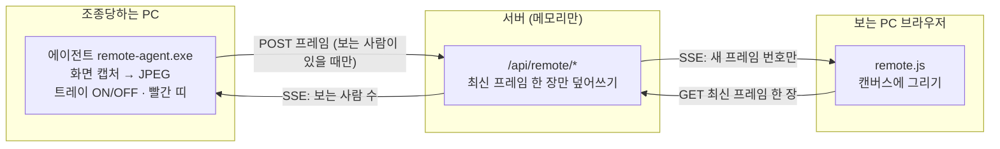

# 원격조종 1단계: 다른 PC 화면 보기

> 이슈 [#17](https://github.com/esstional-tool/text-tunnel/issues/17) · 2026-10-20
> 노트북에서 작은 프로그램(에이전트)을 켜 두면, 같은 짝 열쇠를 가진 다른 PC의 브라우저에서 그 화면을 본다. **보기만** — 조작은 2단계.
> 처음으로 "서버에 사진 한 장 올리는" 수준을 넘어, **연속으로 흘러가는 화면**을 다룬 작업이다.

## 어떤 문제였나

원격지원은 세 조각이 맞물린 것이다.

| 조각 | 하는 일 | 난이도 |
|---|---|---|
| ① 화면 보여주기 | 상대 화면을 찍어 내게 전송 | **가장 어렵고 가장 배울 거리가 많음 — 이번 단계** |
| ② 입력 보내기 | 내 클릭·타자를 상대 PC에서 실행 | 작고 쉬움 — 2단계 |
| ③ 둘을 연결하기 | 서로 다른 네트워크의 두 기기를 잇기 | 이미 만든 짝 맺기·중계를 재사용 |



## 새로 쓴 기술

### 1. 화면 캡처 (GDI `CopyFromScreen`)와 DPI

- **개념**: Windows는 화면을 그리는 도구(GDI)로 "화면 한 구역을 비트맵으로 복사"할 수 있다. C#에서는 `Graphics.CopyFromScreen`.
- **왜 필요했나**: 원격 화면의 원본이 필요하다.
- **이 코드에서는**: 주 모니터를 찍어서(`Screen.PrimaryScreen.Bounds`) 가로 1280 이하로 줄이고 JPEG로 인코딩한다.
- **주의할 점 (DPI)**: 화면 배율이 150%인 PC에서 프로그램이 "DPI를 모른다"고 선언하면 Windows가 좌표를 가상으로 줄여 보여 줘서 **캡처가 일부만 찍히거나 흐려진다.** 시작할 때 `SetProcessDPIAware()`를 불러 "나는 실제 픽셀로 일한다"고 알려야 한다. 2단계에서 클릭 좌표를 변환할 때도 같은 이유로 중요하다.
- **한계**: `CopyFromScreen`은 **마우스 커서를 찍지 않는다.** 2단계에서 커서를 따로 그려야 한다. 또 보호된 콘텐츠(일부 동영상)나 잠금 화면, 관리자 확인 창(UAC)은 찍히지 않거나 검게 나온다.

<!-- code: agent/Program.cs FROM "static class Capture" | 화면 찍기 → 줄이기 → JPEG -->
<details>
<summary>📄 실제 코드 — <code>agent/Program.cs</code> 106–145 · 화면 찍기 → 줄이기 → JPEG</summary>

[GitHub에서 보기](../../agent/Program.cs#L106-L145)

```js
static class Capture
{
    static readonly ImageCodecInfo JpegCodec = FindJpeg();
    static ImageCodecInfo FindJpeg()
    {
        foreach (ImageCodecInfo c in ImageCodecInfo.GetImageEncoders()) if (c.MimeType == "image/jpeg") return c;
        throw new InvalidOperationException("JPEG 인코더가 없어요");
    }

    // 주 모니터를 찍어 가로 maxWidth 이하로 줄이고 JPEG(quality) 로 인코딩한다
    public static byte[] Grab(int maxWidth, long quality, out int w, out int h)
    {
        Rectangle b = Screen.PrimaryScreen.Bounds;
        using (Bitmap full = new Bitmap(b.Width, b.Height, PixelFormat.Format24bppRgb))
        {
            using (Graphics g = Graphics.FromImage(full)) g.CopyFromScreen(b.Location, Point.Empty, b.Size);
            double scale = b.Width > maxWidth ? (double)maxWidth / b.Width : 1.0;
            w = (int)(b.Width * scale); h = (int)(b.Height * scale);
            Bitmap src = full;
            Bitmap small = null;
            try
            {
                if (scale < 1.0)
                {
                    small = new Bitmap(w, h, PixelFormat.Format24bppRgb);
                    using (Graphics g2 = Graphics.FromImage(small)) { g2.InterpolationMode = InterpolationMode.Bilinear; g2.DrawImage(full, 0, 0, w, h); }
                    src = small;
                }
                using (MemoryStream ms = new MemoryStream())
                using (EncoderParameters ep = new EncoderParameters(1))
                {
                    ep.Param[0] = new EncoderParameter(System.Drawing.Imaging.Encoder.Quality, quality);
                    src.Save(ms, JpegCodec, ep);
                    return ms.ToArray();
                }
            }
            finally { if (small != null) small.Dispose(); }
        }
    }
}
```

</details>
<!-- /code -->

### 2. JPEG 비용을 직접 재 보기 — 왜 "통째로 보내기"는 한계인가

- **개념**: JPEG는 한 장짜리 그림을 손실 압축한다. 품질(quality) 값이 낮을수록 작고 거칠다.
- **실측** (이 PC, 1280×720, 품질 60, 로컬 서버):

| 측정 | 값 |
|---|---|
| 한 장 크기 | 77~96KB (화면 내용에 따라 달라짐) |
| 속도 | 초당 약 5장 (목표 5장) |
| 전송량 | **386~468KB/s ≈ 3~4Mbps** |

- **의미**: 로컬에서는 한 장 받는 데 5ms지만, 인터넷(Render)을 거치면 **이 전송량을 계속 흘려야** 한다. 가만히 있는 화면(문서 읽는 중)도 매번 전체를 다시 보내니 낭비다. → **3단계(바뀐 부분만 보내기)가 필요한 이유를 숫자로 확인한 것.** 화면에 초당 프레임·한 장 크기·KB/s를 표시해 둔 것도 그래서다.
- **주의할 점**: 품질을 낮추면 더 작아지지만 글자가 뭉개진다. 화면 공유는 **글자가 읽혀야** 해서 사진보다 높은 품질이 필요하다. 품질·해상도·프레임 수 세 가지가 서로 맞바꾸는 관계다.

### 3. 알림과 가져오기를 나누기 — "당겨오기(pull)"로 만드는 밀리면 버리기

- **개념**: 데이터를 **밀어 넣는(push)** 방식은 받는 쪽이 느리면 서버가 계속 쌓아야 한다. **당겨오는(pull)** 방식은 받는 쪽이 "다 처리했으니 다음 거 줘"라고 할 때만 준다. 이렇게 속도를 받는 쪽이 정하게 하는 것을 *역압력(backpressure)*이라고 한다.
- **왜 필요했나**: 화면은 "늦은 프레임은 쓸모없다"가 특징이다. 3초 전 화면을 차례로 다 보여 주면 점점 더 늦어진다. **옛 프레임은 버리고 최신 것만** 보여야 한다.
- **이 코드에서는**
  1. 서버는 프레임을 **최신 한 장만 메모리에 덮어쓴다.** (`s.frame = {...}` — 이전 것은 사라짐)
  2. 보는 쪽에는 "새 프레임 번호 N이 왔어요" **알림만** 보낸다 (SSE, 몇십 바이트).
  3. 보는 쪽이 `GET /api/remote/frame`으로 **그 순간의 최신 한 장**을 가져간다.
  4. 가져오는 중에 알림이 여러 개 와도 `R.again = true`만 켜 두고, 끝난 뒤 **한 번만 더** 가져온다 → 중간 프레임은 건너뛴다.
- **시험으로 확인**: 프레임 4장(F1~F4)이 연달아 오고 알림도 4개 왔는데, 느린 보는 쪽이 가져온 것은 **F4뿐**이었고 서버에 중간 프레임이 남지 않았다.
- **에이전트 쪽의 역압력**: 에이전트는 **한 장을 다 보낸 뒤에야 다음 장을 찍는다.** 네트워크가 느리면 찍는 속도가 저절로 내려간다. (밀어 넣기만 했다면 에이전트 메모리에 프레임이 쌓였을 것)

<!-- code: remote/server.js FROM "if (p === '/api/remote/frame' && req.method === 'POST')" | 서버: 최신 한 장만 덮어쓰고 알림만 보냄 -->
<details>
<summary>📄 실제 코드 — <code>remote/server.js</code> 123–136 · 서버: 최신 한 장만 덮어쓰고 알림만 보냄</summary>

[GitHub에서 보기](../../remote/server.js#L123-L136)

```js
    if (p === '/api/remote/frame' && req.method === 'POST') {
      const a = auth(url, 'agent');
      if (!a || a.s?.agent?.token !== a.token) { send(res, 401, '다시 연결해야 해요'); return true; }
      body(FRAME_MAX, (buf) => {
        if (buf.length < 4 || buf[0] !== 0xff || buf[1] !== 0xd8) return send(res, 400, 'JPEG 가 아니에요');
        const w = Math.min(8192, Number(url.searchParams.get('w')) || 0), h = Math.min(8192, Number(url.searchParams.get('h')) || 0);
        const s = a.s;
        if (!s.viewers.size) return send(res, 200, 'idle'); // 보는 사람이 없으면 받지 않는다
        s.frame = { buf, seq: ++s.seq, w, h, at: Date.now() };   // 최신 한 장만 — 이전 프레임은 버려진다
        notifyViewers(s, { type: 'frame', seq: s.frame.seq, w, h });
        send(res, 200, 'ok');
      });
      return true;
    }
```

</details>
<!-- /code -->
<!-- code: public/remote.js FROM "async function pull" | 보는 쪽: 가져오는 중이면 끝난 뒤 한 번만 더 -->
<details>
<summary>📄 실제 코드 — <code>public/remote.js</code> 48–70 · 보는 쪽: 가져오는 중이면 끝난 뒤 한 번만 더</summary>

[GitHub에서 보기](../../public/remote.js#L48-L70)

```js
  async function pull() {
    if (R.fetching) { R.again = true; return; }
    R.fetching = true;
    try {
      do {
        R.again = false;
        const t0 = performance.now();
        const r = await fetch(`/api/remote/frame?token=${encodeURIComponent(R.token)}`, { cache: 'no-store' });
        if (!r.ok) break;
        const seq = Number(r.headers.get('x-frame-seq'));
        const blob = await r.blob();
        if (seq <= R.seq) continue; // 이미 그린 것
        const bmp = await createImageBitmap(blob);
        const c = $r('remoteCanvas');
        if (c.width !== bmp.width || c.height !== bmp.height) { c.width = bmp.width; c.height = bmp.height; }
        c.getContext('2d').drawImage(bmp, 0, 0);
        bmp.close?.();
        R.seq = seq;
        $r('remoteEmpty').hidden = true;
        stat(blob.size, performance.now() - t0);
      } while (R.again);
    } catch {} finally { R.fetching = false; }
  }
```

</details>
<!-- /code -->

### 4. 필요할 때만 일하기 — 수요 기반(demand-driven) 캡처

- **개념**: 아무도 안 보는데 화면을 찍어 보내는 것은 낭비이고, **프라이버시에도 나쁘다.**
- **이 코드에서는**: 서버가 "지금 보는 사람 수"를 에이전트에게 SSE로 알려 주고, 에이전트는 **수가 0이면 화면을 찍지도 보내지도 않는다.** 서버도 보는 사람이 없을 때 도착한 프레임은 `idle`로 버린다(이중 방어).
- **효과**: 대기 중에는 네트워크 사용 0, 보는 사람이 나가면 몇 초 안에 멈춘다 (시험: 나간 뒤 띠가 사라지고, 다시 들어오면 프레임이 다시 시작).

### 5. 열쇠 재사용 인증과 네임스페이스 분리

- **개념**: 새 로그인 방식을 만들지 않고, 메신저에서 이미 쓰는 **짝 열쇠를 가진 기기 = 권한 있는 기기**(capability 방식)를 그대로 쓴다. 에이전트도 메신저의 "새 기기 연결" 코드로 같은 열쇠를 받는다.
- **이 코드에서는**: 서버 내부 이름표를 `sha256('remote:' + key)`로 만든다. 메신저 방 번호(`sha256(key)`)와 **다른 값**이라서, 서버 메모리를 들여다봐도 두 기능이 같은 열쇠에서 나왔다는 것이 드러나지 않고 서로 간섭하지도 않는다. 같은 열쇠를 가진 **에이전트는 하나**만 연결되고(새로 들어오면 이전 것 대체), 보는 사람은 여럿이다.
- **주의할 점**: 열쇠가 유출되면 화면을 볼 수 있다. 1단계의 방어선은 ① 에이전트가 ON일 때만 ② 보는 동안 화면에 빨간 띠(누가 보고 있는지 알 수 있음) ③ 트레이에서 즉시 OFF이다. **접속마다 PIN/승인은 아직 없다** — 조작이 들어가는 2단계에서 반드시 넣는다.

<!-- code: remote/server.js FROM "const nsOf" TO "remote:" | 메신저와 다른 이름표 -->
<details>
<summary>📄 실제 코드 — <code>remote/server.js</code> 21–21 · 메신저와 다른 이름표</summary>

[GitHub에서 보기](../../remote/server.js#L21-L21)

```js
  const nsOf = (key) => crypto.createHash('sha256').update('remote:' + key).digest('hex'); // 메신저 방 번호와 다른 값
```

</details>
<!-- /code -->

### 6. 상주 프로그램 만들기 — 트레이, 스레드, 항상 위 띠

- **트레이 아이콘** (`NotifyIcon` + `ApplicationContext`): 창 없이 시계 옆에만 있는 프로그램의 표준 구조. 메뉴에서 ON/OFF·종료.
- **스레드 분리**: 화면 UI 스레드는 건드리지 않고, **연결 스레드**(서버에 입장·알림 수신·끊기면 2초 뒤 재연결)와 **캡처 스레드**(찍기·보내기)를 따로 돌린다. UI를 바꿀 때는 `BeginInvoke`로 UI 스레드에 부탁한다 — 다른 스레드에서 직접 건드리면 오류가 난다.
- **항상 위 빨간 띠**: `TopMost` 창에 `WS_EX_NOACTIVATE`(포커스를 안 빼앗음) + `WS_EX_TOOLWINDOW`(작업 표시줄·Alt+Tab에 안 뜸). 보는 사람이 있을 때만 `Show()`, 없으면 `Hide()`.
- **재연결 루프**: 서버 재시작·네트워크 끊김에도 에이전트가 스스로 다시 붙는다 — 이슈 #11에서 배운 "서버는 언제든 사라질 수 있다"의 에이전트 버전.

<!-- code: agent/Program.cs FROM "class Banner" | 항상 위 빨간 띠 -->
<details>
<summary>📄 실제 코드 — <code>agent/Program.cs</code> 148–171 · 항상 위 빨간 띠</summary>

[GitHub에서 보기](../../agent/Program.cs#L148-L171)

```js
class Banner : Form
{
    readonly Label label = new Label();
    public Banner()
    {
        FormBorderStyle = FormBorderStyle.None; ShowInTaskbar = false; TopMost = true; StartPosition = FormStartPosition.Manual;
        Rectangle b = Screen.PrimaryScreen.Bounds;
        Bounds = new Rectangle(b.X, b.Y, b.Width, 26);
        BackColor = Color.FromArgb(200, 30, 30);
        Text = "text-tunnel-remote-banner";
        label.Dock = DockStyle.Fill; label.ForeColor = Color.White; label.TextAlign = ContentAlignment.MiddleCenter;
        label.Font = new Font("Malgun Gothic", 9.5f, FontStyle.Bold);
        Controls.Add(label);
    }
    protected override bool ShowWithoutActivation { get { return true; } } // 쓰던 창의 포커스를 빼앗지 않음
    protected override CreateParams CreateParams
    {
        get { CreateParams p = base.CreateParams; p.ExStyle |= 0x08000000 | 0x00000080; return p; } // NOACTIVATE | TOOLWINDOW
    }
    public void SetCount(int n)
    {
        label.Text = "● 원격 접속 중 (" + n + "명이 이 화면을 보고 있어요) — 트레이 아이콘에서 끌 수 있어요";
    }
}
```

</details>
<!-- /code -->
<!-- code: agent/Program.cs FROM "void ConnectLoop" | 입장 → 알림 수신 → 끊기면 재연결 -->
<details>
<summary>📄 실제 코드 — <code>agent/Program.cs</code> 245–264 · 입장 → 알림 수신 → 끊기면 재연결</summary>

[GitHub에서 보기](../../agent/Program.cs#L245-L264)

```js
    void ConnectLoop()
    {
        while (!quit)
        {
            if (!on) { Thread.Sleep(300); continue; }
            try
            {
                Dictionary<string, object> j = server.PostJson("/api/remote/agent/join", new Dictionary<string, object> { { "key", key }, { "name", name } });
                token = (string)j["token"];
                HttpWebRequest r = server.OpenEvents(token); events = r;
                Server.ReadEvents(r, delegate (Dictionary<string, object> ev)
                {
                    if (ev != null && (string)ev["type"] == "viewers") { viewers = Convert.ToInt32(ev["count"]); UI(new Action(Refresh)); }
                });
            }
            catch (Exception) { }
            viewers = 0; token = null; UI(new Action(Refresh));
            for (int i = 0; i < 20 && !quit && on; i++) Thread.Sleep(100);
        }
    }
```

</details>
<!-- /code -->
<!-- code: agent/Program.cs FROM "void CaptureLoop" | 보는 사람이 있을 때만 찍어 보내기 -->
<details>
<summary>📄 실제 코드 — <code>agent/Program.cs</code> 267–285 · 보는 사람이 있을 때만 찍어 보내기</summary>

[GitHub에서 보기](../../agent/Program.cs#L267-L285)

```js
    void CaptureLoop()
    {
        const int intervalMs = 200; // 목표 초당 5장
        while (!quit)
        {
            string t = token;
            if (!on || viewers == 0 || t == null) { Thread.Sleep(150); continue; }
            DateTime start = DateTime.UtcNow;
            try
            {
                int w, h;
                byte[] jpeg = Capture.Grab(1280, 60, out w, out h);
                if (server.PostFrame(t, jpeg, w, h)) { framesSent++; lastKb = jpeg.Length / 1024; }
            }
            catch (Exception) { Thread.Sleep(500); }
            int wait = intervalMs - (int)(DateTime.UtcNow - start).TotalMilliseconds;
            if (wait > 0) Thread.Sleep(wait);
        }
    }
```

</details>
<!-- /code -->

### 7. 설치 없이 빌드하기 — Windows 내장 `csc.exe`와 C# 5

- **개념**: Windows에는 .NET Framework의 C# 컴파일러(`csc.exe`)가 **기본으로 들어 있다.** SDK나 Visual Studio 없이 소스를 컴파일할 수 있다 (`agent\build-agent.cmd`, 15KB짜리 exe).
- **제약**: 이 컴파일러는 **C# 5**다. 문자열 보간(`$"..."`), `?.`, `nameof`, 식 본문 멤버가 없다. 처음 쓴 코드가 이런 문법을 안 썼는지 확인하며 작성했다.
- **겪은 오류**: `Capture.Screen(...)`이라는 내 메서드 이름이 `System.Windows.Forms.Screen` 클래스와 겹쳐서 `Screen.PrimaryScreen`을 메서드로 해석하려다 컴파일 오류(CS0119). **이름이 겹치면 가까운 쪽이 이긴다** — 메서드 이름을 `Grab`으로 바꿔 해결.
- **TLS**: 오래된 컴파일 설정의 프로그램은 TLS 1.0이 기본이라 Render(HTTPS)에 못 붙을 수 있다 → `ServicePointManager.SecurityProtocol = (SecurityProtocolType)3072`(TLS 1.2)를 명시.
- **HTTP 클라이언트**: SSE는 끝나지 않는 응답이라 `HttpWebRequest`로 스트림을 한 줄씩 읽는다(`data: ` 줄만 파싱).

### 8. 진짜 프로그램을 시험하기 — 그리고 시험이 틀렸던 경우

- **방법**: 시험 스크립트가 실제 `remote-agent.exe`를 `spawn`하고, 가짜 보는 사람(API)과 진짜 브라우저(헤드리스 Edge)를 붙여 확인했다. 빨간 띠는 **Win32 `FindWindow`/`IsWindowVisible`**로 창이 실제로 떴는지 검사했다.
- **프라이버시를 지킨 시험**: 시험 중 에이전트는 이 PC의 **실제 화면**을 찍는다. 그래서 로컬 서버로만 보내고, **화면 내용은 열어보지 않고** JPEG 헤더·끝 표식(`FFD8…FFD9`)·가로세로(SOF 마커)·크기만 검사했다.
- **시험이 틀렸던 사례**: 띠 검사 3개가 실패해서 에이전트를 의심했는데, 원인은 **시험 코드**였다. PowerShell은 `$null`을 문자열 인자로 넘길 때 `null`이 아니라 **빈 문자열 `""`로 바꿔** `FindWindow`가 "클래스 이름이 빈 창"을 찾는 꼴이 됐다. `[NullString]::Value`로 고치자 통과했다. **실패의 원인이 시험일 수도 있다** — 디버그 값을 출력해 눈으로 확인한 뒤에야 알았다.

<!-- code: tests/remote-agent.test.js FROM "function bannerVisible" | Win32 로 띠 창이 실제로 떴는지 검사 -->
<details>
<summary>📄 실제 코드 — <code>tests/remote-agent.test.js</code> 17–20 · Win32 로 띠 창이 실제로 떴는지 검사</summary>

[GitHub에서 보기](../../tests/remote-agent.test.js#L17-L20)

```js
function bannerVisible() {
  const script = `Add-Type 'using System;using System.Runtime.InteropServices;public class W{[DllImport("user32.dll",CharSet=CharSet.Unicode)]public static extern IntPtr FindWindow(string c,string t);[DllImport("user32.dll")]public static extern bool IsWindowVisible(IntPtr h);}'; $h=[W]::FindWindow([NullString]::Value,'text-tunnel-remote-banner'); if($h -eq [IntPtr]::Zero){'none'}elseif([W]::IsWindowVisible($h)){'visible'}else{'hidden'}`;
  return execFileSync(PS, ['-NoProfile', '-Command', script], { encoding: 'utf8' }).trim();
}
```

</details>
<!-- /code -->
<!-- code: tests/remote-agent.test.js FROM "function jpegSize" | JPEG 가로세로를 헤더에서 읽기 (내용은 보지 않음) -->
<details>
<summary>📄 실제 코드 — <code>tests/remote-agent.test.js</code> 22–31 · JPEG 가로세로를 헤더에서 읽기 (내용은 보지 않음)</summary>

[GitHub에서 보기](../../tests/remote-agent.test.js#L22-L31)

```js
function jpegSize(b) {
  let i = 2;
  while (i < b.length) {
    if (b[i] !== 0xff) { i++; continue; }
    const m = b[i + 1];
    if (m >= 0xc0 && m <= 0xc3) return { h: b.readUInt16BE(i + 5), w: b.readUInt16BE(i + 7) };
    i += 2 + b.readUInt16BE(i + 2);
  }
  return null;
}
```

</details>
<!-- /code -->

## 어떻게 시험했나

| 시험 | 항목 | 내용 |
|---|---|---|
| `tests/remote.test.js` | 26 | 가짜 에이전트·보는 사람: 인증, 프레임 흐름, **최신 한 장만**, 보는 사람 수 알림, 보는 사람 0이면 `idle`, 에이전트 OFF·재시작·대체 |
| `tests/remote-agent.test.js` | 13 | **진짜 exe** + 로컬 서버: 짝 코드로 열쇠 받기, 초당 프레임, JPEG 규격, 띠 창 보임/숨김, 보는 사람 나가면 멈춤, 종료 시 오프라인 |
| `tests/remote-ui.test.js` | 12 | **진짜 exe + 진짜 브라우저**: 메뉴 → 원격 화면, 에이전트 켜짐/꺼짐에 따른 상태·안내·캔버스 크기·속도 표시 |
| 회귀 | 짝 맺기 16 · 업로드 9 · 놓친 메시지 | 메신저가 그대로인지 |

## 더 공부할 키워드·자료

- Windows GDI `BitBlt`/`CopyFromScreen`, **DXGI Desktop Duplication API** (실제 원격 프로그램이 쓰는 더 빠른 캡처 — 바뀐 영역(dirty rect) 정보를 줌)
- JPEG 압축 원리(DCT, 양자화), 화면 공유용 코덱(H.264/VP8의 screen content coding)
- Backpressure — Reactive Streams, Node.js Streams `drain`
- Win32 확장 창 스타일 `WS_EX_NOACTIVATE`, `WS_EX_TOOLWINDOW`, `WS_EX_TRANSPARENT`
- Windows 알림 영역(`Shell_NotifyIcon`), UI 스레드와 `Control.BeginInvoke`
- 다음 단계: **3단계 — 바뀐 부분만 보내기**([STUDY.md](../STUDY.md) 4단계와 이어짐), 2단계 — `SendInput`으로 마우스·키보드 주입

## 스스로 확인

<details><summary>1. 서버가 프레임을 "최신 한 장만" 들고 있는 이유는? 모두 보관하면 어떤 일이 생기나?</summary>

화면은 늦은 프레임이 쓸모없다. 모두 보관하고 차례로 보내면 보는 쪽이 느릴 때 점점 더 옛날 화면을 보게 되고, 서버 메모리도 계속 커진다. 최신 한 장만 덮어쓰면 보는 쪽은 언제나 "지금 화면"에 가장 가까운 것을 본다.
</details>

<details><summary>2. 서버가 프레임 자체를 SSE로 밀어 보내지 않고 "번호 알림"만 보내는 이유는?</summary>

밀어 넣으면 보는 쪽이 느릴 때 서버·연결에 데이터가 쌓인다(역압력이 없다). 알림만 보내고 보는 쪽이 준비됐을 때 가져가게 하면 속도를 받는 쪽이 정한다. 알림은 몇십 바이트라 쌓여도 문제가 없다.
</details>

<details><summary>3. 화면 배율이 150%인 PC에서 DPI 설정을 안 하면 어떻게 되나?</summary>

Windows가 프로그램에 좌표를 가상으로 줄여서 알려 줘서, 캡처가 화면 일부만 찍히거나 흐려진다. 2단계에서는 클릭 좌표도 어긋난다. `SetProcessDPIAware()`로 "실제 픽셀로 일한다"고 선언한다.
</details>

<details><summary>4. 열쇠를 가진 누구나 볼 수 있다면, 이 단계의 안전장치는 무엇이고 무엇이 아직 빠졌나?</summary>

있는 것: 에이전트가 ON일 때만, 보는 동안 화면에 항상 빨간 띠, 트레이에서 즉시 OFF, 보는 사람이 없으면 아무것도 안 보냄. 빠진 것: 접속마다 PIN/승인과 접속 기록 — 조작이 들어가는 2단계에서 넣는다.
</details>

<details><summary>5. 띠 창 검사가 실패했을 때 에이전트 대신 시험 코드를 의심하게 된 단서는?</summary>

화면 전송·JPEG·서버 처리 시험은 모두 통과했고, 띠 검사만 보는 사람이 있든 없든 똑같이 `handle=0`(창을 못 찾음)이었다. 상태에 따라 달라지지 않는 실패는 대상이 아니라 **검사 방법**이 틀렸다는 신호다.
</details>
